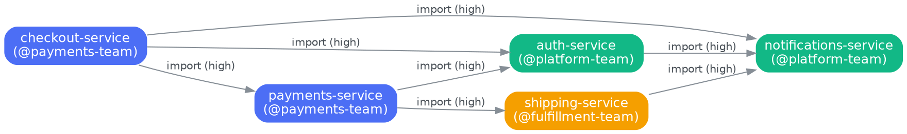
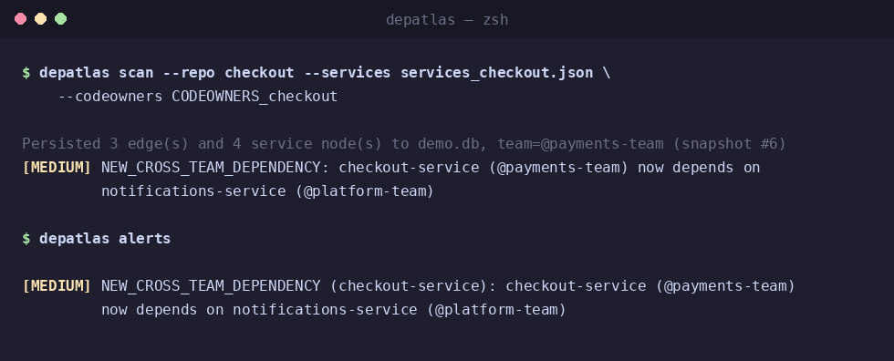
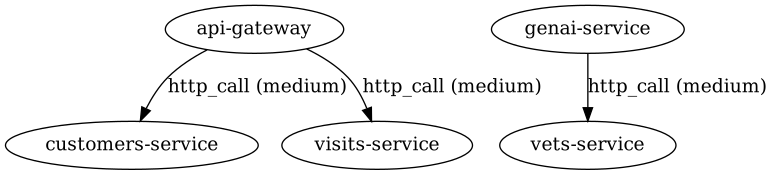

# DepAtlas

[](LICENSE)

*(Originally released as DepGraph — renamed to DepAtlas. The original
design doc in [`docs/SPEC.pdf`](https://github.com/sshafeeq84/DepAtlas/blob/main/docs/SPEC.pdf) predates the rename and
still uses the old name.)*

DepAtlas reads your codebase and builds a living dependency graph across
services, teams, and repositories — so blockers surface before they cost
you a sprint.

Engineering organizations above a certain size develop an invisible
coordination tax: teams block each other without knowing it, status
updates are written from memory, and nobody has a system that actually
knows what depends on what. DepAtlas reads the code itself — the one
source of truth that can't drift out of date — and turns it into a
queryable graph, automatically.

Full original design in [`docs/SPEC.pdf`](https://github.com/sshafeeq84/DepAtlas/blob/main/docs/SPEC.pdf).

<p align="center">
  
</p>

<p align="center">
  
</p>

## Status

v1 core complete. Three language parsers, three
code sources, a persisted queryable graph with history and diffing, full
ownership resolution, all five spec'd alert types (including
signature-level breaking-change detection), and both JSON and DOT
export — all covered by 283 passing tests. Some gaps are known and listed
in [Known limitations](#known-limitations).

| Area | What's there |
|---|---|
| **Languages** | Python (`ast`), Java (`tree-sitter`), JavaScript/TypeScript (`tree-sitter`) |
| **Code sources** | Local directory, GitHub (REST API), AWS CodeCommit (`boto3`) |
| **Persistence** | SQLite-backed graph store; every scan saves an immutable snapshot |
| **Ownership** | CODEOWNERS, with a `depatlas.yaml` manifest fallback |
| **Intelligence** | Diff engine (snapshot-to-snapshot) + 5 alert types, incl. breaking-change signature detection |
| **Export** | JSON and Graphviz DOT |

## Quick start

No setup file is needed. DepAtlas names a service from its own code
(`spring.application.name`, `pom.xml`, `pyproject.toml`, `package.json`, or
the folder) and works out how other code refers to it (Python packages, the
npm name, the Java package):

```bash
pip install depatlas

# What services are in this folder, and what are they called?
depatlas discover --root ~/code --output registry.json

# Scan one of them. The registry says who the others are, so links between
# services are found with nothing hand-written:
depatlas scan --repo ~/code/payments --registry registry.json
depatlas query --service payments-service
```

Everything below also works with an explicit `--services` file when you
want full control.

```bash
pip install -e ".[dev]"

# Scan a local repo, resolving ownership from CODEOWNERS:
depatlas scan \
  --repo tests/fixtures/sample_repo/payments \
  --services tests/fixtures/payments_services.json \
  --codeowners tests/fixtures/sample_repo/payments/CODEOWNERS

# Query what it found:
depatlas query --service payments-service --direction downstream
depatlas query --team @payments-team

# See what changed since the last scan (run the scan above twice to
# see this produce real output; on a first scan there's nothing yet
# to compare against):
depatlas diff --last 2 --repo tests/fixtures/sample_repo/payments

# Check for cross-team dependencies, breaking changes, and more:
depatlas alerts

# Export the whole graph:
depatlas export --format dot --output graph.dot

# A repo that mixes languages is still one service -- scan them together:
depatlas scan --repo . --services services.json --language all
#   (or repeat the option: --language java --language javascript;
#    with no --language, languages are detected from file extensions)

# Exit with status 3 if an alert at or above a severity is raised (status 1
# means the tool itself failed). This needs a graph database that persists
# between runs, so it suits a shared database; on a fresh CI runner use
# `depatlas check` instead (see "Using it in CI"):
depatlas scan --repo . --services services.json --fail-on high
```

The `--services` file is optional. When you want to write one, it is a
small JSON manifest mapping importable module names to service names,
plus a special `__self__` key naming the service being scanned (anything
it says overrides what was inferred):

```json
{
  "__self__": "payments-service",
  "auth_client": "auth-service",
  "endpoints": {
    "auth.internal": "auth-service"
  }
}
```

More usage examples — Java, JS/TS, GitHub, CodeCommit, ownership
manifests — are in [Full usage](#full-usage) below.

## CLI reference

| Command | Purpose |
|---|---|
| `depatlas scan` | Parse a repo (local, GitHub, or CodeCommit) and persist the resulting graph |
| `depatlas query` | Look up a service's dependencies (`--direction downstream\|upstream`) or a team's services |
| `depatlas snapshots` | List saved snapshots for a repo |
| `depatlas diff` | Compare two snapshots (`--from`/`--to` or `--last 2`) |
| `depatlas alerts` | Check the stored graph for all 5 alert types |
| `depatlas check` | Stateless pull-request check: compare HEAD with its merge-base, no database needed |
| `depatlas discover` | Find the services under a folder and show how they are named (no manifest needed) |
| `depatlas scan-all` | Scan many repos listed in a config file into one graph — the nightly org-graph job |
| `depatlas export` | Export the whole graph as JSON or DOT |

Every command supports `--help` for full option details.

## How it works

### Language parsers

Each parser walks a real AST (never regex) and extracts dependencies at
three confidence levels — **high** (an explicit, unambiguous signal),
**medium** (a configured endpoint match), and **low** (a heuristic
match) — plus public function/method signatures for breaking-change
detection.

- **Python** (`ast`): `import`/`from...import` statements (high);
  `requests.get/post/etc.` calls resolved via an endpoint registry
  (medium) or name heuristic (low).
- **Java** (`tree-sitter`): `import` statements resolved against known
  package namespaces (high); `@FeignClient` annotations, an explicit
  dependency declaration (high); RestTemplate/WebClient-style calls
  (medium/low, same scheme as Python).
- **JavaScript/TypeScript** (`tree-sitter`, with the JavaScript,
  TypeScript and TSX grammars, so real TypeScript parses):
  `import`/`export ... from`/`require(...)`/`import(...)` (high);
  `fetch`/`axios.<method>`/`got.<method>` calls (medium/low);
  `package.json` dependencies as `shared_library` edges (high). Public
  signatures are exported functions, exported arrow functions, `export {
  f }` of local functions and the public methods of exported classes,
  with TypeScript types, optional (`?`/default) and rest parameters.

Tests: `tests/test_parsers/`.

### Code sources

`depatlas scan` takes exactly one of:
- **`--repo <path>`** — a local directory.
- **`--github-repo owner/repo`** — downloaded via the GitHub REST API's
  zipball endpoint (no `git clone` dependency). Requires
  `DEPATLAS_GITHUB_TOKEN`.
- **`--codecommit-repo <name>`** — needs the optional AWS extra
  (`pip install "depatlas[aws]"`); downloaded via `boto3`, walking the
  repo tree with `get_folder`/`get_file` (CodeCommit has no bulk-download
  endpoint). Uses the AWS profile in `DEPATLAS_AWS_PROFILE`, or the
  default credential chain.

Tests: `tests/test_connectors/` (all network/AWS calls mocked — no real
credentials needed to run the suite).

### Persistence and diffing

Every `scan` persists to a local SQLite store (default
`.depatlas/graph.db`) and saves an immutable snapshot of that scan's
edges. Rescanning a repo replaces its *live* edges (so the graph always
reflects current code) while snapshots accumulate, giving
`depatlas diff` a timeline to compare. Services known only as a
dependency (not yet scanned directly) get a placeholder node, filled in
once their own repo is scanned.

Tests: `tests/test_graph/`, `tests/test_intelligence/test_diff.py`.

### Ownership

Resolved in priority order: **CODEOWNERS** (majority owner across a
repo's files, last-matching-rule-wins) → **`depatlas.yaml` manifest**
fallback (explicit service→team mapping) → **unowned**.

Tests: `tests/test_ownership/`.

### Alerts

All five SPEC.pdf alert types, checked automatically after every `scan`
(`--no-alerts` to disable) or on demand via `depatlas alerts`:

- **`BREAKING_CHANGE`** (high) — a public function removed, or changed in
  a way that breaks an existing caller, on a service with at least one
  known dependent. For Python and JavaScript/TypeScript that means: a
  parameter removed or moved, a new *required* parameter, an optional
  parameter that became required, a changed type (only when both sides
  have one), `*args`/`**kwargs` removed, and in Python a parameter that
  callers may pass by keyword being renamed or made positional-only or
  keyword-only. Adding an *optional* parameter, or renaming a
  positional-only or JavaScript parameter, is safe and not flagged. For
  Java, a different parameter count or a changed type is breaking and a
  rename is not.
- **`NEW_CROSS_TEAM_DEPENDENCY`** (medium) — a new edge crossing a team
  boundary.
- **`HIGH_FAN_IN`** (medium) — a service's distinct dependent count
  crosses a threshold (default 10).
- **`ORPHANED_SERVICE`** (low) — no dependents and no dependencies.
- **`UNOWNED_SERVICE`** (low) — no resolved team.

Tests: `tests/test_intelligence/test_alerts.py`.

### Using it in CI

A fresh CI runner has no stored history and has only your repo, so `scan`
+ `alerts` cannot see what changed or who depends on you. Two commands fix
that, with nothing hand-written:

**1. A nightly job builds the org-wide graph.** List your repos once:

```yaml
# depatlas-org.yml
repos:
  - github: acme/payments
  - github: acme/orders
    team: "@acme/orders-team"   # only if the repo has no CODEOWNERS
```

```bash
depatlas scan-all --config depatlas-org.yml --db graph.db --reset --export org-graph.json
```

It fetches every repo, infers each service's name and import names, scans
each one against all the others, and writes the graph plus the service
registry to `org-graph.json`. One broken repo does not stop the rest, but
if any fails it exits 1 and writes no export, so a half-built graph is
never published (`--allow-partial` overrides). A glob such as
`path: ./checkouts/monorepo/services/*` treats each folder as a service.

**2. Every pull request checks its change against that graph:**

```bash
depatlas check --base origin/main --graph org-graph.json --fail-on high
```

It finds the merge-base of `--base` and HEAD, scans that commit and your
working tree, and reports `BREAKING_CHANGE` and
`NEW_CROSS_TEAM_DEPENDENCY` for what changed. The graph supplies the teams
and the services that depend on you, which one repo cannot know. Without
`--graph` the check still runs but says that no alert can fire. Exit
status: `0` clean, `3` an alert reached `--fail-on`, `1` the check could
not run. `--repo` can point at a subfolder of a monorepo.

Ready-to-copy GitHub Actions workflows for both jobs are in
[`examples/github-actions/`](https://github.com/sshafeeq84/DepAtlas/tree/main/examples/github-actions):
`depatlas-nightly.yml` rebuilds the graph and publishes it as a release
asset, and `depatlas-pr-check.yml` downloads it and runs `check`. Run the
nightly workflow once by hand before the first pull request.

The point-in-time alerts (`HIGH_FAN_IN`, `ORPHANED_SERVICE`,
`UNOWNED_SERVICE`) describe the whole graph rather than a change, so they
stay in `depatlas alerts` (for example `depatlas alerts --db graph.db` after
`scan-all`).

### How services are named and linked

| Language | Name, first match wins | Other code imports it as |
|---|---|---|
| Java / Spring | `spring.application.name`, Maven `artifactId`, Gradle `rootProject.name` | the package prefix shared by all its sources (at least 3 segments) |
| Python | `[project]` / `[tool.poetry]` name, `setup.cfg`, `setup.py` | its top-level packages |
| JavaScript / TypeScript | `package.json` `name` (scope dropped for the service name) | the full npm name |

The folder name is the last resort. URLs like `http://payments-service:8080/`
or `lb://payments-service` resolve to a service of that name. Generic or
standard-library import names (`utils`, `config`, `json`...) are never
registered, and an import name claimed by two services is dropped with a
warning. A service whose own name is generic (`email`, `config`) is still
found by URL and hostname, but is never matched by a bare `import email`.
Profile files such as `application-dev.yml` never decide a Spring service's name.

If `scan-all` renames a repo (`name:` in the config), `check` finds it again by
`GITHUB_REPOSITORY` when run in GitHub Actions; elsewhere pass `--name`. `check`
warns when the name it uses is not in the registry, because dependents are looked
up by that name. Use `--name`, or write a `--services` file, to override anything.

## Full usage

```bash
# Scan a Java repo:
depatlas scan \
  --repo tests/fixtures/sample_repo_java/payments \
  --services tests/fixtures/payments_services_java.json \
  --language java

# Scan a JS/TS repo:
depatlas scan \
  --repo tests/fixtures/sample_repo_js/payments \
  --services tests/fixtures/payments_services_js.json \
  --language javascript

# Scan a real GitHub repo (requires DEPATLAS_GITHUB_TOKEN):
depatlas scan \
  --github-repo sshafeeq84/DepAtlas \
  --services tests/fixtures/payments_services.json

# Scan a real AWS CodeCommit repo (requires an AWS profile):
depatlas scan \
  --codecommit-repo my-payments-repo \
  --region us-east-1 \
  --services tests/fixtures/payments_services.json

# Resolve ownership from a depatlas.yaml manifest instead of CODEOWNERS:
depatlas scan \
  --repo tests/fixtures/sample_repo/payments \
  --services tests/fixtures/payments_services.json \
  --ownership-manifest tests/fixtures/depatlas.yaml

# List and diff snapshots explicitly:
depatlas snapshots --repo tests/fixtures/sample_repo/payments
depatlas diff --from 1 --to 2

# Filter alerts by severity:
depatlas alerts --severity medium
```

## Tried on a real project

Run against the Java services of
[Spring PetClinic Microservices](https://github.com/spring-petclinic/spring-petclinic-microservices)
(one `depatlas scan` per service, with a small services/endpoints JSON):



DepAtlas found the API gateway's calls to the customers and visits
services (Spring `WebClient`) and the GenAI service's call to the vets
service. Running it on a real project also exposed bugs that the unit
tests had missed (a crash on modern Java syntax and undetected
`WebClient` calls), which are now fixed and covered by tests.

## Known limitations

Known gaps, documented in the relevant modules and in
[`docs/CONTRIBUTING.md`](https://github.com/sshafeeq84/DepAtlas/blob/main/docs/CONTRIBUTING.md):

- **Newest TypeScript syntax** — the TypeScript grammar does not yet
  recognise a few recent forms (for example `export type * from './x'`).
  Such a file gets a warning and contributes everything else that parsed.
- **JavaScript exports** — CommonJS exports (`module.exports = ...`) are
  not recognised, only ES-module exports. A function reachable only
  through a re-export from another module is not followed.
- **Snapshots from before 0.3.0** — parameters carry no kind, so the first
  comparison against such a snapshot reports removed functions but not
  parameter changes. Scan once and later comparisons are exact.
- **Java parameter rules** — Java parameters have no optional or keyword
  forms, so any change in parameter count is breaking (varargs are not
  modelled separately).
- **Dependents of a breaking change** — every dependent is counted, not
  only those that import the changed code (HTTP callers depend on routes,
  which are not extracted yet).
- **Inference limits** — names and import names are read from build files
  and source layout, so an unusual layout can be missed. Java packages
  shorter than three segments are not registered, and a shared package
  name used by two services identifies neither. `depatlas discover` shows
  what was found; override with `--name` or a `--services` file.
- **CI graph freshness** — `depatlas check` reads the org graph written by
  the nightly job, so it is only as fresh as the last run. `scan --fail-on`
  still needs a database that persists between runs. `scan-all` takes an
  explicit repo list; it does not list an organisation's repos for you.
- **HTTP calls that name no service** — only the hostname of an absolute
  URL is matched against service names. Calls routed through a gateway
  (`https://api.company.com/payments/...`) or made through a base-URL
  client (`webClient.uri("/owners")`) need `endpoints` entries in the
  manifest.
- **Test code** — edges found in test files are stored and tagged
  (`from_test`) but ignored by alerts.

- **Not built yet:** `boto3`/`grpc` call detection, Maven/Gradle
  shared-library detection, and the `watch` and `init` commands.
- The **CodeCommit connector** is tested against a mocked AWS API but has
  not been exercised against a real AWS account.

## Running tests

```bash
pytest tests/ -v
```

## Repository structure

```
depatlas/
├── depatlas/
│   ├── cli/            # CLI entry point (click)
│   ├── check.py          # `check`: the stateless pull-request comparison
│   ├── discovery.py       # infer service names, import names, registry
│   ├── orgscan.py          # `scan-all`: many repos into one graph
│   ├── workflow.py          # the scan pipeline shared by scan and scan-all
│   ├── connectors/       # GitHub, AWS CodeCommit
│   ├── parsers/          # python_parser (ast), java_parser (tree-sitter),
│   │                       js_ts_parser (tree-sitter)
│   ├── graph/             # Models, graph builder, SQLite store
│   ├── ownership/          # CODEOWNERS + depatlas.yaml manifest
│   ├── intelligence/        # Diff engine, alerts
│   └── output/                # JSON and DOT exporters
├── examples/                      # org config + GitHub Actions workflows
├── tests/                       # Mirrors the structure above, 1:1
├── docs/
│   ├── SPEC.pdf                  # Original v0.1 spec
│   └── CONTRIBUTING.md
└── pyproject.toml
```

## Contributing

See [`docs/CONTRIBUTING.md`](https://github.com/sshafeeq84/DepAtlas/blob/main/docs/CONTRIBUTING.md) for setup,
testing conventions, and known scope boundaries.

## License

Apache 2.0 — see [`LICENSE`](https://github.com/sshafeeq84/DepAtlas/blob/main/LICENSE).
