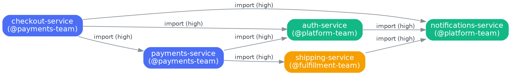
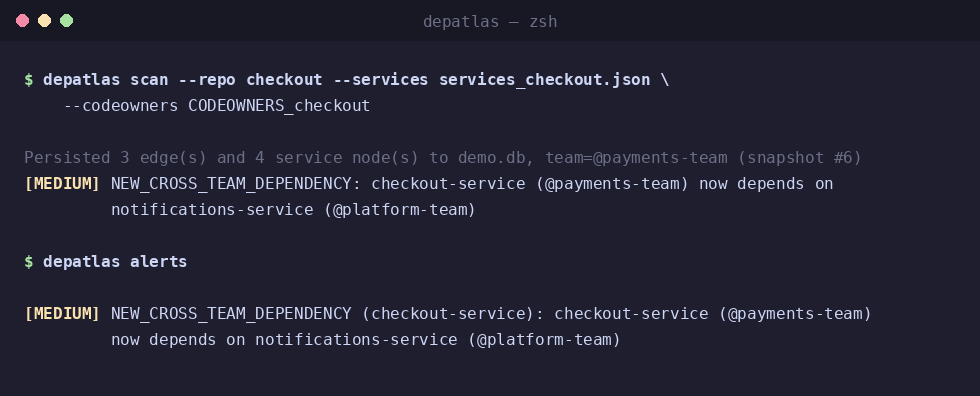
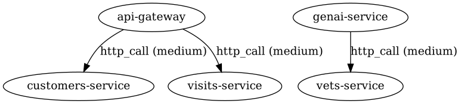

# DepAtlas 0.4.2 source (package, examples, README, pyproject)

Tests are in the separate tests file.

## Files

- `pyproject.toml`
- `README.md`
- `depatlas/check.py`
- `depatlas/cli/main.py`
- `depatlas/connectors/codecommit.py`
- `depatlas/connectors/github.py`
- `depatlas/discovery.py`
- `depatlas/fsutil.py`
- `depatlas/gitinfo.py`
- `depatlas/graph/builder.py`
- `depatlas/graph/models.py`
- `depatlas/graph/store.py`
- `depatlas/intelligence/alerts.py`
- `depatlas/intelligence/diff.py`
- `depatlas/orgscan.py`
- `depatlas/output/dot_export.py`
- `depatlas/output/json_export.py`
- `depatlas/ownership/codeowners.py`
- `depatlas/ownership/manifest.py`
- `depatlas/parsers/java_parser.py`
- `depatlas/parsers/js_ts_parser.py`
- `depatlas/parsers/python_parser.py`
- `depatlas/resolution.py`
- `depatlas/workflow.py`
- `examples/depatlas-org.yml`
- `examples/github-actions/depatlas-nightly.yml`
- `examples/github-actions/depatlas-pr-check.yml`


## `pyproject.toml`

`````toml
[project]
name = "depatlas"
version = "0.4.2"
description = "Reads your codebase and builds a living dependency graph across services, teams, and repositories."
readme = "README.md"
requires-python = ">=3.10"
license = { text = "Apache-2.0" }
authors = [
    { name = "Shameel" },
]
keywords = [
     "dependency-graph",
    "static-analysis",
    "code-analysis",
    "dependency-scanner",
    "service-mapping",
    "cli",
    "devtools",
    "codeowners",
    "microservices",
    "python",
    "java",
    "javascript",
    "typescript",
    "github",
    "aws",
    "codecommit",
    "sqlite",
    "graphviz",
    "ast",
    "impact-analysis",
    "breaking-changes",
    "devops",
    "software-architecture",
    "team-ownership",
]
classifiers = [
    "Development Status :: 4 - Beta",
    "Environment :: Console",
    "Intended Audience :: Developers",
    "License :: OSI Approved :: Apache Software License",
    "Operating System :: OS Independent",
    "Programming Language :: Python :: 3",
    "Programming Language :: Python :: 3 :: Only",
    "Programming Language :: Python :: 3.10",
    "Programming Language :: Python :: 3.11",
    "Programming Language :: Python :: 3.12",
    "Programming Language :: Python :: 3.13",
    "Topic :: Software Development :: Build Tools",
    "Topic :: Software Development :: Quality Assurance",
    "Topic :: Software Development :: Documentation",
]
dependencies = [
    "click>=8.1",
    "tree-sitter>=0.23,<0.27",
    "tree-sitter-java>=0.23,<0.27",
    "tree-sitter-javascript>=0.23,<0.27",
    "tree-sitter-typescript>=0.23,<0.27",
    "requests>=2.28",
    "pyyaml>=6.0",
]

[project.urls]
Homepage = "https://github.com/sshafeeq84/DepAtlas"
Repository = "https://github.com/sshafeeq84/DepAtlas"
Issues = "https://github.com/sshafeeq84/DepAtlas/issues"

[project.optional-dependencies]
aws = [
    "boto3>=1.34",
]
dev = [
    "pytest>=8.0",
    "boto3>=1.34",
]

[project.scripts]
depatlas = "depatlas.cli.main:cli"

[build-system]
requires = ["setuptools>=68"]
build-backend = "setuptools.build_meta"

[tool.setuptools.packages.find]
include = ["depatlas*"]
`````


## `README.md`

`````markdown
# DepAtlas

[](LICENSE)

*(Originally released as DepGraph — renamed to DepAtlas. The original
design doc in [`docs/SPEC.pdf`](https://github.com/sshafeeq84/DepAtlas/blob/main/docs/SPEC.pdf) predates the rename and
still uses the old name.)*

DepAtlas reads your codebase and builds a living dependency graph across
services, teams, and repositories — so blockers surface before they cost
you a sprint.

Engineering organizations above a certain size develop an invisible
coordination tax: teams block each other without knowing it, status
updates are written from memory, and nobody has a system that actually
knows what depends on what. DepAtlas reads the code itself — the one
source of truth that can't drift out of date — and turns it into a
queryable graph, automatically.

Full original design in [`docs/SPEC.pdf`](https://github.com/sshafeeq84/DepAtlas/blob/main/docs/SPEC.pdf).

<p align="center">
  
</p>

<p align="center">
  
</p>

## Status

v1 core complete. Three language parsers, three
code sources, a persisted queryable graph with history and diffing, full
ownership resolution, all five spec'd alert types (including
signature-level breaking-change detection), and both JSON and DOT
export — all covered by 323 passing tests. Some gaps are known and listed
in [Known limitations](#known-limitations).

| Area | What's there |
|---|---|
| **Languages** | Python (`ast`), Java (`tree-sitter`), JavaScript/TypeScript (`tree-sitter`) |
| **Code sources** | Local directory, GitHub (REST API), AWS CodeCommit (`boto3`) |
| **Persistence** | SQLite-backed graph store; every scan saves an immutable snapshot |
| **Ownership** | CODEOWNERS, with a `depatlas.yaml` manifest fallback |
| **Intelligence** | Diff engine (snapshot-to-snapshot) + 5 alert types, incl. breaking-change signature detection |
| **Export** | JSON and Graphviz DOT |

## Quick start

No setup file is needed. DepAtlas names a service from its own code
(`spring.application.name`, `pom.xml`, `pyproject.toml`, `package.json`, or
the folder) and works out how other code refers to it (Python packages, the
npm name, the Java package):

```bash
pip install depatlas

# What services are in this folder, and what are they called?
depatlas discover --root ~/code --output registry.json

# Scan one of them. The registry says who the others are, so links between
# services are found with nothing hand-written:
depatlas scan --repo ~/code/payments --registry registry.json
depatlas query --service payments-service
```

Everything below also works with an explicit `--services` file when you
want full control.

```bash
pip install -e ".[dev]"

# Scan a local repo, resolving ownership from CODEOWNERS:
depatlas scan \
  --repo tests/fixtures/sample_repo/payments \
  --services tests/fixtures/payments_services.json \
  --codeowners tests/fixtures/sample_repo/payments/CODEOWNERS

# Query what it found:
depatlas query --service payments-service --direction downstream
depatlas query --team @payments-team

# See what changed since the last scan (run the scan above twice to
# see this produce real output; on a first scan there's nothing yet
# to compare against):
depatlas diff --last 2 --repo tests/fixtures/sample_repo/payments

# Check for cross-team dependencies, breaking changes, and more:
depatlas alerts

# Export the whole graph:
depatlas export --format dot --output graph.dot

# A repo that mixes languages is still one service -- scan them together:
depatlas scan --repo . --services services.json --language all
#   (or repeat the option: --language java --language javascript;
#    with no --language, languages are detected from file extensions)

# Exit with status 3 if an alert at or above a severity is raised (status 1
# means the tool itself failed). This needs a graph database that persists
# between runs, so it suits a shared database; on a fresh CI runner use
# `depatlas check` instead (see "Using it in CI"):
depatlas scan --repo . --services services.json --fail-on high
```

The `--services` file is optional. When you want to write one, it is a
small JSON manifest mapping importable module names to service names,
plus a special `__self__` key naming the service being scanned (anything
it says overrides what was inferred):

```json
{
  "__self__": "payments-service",
  "auth_client": "auth-service",
  "endpoints": {
    "auth.internal": "auth-service"
  }
}
```

More usage examples — Java, JS/TS, GitHub, CodeCommit, ownership
manifests — are in [Full usage](#full-usage) below.

## CLI reference

| Command | Purpose |
|---|---|
| `depatlas scan` | Parse a repo (local, GitHub, or CodeCommit) and persist the resulting graph |
| `depatlas query` | Look up a service's dependencies (`--direction downstream\|upstream`) or a team's services |
| `depatlas snapshots` | List saved snapshots for a repo |
| `depatlas diff` | Compare two snapshots (`--from`/`--to` or `--last 2`) |
| `depatlas alerts` | Check the stored graph for all 5 alert types |
| `depatlas check` | Stateless pull-request check: compare HEAD with its merge-base, no database needed |
| `depatlas discover` | Find the services under a folder and show how they are named (no manifest needed) |
| `depatlas scan-all` | Scan many repos listed in a config file into one graph — the nightly org-graph job |
| `depatlas export` | Export the whole graph as JSON or DOT |

Every command supports `--help` for full option details.

## How it works

### Language parsers

Each parser walks a real AST (never regex) and extracts dependencies at
three confidence levels — **high** (an explicit, unambiguous signal),
**medium** (a configured endpoint match), and **low** (a heuristic
match) — plus public function/method signatures for breaking-change
detection.

- **Python** (`ast`): `import`/`from...import` statements (high);
  `requests.get/post/etc.` calls resolved via an endpoint registry
  (medium) or name heuristic (low).
- **Java** (`tree-sitter`): `import` statements resolved against known
  package namespaces (high); `@FeignClient` annotations, an explicit
  dependency declaration (high); RestTemplate/WebClient-style calls
  (medium/low, same scheme as Python).
- **JavaScript/TypeScript** (`tree-sitter`, with the JavaScript,
  TypeScript and TSX grammars, so real TypeScript parses):
  `import`/`export ... from`/`require(...)`/`import(...)` (high);
  `fetch`/`axios.<method>`/`got.<method>` calls (medium/low);
  `package.json` dependencies as `shared_library` edges (high). Public
  signatures are exported functions, exported arrow functions, `export {
  f }` of local functions and the public methods of exported classes,
  with TypeScript types, optional (`?`/default) and rest parameters.

Tests: `tests/test_parsers/`.

### Code sources

`depatlas scan` takes exactly one of:
- **`--repo <path>`** — a local directory.
- **`--github-repo owner/repo`** — downloaded via the GitHub REST API's
  zipball endpoint (no `git clone` dependency). Requires
  `DEPATLAS_GITHUB_TOKEN`.
- **`--codecommit-repo <name>`** — needs the optional AWS extra
  (`pip install "depatlas[aws]"`); downloaded via `boto3`, walking the
  repo tree with `get_folder`/`get_file` (CodeCommit has no bulk-download
  endpoint). Uses the AWS profile in `DEPATLAS_AWS_PROFILE`, or the
  default credential chain.

Tests: `tests/test_connectors/` (all network/AWS calls mocked — no real
credentials needed to run the suite).

### Persistence and diffing

Every `scan` persists to a local SQLite store (default
`.depatlas/graph.db`) and saves an immutable snapshot of that scan's
edges. Rescanning a repo replaces its *live* edges (so the graph always
reflects current code) while snapshots accumulate, giving
`depatlas diff` a timeline to compare. Services known only as a
dependency (not yet scanned directly) get a placeholder node, filled in
once their own repo is scanned.

Tests: `tests/test_graph/`, `tests/test_intelligence/test_diff.py`.

### Ownership

Resolved in priority order: **CODEOWNERS** (majority owner across a
repo's files, last-matching-rule-wins) → **`depatlas.yaml` manifest**
fallback (explicit service→team mapping) → **unowned**.

Tests: `tests/test_ownership/`.

### Alerts

All five SPEC.pdf alert types, checked automatically after every `scan`
(`--no-alerts` to disable) or on demand via `depatlas alerts`:

- **`BREAKING_CHANGE`** (high) — a public function removed, or changed in
  a way that breaks an existing caller, on a service with at least one
  known dependent. For Python and JavaScript/TypeScript that means: a
  parameter removed or moved, a new *required* parameter, an optional
  parameter that became required, a changed type (only when both sides
  have one), `*args`/`**kwargs` removed, and in Python a parameter that
  callers may pass by keyword being renamed or made positional-only or
  keyword-only. Adding an *optional* parameter, or renaming a
  positional-only or JavaScript parameter, is safe and not flagged. For
  Java, a different parameter count or a changed type is breaking and a
  rename is not.
- **`NEW_CROSS_TEAM_DEPENDENCY`** (medium) — a new edge crossing a team
  boundary.
- **`HIGH_FAN_IN`** (medium) — a service's distinct dependent count
  crosses a threshold (default 10).
- **`ORPHANED_SERVICE`** (low) — no dependents and no dependencies.
- **`UNOWNED_SERVICE`** (low) — no resolved team.

Tests: `tests/test_intelligence/test_alerts.py`.

### Using it in CI

A fresh CI runner has no stored history and has only your repo, so `scan`
+ `alerts` cannot see what changed or who depends on you. Two commands fix
that, with nothing hand-written:

**1. A nightly job builds the org-wide graph.** List your repos once:

```yaml
# depatlas-org.yml
repos:
  - github: acme/payments
  - github: acme/orders
    team: "@acme/orders-team"   # only if the repo has no CODEOWNERS
```

```bash
depatlas scan-all --config depatlas-org.yml --db graph.db --reset --export org-graph.json
```

It fetches every repo, infers each service's name and import names, scans
each one against all the others, and writes the graph plus the service
registry to `org-graph.json`. One broken repo does not stop the rest, but
if any fails it exits 1 and writes no export, so a half-built graph is
never published (`--allow-partial` overrides). A glob such as
`path: ./checkouts/monorepo/services/*` treats each folder as a service.

**2. Every pull request checks its change against that graph:**

```bash
depatlas check --base origin/main --graph org-graph.json --fail-on high
```

It finds the merge-base of `--base` and HEAD, scans both commits the same
way (`git archive`, so generated or git-ignored files cannot make one side
look different), and reports `BREAKING_CHANGE` and
`NEW_CROSS_TEAM_DEPENDENCY` for what changed. Uncommitted edits are not
checked unless you pass `--working-tree`. The graph supplies the teams and
the services that depend on you, which one repo cannot know, so `--fail-on`
requires `--graph`. When the service's folder did not exist at the base
(new or moved), the graph's existing dependencies for it are the baseline.
Exit status: `0` clean, `3` an alert reached `--fail-on`, `1` the check
could not run. `--repo` can point at a subfolder of a monorepo.

Ready-to-copy GitHub Actions workflows for both jobs are in
[`examples/github-actions/`](https://github.com/sshafeeq84/DepAtlas/tree/main/examples/github-actions):
`depatlas-nightly.yml` rebuilds the graph and publishes it as a release
asset, and `depatlas-pr-check.yml` downloads it and runs `check`. Run the
nightly workflow once by hand before the first pull request. Two things to
get right: keep the config repo **private** (the graph lists your services,
teams and dependencies; the nightly job refuses to publish from a public
repo), and give pull-request jobs a **separate token that can read only that
repo**, not the nightly token that can read every repo. Pull requests from
forks are skipped, and GitHub counts a skipped required check as passing, so
they are not gated.

The point-in-time alerts (`HIGH_FAN_IN`, `ORPHANED_SERVICE`,
`UNOWNED_SERVICE`) describe the whole graph rather than a change, so they
stay in `depatlas alerts` (for example `depatlas alerts --db graph.db` after
`scan-all`).

### How services are named and linked

| Language | Name, first match wins | Other code imports it as |
|---|---|---|
| Java / Spring | `spring.application.name`, Maven `artifactId`, Gradle `rootProject.name` | the package prefix shared by all its sources (at least 3 segments) |
| Python | `[project]` / `[tool.poetry]` name, `setup.cfg`, `setup.py` | its top-level packages |
| JavaScript / TypeScript | `package.json` `name` (scope dropped for the service name) | the full npm name |

The folder name is the last resort. URLs like `http://payments-service:8080/`
or `lb://payments-service` resolve to a service of that name. Generic or
standard-library import names (`utils`, `config`, `json`...) are never
registered, and an import name claimed by two services is dropped with a
warning. A service whose own name is generic (`email`, `config`) is still
found by URL and hostname, but is never matched by a bare `import email`.
Profile files such as `application-dev.yml` never decide a Spring service's name.

If `scan-all` renames a repo (`name:` in the config), `check` finds it again by
`GITHUB_REPOSITORY` when run in GitHub Actions; elsewhere pass `--name`. `check`
warns when the name it uses is not in the registry, because dependents are looked
up by that name. Use `--name`, or write a `--services` file, to override anything.

## Full usage

```bash
# Scan a Java repo:
depatlas scan \
  --repo tests/fixtures/sample_repo_java/payments \
  --services tests/fixtures/payments_services_java.json \
  --language java

# Scan a JS/TS repo:
depatlas scan \
  --repo tests/fixtures/sample_repo_js/payments \
  --services tests/fixtures/payments_services_js.json \
  --language javascript

# Scan a real GitHub repo (requires DEPATLAS_GITHUB_TOKEN):
depatlas scan \
  --github-repo sshafeeq84/DepAtlas \
  --services tests/fixtures/payments_services.json

# Scan a real AWS CodeCommit repo (requires an AWS profile):
depatlas scan \
  --codecommit-repo my-payments-repo \
  --region us-east-1 \
  --services tests/fixtures/payments_services.json

# Resolve ownership from a depatlas.yaml manifest instead of CODEOWNERS:
depatlas scan \
  --repo tests/fixtures/sample_repo/payments \
  --services tests/fixtures/payments_services.json \
  --ownership-manifest tests/fixtures/depatlas.yaml

# List and diff snapshots explicitly:
depatlas snapshots --repo tests/fixtures/sample_repo/payments
depatlas diff --from 1 --to 2

# Filter alerts by severity:
depatlas alerts --severity medium
```

## Tried on a real project

Run against the Java services of
[Spring PetClinic Microservices](https://github.com/spring-petclinic/spring-petclinic-microservices)
(one `depatlas scan` per service, with a small services/endpoints JSON):



DepAtlas found the API gateway's calls to the customers and visits
services (Spring `WebClient`) and the GenAI service's call to the vets
service. Running it on a real project also exposed bugs that the unit
tests had missed (a crash on modern Java syntax and undetected
`WebClient` calls), which are now fixed and covered by tests.

## Known limitations

Known gaps, documented in the relevant modules and in
[`docs/CONTRIBUTING.md`](https://github.com/sshafeeq84/DepAtlas/blob/main/docs/CONTRIBUTING.md):

- **Newest TypeScript syntax** — the TypeScript grammar does not yet
  recognise a few recent forms (for example `export type * from './x'`).
  Such a file gets a warning and contributes everything else that parsed.
- **JavaScript exports** — CommonJS exports (`module.exports = ...`) are
  not recognised, only ES-module exports. A function reachable only
  through a re-export from another module is not followed.
- **Snapshots from before 0.3.0** — parameters carry no kind, so the first
  comparison against such a snapshot reports removed functions but not
  parameter changes. Scan once and later comparisons are exact.
- **Java parameter rules** — Java parameters have no optional or keyword
  forms, so any change in parameter count is breaking (varargs are not
  modelled separately).
- **Java constructors** — constructors are not extracted as signatures, so
  removing or changing a public constructor is not flagged.
- **Ownership patterns** — CODEOWNERS matching supports files, folders,
  anchored paths and `*` globs; negation and `**` are not supported, and `*`
  also crosses folder boundaries (more generous than GitHub).
- **Large files** — source files over 2 MB are skipped with a warning
  (minified bundles, generated code).
- **Dependents of a breaking change** — every dependent is counted, not
  only those that import the changed code (HTTP callers depend on routes,
  which are not extracted yet).
- **Inference limits** — names and import names are read from build files
  and source layout, so an unusual layout can be missed. Java packages
  shorter than three segments are not registered, and a shared package
  name used by two services identifies neither. `depatlas discover` shows
  what was found; override with `--name` or a `--services` file.
- **CI graph freshness** — `depatlas check` reads the org graph written by
  the nightly job, so it is only as fresh as the last run. `scan --fail-on`
  still needs a database that persists between runs. `scan-all` takes an
  explicit repo list; it does not list an organisation's repos for you.
- **HTTP calls that name no service** — only the hostname of an absolute
  URL is matched against service names. Calls routed through a gateway
  (`https://api.company.com/payments/...`) or made through a base-URL
  client (`webClient.uri("/owners")`) need `endpoints` entries in the
  manifest.
- **Test code** — edges found in test files are stored and tagged
  (`from_test`) but ignored by alerts.

- **Not built yet:** `boto3`/`grpc` call detection, Maven/Gradle
  shared-library detection, and the `watch` and `init` commands.
- The **CodeCommit connector** is tested against a mocked AWS API but has
  not been exercised against a real AWS account.

## Running tests

```bash
pytest tests/ -v
```

## Repository structure

```
depatlas/
├── depatlas/
│   ├── cli/            # CLI entry point (click)
│   ├── check.py          # `check`: the stateless pull-request comparison
│   ├── discovery.py       # infer service names, import names, registry
│   ├── orgscan.py          # `scan-all`: many repos into one graph
│   ├── workflow.py          # the scan pipeline shared by scan and scan-all
│   ├── connectors/       # GitHub, AWS CodeCommit
│   ├── parsers/          # python_parser (ast), java_parser (tree-sitter),
│   │                       js_ts_parser (tree-sitter)
│   ├── graph/             # Models, graph builder, SQLite store
│   ├── ownership/          # CODEOWNERS + depatlas.yaml manifest
│   ├── intelligence/        # Diff engine, alerts
│   └── output/                # JSON and DOT exporters
├── examples/                      # org config + GitHub Actions workflows
├── tests/                       # Mirrors the structure above, 1:1
├── docs/
│   ├── SPEC.pdf                  # Original v0.1 spec
│   └── CONTRIBUTING.md
└── pyproject.toml
```

## Contributing

See [`docs/CONTRIBUTING.md`](https://github.com/sshafeeq84/DepAtlas/blob/main/docs/CONTRIBUTING.md) for setup,
testing conventions, and known scope boundaries.

## License

Apache 2.0 — see [`LICENSE`](https://github.com/sshafeeq84/DepAtlas/blob/main/LICENSE).
`````


## `depatlas/check.py`

`````python
"""Stateless pull-request check: `depatlas check --base origin/main`.

`scan` + `alerts` need a graph database that persists between runs, which a
fresh CI runner does not have. This module does the same comparison in one
run, with no database:

  1. find the merge-base of the base ref and HEAD;
  2. extract that commit to a temporary folder (from a temporary git
     index, so the checkout is never touched);
  3. analyse the base tree and the working tree the same way `scan` does
     (edges and public signatures);
  4. report the alerts that need a before/after comparison:
       - NEW_CROSS_TEAM_DEPENDENCY (edges added since the base)
       - BREAKING_CHANGE (public functions removed or changed, when other
         services depend on this one)
  5. read teams and dependents from an org-wide graph export
     (`depatlas export --format json`, produced by a nightly job that scans
     every repo), because one repo cannot know who depends on it.

The point-in-time alerts (HIGH_FAN_IN, ORPHANED_SERVICE, UNOWNED_SERVICE) are
about the whole graph, not about a change, so they stay in `depatlas alerts`.
"""

from __future__ import annotations

import json
import os
import subprocess
import tempfile
from pathlib import Path
from typing import Callable

from depatlas.fsutil import detect_languages, is_test_path
from depatlas.graph.builder import build_graph
from depatlas.intelligence.alerts import (
    Alert,
    check_breaking_changes,
    check_new_cross_team_dependencies,
)
from depatlas.intelligence.diff import compute_diff


class CheckError(Exception):
    """A problem the user can fix (bad ref, shallow clone, bad graph file)."""


def _git(repo: Path, *args: str, binary: bool = False, env: dict | None = None):
    try:
        result = subprocess.run(
            ["git", "-C", str(repo), *args],
            capture_output=True,
            text=not binary,
            timeout=120,
            env={**os.environ, **env} if env else None,
        )
    except (OSError, subprocess.SubprocessError) as exc:
        raise CheckError(f"Could not run git: {exc}") from exc
    return result


def resolve_merge_base(repo: Path, base: str) -> str:
    """The commit where HEAD branched from `base`."""
    result = _git(repo, "merge-base", base, "HEAD")
    sha = result.stdout.strip()
    if result.returncode != 0 or not sha:
        raise CheckError(
            f"Could not find a merge-base between '{base}' and HEAD. "
            "Check that the ref exists. On a CI runner the checkout must "
            "include history: in GitHub Actions use "
            "`actions/checkout` with `fetch-depth: 0`."
        )
    return sha


def export_tree(repo: Path, commit: str, dest: Path) -> bool:
    """Write `commit`'s version of `repo` (a folder inside a git checkout,
    possibly a subfolder of a monorepo) into `dest`. Returns False when the
    folder did not exist at that commit (a brand-new service).

    The files come from a temporary index (`read-tree` + `checkout-index`),
    so the real checkout and index are never touched, `export-ignore`
    attributes do not hide files, and git itself refuses paths that would
    land outside `dest`. Git-ignored and generated files are not part of a
    commit, so they never appear.
    """
    prefix = _git(repo, "rev-parse", "--show-prefix").stdout.strip().rstrip("/")
    if prefix and _git(repo, "cat-file", "-e", f"{commit}:{prefix}").returncode != 0:
        return False
    tree = f"{commit}:{prefix}" if prefix else commit
    # Run from the top of the checkout: from a subfolder, checkout-index -a
    # would only write entries under that subfolder's path.
    top = _git(repo, "rev-parse", "--show-toplevel").stdout.strip() or str(repo)
    with tempfile.TemporaryDirectory(prefix="depatlas-index-") as scratch:
        env = {"GIT_INDEX_FILE": str(Path(scratch) / "index")}
        read = _git(top, "read-tree", tree, env=env)
        if read.returncode != 0:
            raise CheckError(f"git read-tree failed: {read.stderr.strip()}")
        out = _git(top, "checkout-index", "-a", f"--prefix={dest.resolve().as_posix()}/", env=env)
        if out.returncode != 0:
            raise CheckError(f"git checkout-index failed: {out.stderr.strip()}")
    return True


def load_graph(path: Path) -> tuple[list[dict], list[dict]]:
    """Nodes and edges from `depatlas export --format json`."""
    try:
        data = json.loads(Path(path).read_text(encoding="utf-8"))
        nodes, edges = data["nodes"], data["edges"]
    except (OSError, ValueError, KeyError, TypeError) as exc:
        raise CheckError(
            f"{path} is not a DepAtlas graph export (expected the output of "
            f"`depatlas export --format json`): {exc}"
        ) from exc
    return nodes, edges


def analyse(
    repo_path: Path,
    languages: list[str],
    known_services: dict,
    known_endpoints: dict,
    self_service: str,
    parsers: dict[str, Callable],
    extractors: dict[str, Callable],
) -> tuple[list, list]:
    """Edges (tagged `from_test`) and public signatures for one tree."""
    edges = []
    signatures = []
    for lang in languages:
        edges.extend(parsers[lang](repo_path, known_services, known_endpoints))
        signatures.extend(extractors[lang](repo_path, self_service))
    for edge in edges:
        edge.from_test = is_test_path(Path(edge.source_file))
    return edges, signatures


def run_check(
    repo_path: Path,
    base: str,
    known_services: dict,
    known_endpoints: dict,
    languages: list[str] | None,
    parsers: dict[str, Callable],
    extractors: dict[str, Callable],
    graph_path: Path | None = None,
    codeowners_rules=None,
    manifest_teams: dict | None = None,
    use_working_tree: bool = False,
) -> dict:
    """Run the check. Returns {"alerts", "base_sha", "notes", "languages"}."""
    self_service = known_services.get("__self__", "unknown-service")
    notes: list[str] = []

    base_sha = resolve_merge_base(repo_path, base)

    graph_nodes: list[dict] = []
    graph_edges: list[dict] = []
    if graph_path is not None:
        graph_nodes, graph_edges = load_graph(graph_path)
    else:
        notes.append(
            "No --graph given: teams and dependents are unknown, so "
            "NEW_CROSS_TEAM_DEPENDENCY and BREAKING_CHANGE cannot fire."
        )

    with tempfile.TemporaryDirectory(prefix="depatlas-base-") as tmp:
        base_dir = Path(tmp) / "base"
        base_dir.mkdir()
        base_existed = export_tree(repo_path, base_sha, base_dir)
        if not base_existed:
            notes.append(f"{repo_path} does not exist at {base_sha[:8]}: treating it as new.")

        # Both sides come out of git the same way (from git), so files
        # that are ignored, generated by an earlier CI step, export-ignored
        # or LFS pointers look the same on both. `use_working_tree` compares
        # the files on disk instead, to include uncommitted edits.
        if use_working_tree:
            head_dir = repo_path
        else:
            head_dir = Path(tmp) / "head"
            head_dir.mkdir()
            if not export_tree(repo_path, "HEAD", head_dir):
                notes.append(
                    f"{repo_path} is not committed at HEAD, so there is nothing to check; "
                    "commit it, or pass --working-tree."
                )
            elif _git(repo_path, "status", "--porcelain", "--", ".").stdout.strip():
                notes.append(
                    "uncommitted changes are not checked (comparing HEAD with the base); "
                    "commit them, or pass --working-tree."
                )

        if languages:
            used = list(languages)
        else:
            used = sorted(set(detect_languages(head_dir)) | set(detect_languages(base_dir))) or [
                "python"
            ]

        new_edges, new_sigs = analyse(
            head_dir, used, known_services, known_endpoints, self_service, parsers, extractors
        )
        old_edges, old_sigs = (
            analyse(base_dir, used, known_services, known_endpoints, self_service, parsers, extractors)
            if base_existed
            else ([], [])
        )

    # Teams: the org graph, overlaid with this repo's own ownership inputs.
    service_teams = {n["id"]: n.get("team") for n in graph_nodes}
    if codeowners_rules or manifest_teams:
        own = build_graph(
            new_edges,
            repo_path,
            self_service,
            language=",".join(used),
            codeowners_rules=codeowners_rules,
            manifest_teams=manifest_teams,
        )
        for node in own:
            if node.id == self_service and node.team:
                service_teams[self_service] = node.team

    old_edge_dicts = [e.to_dict() for e in old_edges]
    if not base_existed:
        # A new or moved folder has no base to compare with, so every
        # dependency would look new. The org graph already knows what this
        # service depended on; use that as the baseline (a genuinely new
        # service has none, and is still all-new).
        old_edge_dicts = [e for e in graph_edges if e.get("source_service") == self_service]
        if old_edge_dicts:
            notes.append(
                f"using the {len(old_edge_dicts)} dependencies the org graph already has for "
                f"'{self_service}' as the baseline."
            )
    diff = compute_diff(old_edge_dicts, [e.to_dict() for e in new_edges], by_location=False)
    alerts: list[Alert] = []
    alerts += check_new_cross_team_dependencies(diff["added"], service_teams)

    # Dependents come from other repos' scans; this repo's own edges are
    # replaced by the fresh scan, so they are not counted.
    dependents = [
        e
        for e in graph_edges
        if e.get("target_service") == self_service and e.get("source_service") != self_service
    ]
    alerts += check_breaking_changes(
        self_service,
        [s.to_dict() for s in old_sigs],
        [s.to_dict() for s in new_sigs],
        dependents,
    )

    return {"alerts": alerts, "base_sha": base_sha, "notes": notes, "languages": used}
`````


## `depatlas/cli/main.py`

`````python
"""DepAtlas CLI.

Commands: `scan` (parse a local directory, GitHub repo or AWS CodeCommit
repo into a persisted SQLite graph, with CODEOWNERS / manifest team
resolution and alerting), `query` (read it back by service or team),
`snapshots` and `diff` (history), `alerts` (check the whole stored graph),
and `export` (JSON or DOT). SPEC.pdf section 9 has the full planned command
surface; `watch` and `init` are not built yet.
"""

from __future__ import annotations

import json
from pathlib import Path

import click

from depatlas.parsers.python_parser import (
    parse_repo as parse_python_repo,
    extract_signatures as extract_python_signatures,
)
from depatlas.parsers.java_parser import (
    parse_repo as parse_java_repo,
    extract_signatures as extract_java_signatures,
)
from depatlas.parsers.js_ts_parser import (
    parse_repo as parse_js_ts_repo,
    extract_signatures as extract_js_ts_signatures,
)
from depatlas.output.json_export import export_edges, export_graph_json
from depatlas.output.dot_export import export_dot
from depatlas.graph.builder import build_graph
from depatlas.graph.store import GraphStore
from depatlas.ownership.codeowners import parse_codeowners
from depatlas.ownership.manifest import parse_ownership_manifest
from depatlas.gitinfo import get_sha
from depatlas.intelligence.diff import compute_diff
from depatlas.check import CheckError, run_check
from depatlas.discovery import (
    discover_workspace,
    find_codeowners,
    load_registry,
    registry_to_dict,
    resolve_manifest,
)
from depatlas.orgscan import scan_all
from depatlas.workflow import resolve_languages, run_scan
from depatlas.fsutil import detect_languages, is_test_path
from depatlas.intelligence.alerts import (
    check_breaking_changes,
    comparable_signatures,
    check_high_fan_in,
    check_new_cross_team_dependencies,
    check_orphaned_service,
    check_unowned_service,
    DEFAULT_HIGH_FAN_IN_THRESHOLD,
)
from depatlas.connectors.github import GitHubConnectorError, fetch_repo as fetch_github_repo, get_token
from depatlas.connectors.codecommit import (
    CodeCommitConnectorError,
    fetch_repo as fetch_codecommit_repo,
    get_client as get_codecommit_client,
)

DEFAULT_DB_PATH = Path(".depatlas/graph.db")
DEFAULT_CACHE_DIR = Path(".depatlas/cache")

PARSERS = {
    "python": parse_python_repo,
    "java": parse_java_repo,
    "javascript": parse_js_ts_repo,
}

SIGNATURE_EXTRACTORS = {
    "python": extract_python_signatures,
    "java": extract_java_signatures,
    "javascript": extract_js_ts_signatures,
}


def _repo_key(value: str) -> str:
    """Turn a `--repo` filter into the key snapshots are stored under:
    "github:owner/repo" and "codecommit:name" are used as given; anything
    else is a local path, resolved to an absolute one.
    """
    if value.startswith(("github:", "codecommit:")):
        return value
    return str(Path(value).resolve())


_SEVERITY_RANK = {"low": 1, "medium": 2, "high": 3}


ALERT_EXIT_CODE = 3  # distinct from 1 (click errors / crashes) and 2 (usage)


def _exit_if_failing(alert_list: list, fail_on: str | None) -> None:
    """Exit with status 3 if any alert is at or above `fail_on`, so a CI job
    can tell "blocked by an alert" (3) from "the tool failed" (1)."""
    if fail_on is None:
        return
    threshold = _SEVERITY_RANK[fail_on]
    if any(_SEVERITY_RANK.get(a.severity, 0) >= threshold for a in alert_list):
        raise click.exceptions.Exit(ALERT_EXIT_CODE)


_REGISTRY_OPTION = click.option(
    "--registry",
    "registry_path",
    type=click.Path(exists=True, dir_okay=False, path_type=Path),
    default=None,
    help=(
        "The other services in your system: the output of `depatlas discover`, "
        "or a graph export from `depatlas scan-all` (which carries one)."
    ),
)
_NAME_OPTION = click.option(
    "--name",
    "service_name_override",
    default=None,
    help="Name of the service being scanned (default: inferred from the code).",
)


def _log(message: str) -> None:
    click.echo(message, err=True)


def _ownership_for(repo_path: Path, codeowners_path: Path | None):
    """The CODEOWNERS file to use: the one given, else one in a standard place."""
    if codeowners_path is not None:
        return codeowners_path
    found = find_codeowners(repo_path)
    if found is not None:
        _log(f"Using {found.relative_to(repo_path).as_posix()} for ownership")
    return found


_FAIL_ON_OPTION = click.option(
    "--fail-on",
    "fail_on",
    type=click.Choice(["low", "medium", "high"]),
    default=None,
    help="Exit with status 3 if any alert at or above this severity is raised (for CI).",
)


@click.group()
@click.version_option(package_name="depatlas")
def cli() -> None:
    """DepAtlas -- map service-to-service dependencies from source code."""


@cli.command()
@click.option(
    "--repo",
    "repo_path",
    type=click.Path(exists=True, file_okay=False, path_type=Path),
    default=None,
    help="Path to a local repo directory to scan. Use this OR --github-repo OR --codecommit-repo.",
)
@click.option(
    "--github-repo",
    "github_repo",
    default=None,
    help=(
        "A GitHub repo to scan, as 'owner/repo' (e.g. 'sshafeeq84/DepAtlas'). "
        "Downloaded via the GitHub API using the token in the "
        "DEPATLAS_GITHUB_TOKEN environment variable."
    ),
)
@click.option(
    "--codecommit-repo",
    "codecommit_repo",
    default=None,
    help=(
        "An AWS CodeCommit repo name to scan. Fetched via boto3 using the "
        "AWS profile named in the DEPATLAS_AWS_PROFILE environment "
        "variable (falls back to the default AWS credential chain if unset)."
    ),
)
@click.option(
    "--region",
    "region",
    default="us-east-1",
    show_default=True,
    help="AWS region (only used with --codecommit-repo).",
)
@click.option(
    "--ref",
    "ref",
    default="HEAD",
    show_default=True,
    help="Branch, tag, or commit SHA to scan (used with --github-repo or --codecommit-repo).",
)
@click.option(
    "--cache-dir",
    "cache_dir",
    type=click.Path(path_type=Path),
    default=DEFAULT_CACHE_DIR,
    show_default=True,
    help="Where downloaded remote repos are extracted (used with --github-repo or --codecommit-repo).",
)
@click.option(
    "--services",
    "services_path",
    type=click.Path(exists=True, dir_okay=False, path_type=Path),
    default=None,
    help=(
        "Optional. A JSON file mapping importable module names to service "
        "names, e.g. {\"__self__\": \"payments-service\", \"auth_client\": \"auth-service\"}. "
        "__self__ names the service being scanned. An optional reserved "
        "\"endpoints\" key maps URL host/path patterns to service names, e.g. "
        "{\"endpoints\": {\"auth.internal\": \"auth-service\"}}. Without it "
        "the service is named from the code (see `depatlas discover`) and "
        "--registry supplies the other services."
    ),
)
@_REGISTRY_OPTION
@_NAME_OPTION
@click.option(
    "--language",
    "language",
    type=click.Choice(sorted(PARSERS.keys()) + ["all"]),
    multiple=True,
    default=(),
    help=(
        "Language parser(s) to run on this repo. Repeat the option "
        "(--language java --language javascript) or use 'all' for a repo "
        "that mixes languages; results are saved as one service. Default: "
        "detect from file extensions."
    ),
)
@click.option(
    "--codeowners",
    "codeowners_path",
    type=click.Path(exists=True, dir_okay=False, path_type=Path),
    default=None,
    help=(
        "Path to a CODEOWNERS file. If supplied, the scanned service's "
        "team is resolved as the majority owner across its files "
        "(SPEC.pdf section 8, priority 1)."
    ),
)
@click.option(
    "--ownership-manifest",
    "ownership_manifest_path",
    type=click.Path(exists=True, dir_okay=False, path_type=Path),
    default=None,
    help=(
        "Path to a depatlas.yaml ownership manifest, mapping service "
        "names directly to teams. Used only when --codeowners is not "
        "supplied, or resolves no team for this repo "
        "(SPEC.pdf section 8, priority 2)."
    ),
)
@click.option(
    "--output",
    "output_path",
    type=click.Path(path_type=Path),
    default=None,
    help="Also write JSON output to this file (in addition to persisting).",
)
@click.option(
    "--db",
    "db_path",
    type=click.Path(path_type=Path),
    default=DEFAULT_DB_PATH,
    show_default=True,
    help="Path to the SQLite graph store.",
)
@click.option(
    "--alerts/--no-alerts",
    "alerts_enabled",
    default=True,
    help=(
        "Check for NEW_CROSS_TEAM_DEPENDENCY, BREAKING_CHANGE, "
        "ORPHANED_SERVICE, UNOWNED_SERVICE, and HIGH_FAN_IN after this scan and print any "
        "that trigger (SPEC.pdf section 10). On by default."
    ),
)
@click.option(
    "--fan-in-threshold",
    "fan_in_threshold",
    type=int,
    default=DEFAULT_HIGH_FAN_IN_THRESHOLD,
    show_default=True,
    help="Distinct-dependent count that triggers a HIGH_FAN_IN alert.",
)
@_FAIL_ON_OPTION
def scan(
    repo_path: Path | None,
    github_repo: str | None,
    codecommit_repo: str | None,
    region: str,
    ref: str,
    cache_dir: Path,
    services_path: Path | None,
    registry_path: Path | None,
    service_name_override: str | None,
    language: tuple[str, ...],
    codeowners_path: Path | None,
    ownership_manifest_path: Path | None,
    output_path: Path | None,
    db_path: Path,
    alerts_enabled: bool,
    fan_in_threshold: int,
    fail_on: str | None,
) -> None:
    """Scan a repo (local, GitHub, or CodeCommit), persist the results, and print the edges found."""
    sources_given = [s for s in (repo_path, github_repo, codecommit_repo) if s]
    if len(sources_given) == 0:
        raise click.UsageError("Provide one of --repo, --github-repo, or --codecommit-repo.")
    if len(sources_given) > 1:
        raise click.UsageError("Provide only one of --repo, --github-repo, or --codecommit-repo.")

    if fail_on is not None and not alerts_enabled:
        raise click.UsageError("--fail-on has no effect with --no-alerts; drop one of them.")

    repo_key: str | None = None  # stable identity for this repo across scans

    if github_repo:
        if "/" not in github_repo:
            raise click.UsageError("--github-repo must be in 'owner/repo' form.")
        owner, repo_name = github_repo.split("/", 1)
        try:
            token = get_token()
            click.echo(f"Downloading {github_repo}@{ref} from GitHub...", err=True)
            repo_path = fetch_github_repo(owner, repo_name, token, cache_dir, ref)
            repo_key = f"github:{github_repo}"
        except GitHubConnectorError as exc:
            raise click.ClickException(str(exc))

    if codecommit_repo:
        try:
            client = get_codecommit_client(region)
            click.echo(f"Downloading {codecommit_repo} from AWS CodeCommit ({region})...", err=True)
            commit_specifier = ref if ref != "HEAD" else ""
            repo_path = fetch_codecommit_repo(codecommit_repo, client, cache_dir, commit_specifier)
            repo_key = f"codecommit:{codecommit_repo}"
        except CodeCommitConnectorError as exc:
            raise click.ClickException(str(exc))

    # Normalize to an absolute path now, once -- everything downstream
    # (the edges table, the services table, and snapshots) keys off this
    # exact string, so a relative "--repo repo" and an equivalent
    # absolute "--repo /full/path/to/repo" must resolve to the same
    # value, or repeat scans and `diff --last` silently stop matching up.
    repo_path = repo_path.resolve()
    if repo_key is None:
        repo_key = str(repo_path)

    try:
        known_services, known_endpoints = resolve_manifest(
            repo_path, services_path, registry_path, service_name_override, _log
        )
    except ValueError as exc:
        raise click.ClickException(str(exc))
    self_service = known_services.get("__self__", "unknown-service")

    codeowners_path = _ownership_for(repo_path, codeowners_path)
    manifest_teams = (
        parse_ownership_manifest(ownership_manifest_path) if ownership_manifest_path else None
    )
    languages = resolve_languages(repo_path, language, PARSERS, _log)

    result = run_scan(
        repo_path,
        repo_key,
        known_services,
        known_endpoints,
        languages,
        PARSERS,
        SIGNATURE_EXTRACTORS,
        db_path,
        codeowners_path=codeowners_path,
        manifest_teams=manifest_teams,
        ownership_inputs_supplied=bool(codeowners_path or ownership_manifest_path),
        alerts_enabled=alerts_enabled,
        fan_in_threshold=fan_in_threshold,
        log=_log,
    )
    edges, nodes = result.edges, result.nodes
    snapshot_id, triggered_alerts = result.snapshot_id, result.alerts

    text = export_edges(edges, output_path)
    click.echo(text)

    self_node = next(n for n in nodes if n.id == self_service)
    team_note = f", team={self_node.team}" if self_node.team else ", team=unowned"
    click.echo(
        f"\nPersisted {len(edges)} edge(s) and {len(nodes)} service node(s) to {db_path}"
        f"{team_note} (snapshot #{snapshot_id})",
        err=True,
    )
    if output_path is not None:
        click.echo(f"Also wrote JSON to {output_path}", err=True)

    for alert in triggered_alerts:
        click.echo(f"[{alert.severity.upper()}] {alert.type}: {alert.message}", err=True)

    _exit_if_failing(triggered_alerts, fail_on)


@cli.command()
@click.option("--service", "service_name", default=None, help="Service name to query.")
@click.option("--team", "team_name", default=None, help="List services owned by this team.")
@click.option(
    "--direction",
    type=click.Choice(["downstream", "upstream"]),
    default="downstream",
    show_default=True,
    help=(
        "Only used with --service. downstream = what this service "
        "depends on. upstream = what depends on this service "
        "(i.e. 'impact of')."
    ),
)
@click.option(
    "--db",
    "db_path",
    type=click.Path(exists=True, dir_okay=False, path_type=Path),
    default=DEFAULT_DB_PATH,
    show_default=True,
    help="Path to the SQLite graph store.",
)
def query(service_name: str | None, team_name: str | None, direction: str, db_path: Path) -> None:
    """Query the persisted graph, either by --service or by --team."""
    if not service_name and not team_name:
        raise click.UsageError("Provide either --service or --team.")
    if service_name and team_name:
        raise click.UsageError("Provide only one of --service or --team, not both.")

    store = GraphStore(db_path)

    if team_name:
        services = [s for s in store.all_services() if s["team"] == team_name]
        store.close()
        if not services:
            click.echo(f"No services found owned by '{team_name}'.")
            return
        click.echo(f"Services owned by '{team_name}':")
        for svc in services:
            click.echo(f"  {svc['id']}  (repo: {svc['repo'] or 'unknown'})")
        return

    edges = store.edges_for_service(service_name, direction)
    store.close()

    if not edges:
        click.echo(f"No {direction} dependencies found for '{service_name}'.")
        return

    if direction == "downstream":
        for edge in edges:
            click.echo(
                f"{service_name} -> {edge['target_service']}  "
                f"[{edge['type']}, {edge['confidence']}]  "
                f"({edge['source_file']}:{edge['source_line']})"
            )
    else:
        click.echo(f"Services that depend on '{service_name}':")
        for edge in edges:
            click.echo(
                f"{edge['source_service']} -> {service_name}  "
                f"[{edge['type']}, {edge['confidence']}]  "
                f"({edge['source_file']}:{edge['source_line']})"
            )


@cli.command()
@click.option(
    "--repo",
    "repo_filter",
    default=None,
    help="Limit to snapshots of this repo path (as recorded at scan time).",
)
@click.option(
    "--limit",
    "limit",
    type=int,
    default=20,
    show_default=True,
    help="Maximum number of snapshots to list.",
)
@click.option(
    "--db",
    "db_path",
    type=click.Path(exists=True, dir_okay=False, path_type=Path),
    default=DEFAULT_DB_PATH,
    show_default=True,
    help="Path to the SQLite graph store.",
)
def snapshots(repo_filter: str | None, limit: int, db_path: Path) -> None:
    """List saved snapshots (most recent first) -- use their ids with `diff --from/--to`."""
    if repo_filter is not None:
        repo_filter = _repo_key(repo_filter)

    store = GraphStore(db_path)
    rows = store.list_snapshots(repo=repo_filter, limit=limit)
    store.close()

    if not rows:
        click.echo("No snapshots found.")
        return

    for row in rows:
        click.echo(f"#{row['id']}  {row['created_at']}  {row['repo']}")


@cli.command()
@click.option("--from", "from_snapshot_id", type=int, default=None)
@click.option("--to", "to_snapshot_id", type=int, default=None)
@click.option(
    "--last",
    "last_n",
    type=int,
    default=None,
    help="Compare the two most recent snapshots for --repo (i.e. --last 2).",
)
@click.option(
    "--repo",
    "repo_filter",
    default=None,
    help="Repo path to use with --last (required when using --last).",
)
@click.option(
    "--db",
    "db_path",
    type=click.Path(exists=True, dir_okay=False, path_type=Path),
    default=DEFAULT_DB_PATH,
    show_default=True,
    help="Path to the SQLite graph store.",
)
def diff(
    from_snapshot_id: int | None,
    to_snapshot_id: int | None,
    last_n: int | None,
    repo_filter: str | None,
    db_path: Path,
) -> None:
    """Compare two snapshots and report added/removed dependencies.

    Either give explicit ids with --from/--to (see `depatlas snapshots`
    for available ids), or use --last 2 --repo <path> to compare a repo's
    two most recent scans.
    """
    store = GraphStore(db_path)

    if last_n is not None:
        if last_n != 2:
            store.close()
            raise click.UsageError("Only '--last 2' is currently supported.")
        if not repo_filter:
            store.close()
            raise click.UsageError("--last requires --repo.")
        repo_filter = _repo_key(repo_filter)
        recent = store.list_snapshots(repo=repo_filter, limit=2)
        if len(recent) < 2:
            store.close()
            click.echo(f"Not enough snapshots for '{repo_filter}' to compare (need 2).")
            return
        to_snapshot_id, from_snapshot_id = recent[0]["id"], recent[1]["id"]
    elif from_snapshot_id is None or to_snapshot_id is None:
        store.close()
        raise click.UsageError("Provide either --from/--to, or --last 2 --repo <path>.")

    old_snapshot = store.get_snapshot(from_snapshot_id)
    new_snapshot = store.get_snapshot(to_snapshot_id)
    store.close()

    if old_snapshot is None:
        raise click.ClickException(f"No snapshot #{from_snapshot_id} found.")
    if new_snapshot is None:
        raise click.ClickException(f"No snapshot #{to_snapshot_id} found.")

    result = compute_diff(old_snapshot["edges"], new_snapshot["edges"])

    click.echo(
        f"Diff: #{from_snapshot_id} ({old_snapshot['created_at']}) "
        f"-> #{to_snapshot_id} ({new_snapshot['created_at']})"
    )

    if not result["added"] and not result["removed"]:
        click.echo("No changes.")
        return

    for edge in result["added"]:
        click.echo(
            f"  + {edge['source_service']} -> {edge['target_service']}  "
            f"[{edge['type']}, {edge['confidence']}]  "
            f"({edge['source_file']}:{edge['source_line']})"
        )
    for edge in result["removed"]:
        click.echo(
            f"  - {edge['source_service']} -> {edge['target_service']}  "
            f"[{edge['type']}, {edge['confidence']}]  "
            f"({edge['source_file']}:{edge['source_line']})"
        )


@cli.command()
@click.option(
    "--severity",
    "severity_filter",
    type=click.Choice(["high", "medium", "low"]),
    default=None,
    help="Only show alerts at this severity.",
)
@click.option(
    "--fan-in-threshold",
    "fan_in_threshold",
    type=int,
    default=DEFAULT_HIGH_FAN_IN_THRESHOLD,
    show_default=True,
    help="Distinct-dependent count that triggers a HIGH_FAN_IN alert.",
)
@click.option(
    "--db",
    "db_path",
    type=click.Path(exists=True, dir_okay=False, path_type=Path),
    default=DEFAULT_DB_PATH,
    show_default=True,
    help="Path to the SQLite graph store.",
)
@_FAIL_ON_OPTION
def alerts(
    severity_filter: str | None, fan_in_threshold: int, db_path: Path, fail_on: str | None
) -> None:
    """Check the whole stored graph for all five SPEC.pdf section 10
    alert types: NEW_CROSS_TEAM_DEPENDENCY, HIGH_FAN_IN, ORPHANED_SERVICE,
    UNOWNED_SERVICE, and BREAKING_CHANGE.
    """
    store = GraphStore(db_path)
    all_services = store.all_services()
    service_teams = {s["id"]: s["team"] for s in all_services}
    # A repo maps to exactly one "real" (non-placeholder) service node --
    # the one that was actually scanned there -- needed to know which
    # service's signatures to diff for BREAKING_CHANGE.
    repo_to_service = {s["repo"]: s["id"] for s in all_services if s["repo"]}

    triggered: list = []

    # NEW_CROSS_TEAM_DEPENDENCY and BREAKING_CHANGE: for every distinct
    # repo with at least two snapshots, diff the two most recent.
    seen_repos = {s["repo"] for s in all_services if s["repo"]}
    for repo in seen_repos:
        recent = store.list_snapshots(repo=repo, limit=2)
        if len(recent) == 2:
            old_snapshot = store.get_snapshot(recent[1]["id"])
            new_snapshot = store.get_snapshot(recent[0]["id"])
            diff_result = compute_diff(old_snapshot["edges"], new_snapshot["edges"], by_location=False)
            triggered += check_new_cross_team_dependencies(diff_result["added"], service_teams)

            self_service = repo_to_service.get(repo)
            if self_service:
                upstream = store.edges_for_service(self_service, direction="upstream")
                old_sigs, new_sigs, skipped = comparable_signatures(old_snapshot, new_snapshot)
                if skipped:
                    click.echo(
                        f"warning: {repo}: language set changed between the last two "
                        f"scans; not comparing signatures for: {', '.join(skipped)}",
                        err=True,
                    )
                triggered += check_breaking_changes(self_service, old_sigs, new_sigs, upstream)

    # The other three are point-in-time checks against every known service.
    for svc in all_services:
        downstream = store.edges_for_service(svc["id"], direction="downstream")
        upstream = store.edges_for_service(svc["id"], direction="upstream")
        triggered += check_orphaned_service(svc["id"], downstream, upstream)
        triggered += check_unowned_service(svc["id"], svc["team"])
        triggered += check_high_fan_in(svc["id"], upstream, threshold=fan_in_threshold)

    store.close()

    # --fail-on looks at everything found; --severity only filters the display.
    all_triggered = triggered
    if severity_filter:
        triggered = [a for a in triggered if a.severity == severity_filter]

    if not triggered:
        click.echo("No alerts.")
    for alert in triggered:
        click.echo(f"[{alert.severity.upper()}] {alert.type} ({alert.service}): {alert.message}")

    _exit_if_failing(all_triggered, fail_on)


@cli.command()
@click.option(
    "--repo",
    "repo_path",
    type=click.Path(exists=True, file_okay=False, path_type=Path),
    default=Path("."),
    show_default=True,
    help="The service's folder inside a git checkout (a monorepo subfolder is fine).",
)
@click.option(
    "--base",
    "base",
    required=True,
    help="The ref to compare against, e.g. origin/main. The merge-base with HEAD is used.",
)
@click.option(
    "--services",
    "services_path",
    type=click.Path(exists=True, dir_okay=False, path_type=Path),
    default=None,
    help="Optional: the same --services manifest `scan` takes. Without it the service is named from the code.",
)
@_REGISTRY_OPTION
@_NAME_OPTION
@click.option(
    "--graph",
    "graph_path",
    type=click.Path(exists=True, dir_okay=False, path_type=Path),
    default=None,
    help=(
        "An org-wide graph (from `depatlas scan-all --export`, or `depatlas "
        "export --format json`), e.g. produced by a nightly job. Supplies the "
        "teams and the dependents, and -- when it carries a registry -- the "
        "other services' names; without it no alert can fire."
    ),
)
@click.option(
    "--language",
    "language",
    type=click.Choice(sorted(PARSERS.keys()) + ["all"]),
    multiple=True,
    default=(),
    help="Language parser(s), as for `scan`. Default: detect from file extensions.",
)
@click.option(
    "--codeowners",
    "codeowners_path",
    type=click.Path(exists=True, dir_okay=False, path_type=Path),
    default=None,
    help="CODEOWNERS file, to resolve this service's own team.",
)
@click.option(
    "--ownership-manifest",
    "ownership_manifest_path",
    type=click.Path(exists=True, dir_okay=False, path_type=Path),
    default=None,
    help="depatlas.yaml ownership manifest, to resolve this service's own team.",
)
@click.option(
    "--working-tree",
    "use_working_tree",
    is_flag=True,
    help="Compare the files on disk (uncommitted edits included) instead of HEAD.",
)
@_FAIL_ON_OPTION
def check(
    repo_path: Path,
    base: str,
    services_path: Path | None,
    registry_path: Path | None,
    service_name_override: str | None,
    graph_path: Path | None,
    language: tuple[str, ...],
    codeowners_path: Path | None,
    ownership_manifest_path: Path | None,
    use_working_tree: bool,
    fail_on: str | None,
) -> None:
    """Check a change against its base branch, with no database.

    Scans the merge-base of --base and HEAD, scans the working tree, and
    reports NEW_CROSS_TEAM_DEPENDENCY and BREAKING_CHANGE for what changed.
    Designed for a pull-request job on a fresh CI runner (which has no
    stored history): pass the org graph with --graph. Exit status 3 when an
    alert reaches --fail-on, 1 when the check itself could not run.
    """
    if fail_on is not None and graph_path is None:
        raise click.UsageError(
            "--fail-on needs --graph: without the org graph no alert can fire, so the "
            "check would always pass. Pass the graph file from `scan-all --export`."
        )
    if registry_path is None and graph_path is not None:
        try:  # a graph export from `scan-all` carries the registry too
            load_registry(graph_path)
            registry_path = graph_path
        except ValueError:
            pass
    try:
        known_services, known_endpoints = resolve_manifest(
            repo_path.resolve(), services_path, registry_path, service_name_override, _log
        )
    except ValueError as exc:
        raise click.ClickException(str(exc))
    languages = (
        sorted(PARSERS) if "all" in language else list(dict.fromkeys(language))
    )
    codeowners_path = _ownership_for(repo_path.resolve(), codeowners_path)
    try:
        result = run_check(
            repo_path.resolve(),
            base,
            known_services,
            known_endpoints,
            languages,
            PARSERS,
            SIGNATURE_EXTRACTORS,
            graph_path=graph_path,
            codeowners_rules=parse_codeowners(codeowners_path) if codeowners_path else None,
            manifest_teams=(
                parse_ownership_manifest(ownership_manifest_path)
                if ownership_manifest_path
                else None
            ),
            use_working_tree=use_working_tree,
        )
    except CheckError as exc:
        raise click.ClickException(str(exc))

    click.echo(
        f"Compared {'the working tree' if use_working_tree else 'HEAD'} with the merge-base of '{base}' "
        f"({result['base_sha'][:8]}); languages: {', '.join(result['languages'])}",
        err=True,
    )
    for note in result["notes"]:
        click.echo(f"note: {note}", err=True)

    if not result["alerts"]:
        click.echo("No alerts.")
    for alert in result["alerts"]:
        click.echo(f"[{alert.severity.upper()}] {alert.type} ({alert.service}): {alert.message}")

    _exit_if_failing(result["alerts"], fail_on)


@cli.command()
@click.option(
    "--root",
    "root",
    type=click.Path(exists=True, file_okay=False, path_type=Path),
    default=Path("."),
    show_default=True,
    help="Folder to search for services (a monorepo, or a folder of checkouts).",
)
@click.option("--depth", type=int, default=3, show_default=True, help="How many folders deep to look.")
@click.option(
    "--output",
    "output_path",
    type=click.Path(dir_okay=False, path_type=Path),
    default=None,
    help="Write the registry here (for `scan --registry`).",
)
def discover(root: Path, depth: int, output_path: Path | None) -> None:
    """Find the services under a folder and show how they are named.

    No manifest needed: names come from spring.application.name, pom.xml,
    pyproject.toml or package.json, and the import names (Python packages,
    npm name, Java package prefix) are what other code uses to depend on
    each service. Use the output with `scan --registry`.
    """
    services = discover_workspace(root, max_depth=depth)
    if not services:
        click.echo("No services found.")
        return
    for service in services:
        click.echo(
            f"{service.name}  [{', '.join(service.languages) or '-'}]  {service.path}\n"
            f"    from {service.source}; import names: {', '.join(service.import_names) or '(none)'}"
        )
    if output_path is not None:
        output_path.write_text(json.dumps(registry_to_dict(services), indent=2), encoding="utf-8")
        click.echo(f"\nWrote registry for {len(services)} service(s) to {output_path}", err=True)


@cli.command("scan-all")
@click.option(
    "--config",
    "config_path",
    required=True,
    type=click.Path(exists=True, dir_okay=False, path_type=Path),
    help="YAML file listing the repos to scan (see the README).",
)
@click.option(
    "--db",
    "db_path",
    type=click.Path(dir_okay=False, path_type=Path),
    default=DEFAULT_DB_PATH,
    show_default=True,
    help="Path to the SQLite graph store.",
)
@click.option(
    "--export",
    "export_path",
    type=click.Path(dir_okay=False, path_type=Path),
    default=None,
    help="Write the whole graph, with the service registry, to this JSON file (for `check --graph`).",
)
@click.option(
    "--cache-dir",
    "cache_dir",
    type=click.Path(file_okay=False, path_type=Path),
    default=None,
    help="Where remote repos are downloaded (default: from the config, else .depatlas/cache).",
)
@click.option("--reset", is_flag=True, help="Start from an empty database.")
@click.option(
    "--allow-partial",
    is_flag=True,
    help="Write the export even if some repos failed (default: write nothing and exit 1).",
)
def scan_all_command(
    config_path: Path,
    db_path: Path,
    export_path: Path | None,
    cache_dir: Path | None,
    reset: bool,
    allow_partial: bool,
) -> None:
    """Scan every repo in a config file into one graph.

    Meant for a scheduled job: it builds the org-wide graph that
    `depatlas check --graph` reads in pull requests. Names and links
    between repos are inferred from the code. Exits 1 if any repo failed
    (and then writes no export unless --allow-partial), so a half-built
    graph is never published by mistake.
    """
    if reset:
        for suffix in ("", "-wal", "-shm"):
            Path(str(db_path) + suffix).unlink(missing_ok=True)
    try:
        report = scan_all(config_path, db_path, PARSERS, SIGNATURE_EXTRACTORS, cache_dir, _log)
    except ValueError as exc:
        raise click.ClickException(str(exc))

    click.echo(f"\nScanned {len(report.scanned)} repo(s):")
    for item in report.scanned:
        click.echo(f"  {item['name']}: {item['edges']} edge(s)")
    if report.failures:
        click.echo(f"\n{len(report.failures)} repo(s) failed:", err=True)
        for label, reason in report.failures:
            click.echo(f"  {label}: {reason}", err=True)

    if export_path is not None and (allow_partial or not report.failures):
        store = GraphStore(db_path)
        payload = {
            "nodes": store.all_services(),
            "edges": store.all_edges(),
            "registry": report.registry,
        }
        store.close()
        export_path.write_text(json.dumps(payload, indent=2), encoding="utf-8")
        click.echo(f"Wrote graph ({len(payload['nodes'])} node(s), {len(payload['edges'])} edge(s)) to {export_path}")
    elif export_path is not None:
        click.echo("Not writing the export because some repos failed (use --allow-partial).", err=True)

    if report.failures:
        raise click.exceptions.Exit(1)


@cli.command()
@click.option(
    "--format",
    "export_format",
    type=click.Choice(["json", "dot"]),
    required=True,
    help="Output format.",
)
@click.option(
    "--output",
    "output_path",
    type=click.Path(path_type=Path),
    required=True,
    help="File to write the export to.",
)
@click.option(
    "--db",
    "db_path",
    type=click.Path(exists=True, dir_okay=False, path_type=Path),
    default=DEFAULT_DB_PATH,
    show_default=True,
    help="Path to the SQLite graph store.",
)
def export(export_format: str, output_path: Path, db_path: Path) -> None:
    """Export the whole persisted graph as JSON or DOT (SPEC.pdf section 9).

    Unlike `scan --output`, which writes just that one scan's edges,
    this exports every service and edge currently in the store, across
    every repo that's been scanned.
    """
    store = GraphStore(db_path)
    nodes = store.all_services()
    edges = store.all_edges()
    store.close()

    if export_format == "json":
        export_graph_json(nodes, edges, output_path)
    else:
        output_path.write_text(export_dot(nodes, edges), encoding="utf-8")

    click.echo(f"Wrote {export_format} export ({len(nodes)} node(s), {len(edges)} edge(s)) to {output_path}")


if __name__ == "__main__":
    cli()
`````


## `depatlas/connectors/codecommit.py`

`````python
"""AWS CodeCommit connector (SPEC.pdf section 4.1, "Code store connectors":
AWS CodeCommit).

Unlike the GitHub connector (a single zip download), CodeCommit's API has
no bulk-download endpoint -- a repo's tree is walked one folder at a time
via `get_folder` (which lists files and subfolders at a given path) and
each file's content is fetched individually via `get_file`. This
connector reconstructs that tree locally so the existing language
parsers can run against it unchanged, same as the GitHub connector's job.

The boto3 client is passed in rather than constructed deep inside
`fetch_repo`, so tests can supply a fake client with canned responses
instead of mocking botocore internals -- the same "inject the thing you
want to fake" approach used for `requests.get` in the GitHub connector's
tests, just via a parameter instead of monkeypatching a module.
"""

from __future__ import annotations

import os
import shutil
from pathlib import Path

from depatlas.gitinfo import write_sha

try:  # boto3 is an optional extra: pip install "depatlas[aws]"
    import boto3
    from botocore.exceptions import BotoCoreError, ClientError
except ImportError:  # pragma: no cover - exercised via get_client's error
    boto3 = None

    class BotoCoreError(Exception):  # type: ignore[no-redef]
        pass

    class ClientError(Exception):  # type: ignore[no-redef]
        pass

PROFILE_ENV_VAR = "DEPATLAS_AWS_PROFILE"


class CodeCommitConnectorError(Exception):
    """Raised when CodeCommit can't be reached or returns an error."""


def get_client(region: str, profile_env: str = PROFILE_ENV_VAR):
    """Build a boto3 CodeCommit client using an AWS profile named by the
    environment variable `profile_env` (SPEC.pdf section 9's config
    convention: profile_env: DEPATLAS_AWS_PROFILE). Falls back to boto3's
    normal default credential chain if the env var isn't set, so this
    also works in environments using instance roles, SSO, etc.

    Never accepts an access key or secret directly -- credentials always
    come from the AWS credentials file / environment / role, matching
    SPEC.pdf section 12's "Auth credential storage: Environment variables
    only -- never written to disk" (the profile *name* is not a secret;
    the actual keys live in the AWS credentials file, managed by the AWS
    CLI, not by DepAtlas).
    """
    profile_name = os.environ.get(profile_env)
    if boto3 is None:
        raise CodeCommitConnectorError(
            "AWS CodeCommit support needs boto3. Install it with: "
            'pip install "depatlas[aws]"'
        )
    session = boto3.Session(profile_name=profile_name) if profile_name else boto3.Session()
    return session.client("codecommit", region_name=region)


def fetch_repo(repo_name: str, client, cache_dir: Path, commit_specifier: str = "") -> Path:
    """Download a CodeCommit repo's tree via get_folder/get_file and
    reconstruct it locally under cache_dir/repo_name. Returns the local
    path to the reconstructed repo root.

    Re-fetches and overwrites the cached copy every call, same "always
    current, never a stale partial cache" behavior as the GitHub
    connector.
    """
    extract_root = Path(cache_dir) / repo_name
    if extract_root.exists():
        shutil.rmtree(extract_root)
    extract_root.mkdir(parents=True)

    commit_ids: list[str] = []
    # Every call after the first reads the same commit. Without pinning, a
    # push during the walk would produce a tree made of two commits.
    pinned = {"id": commit_specifier}

    def _walk(folder_path: str) -> None:
        kwargs = {"repositoryName": repo_name, "folderPath": folder_path}
        if pinned["id"]:
            kwargs["commitSpecifier"] = pinned["id"]

        try:
            response = client.get_folder(**kwargs)
        except ClientError as exc:
            code = exc.response.get("Error", {}).get("Code", "")
            if code == "RepositoryDoesNotExistException":
                raise CodeCommitConnectorError(
                    f"Repo '{repo_name}' not found (or credentials lack access)."
                ) from exc
            if code in ("FolderDoesNotExistException", "PathDoesNotExistException"):
                return  # empty folder at this path; nothing more to walk
            raise CodeCommitConnectorError(f"CodeCommit API error ({code}): {exc}") from exc

        if response.get("commitId"):
            if not commit_ids:
                # Pin to the commit id from the first response -- even if
                # the caller passed a branch name, which would otherwise be
                # re-resolved on every call (and move if someone pushes).
                pinned["id"] = response["commitId"]
            commit_ids.append(response["commitId"])

        for file_info in response.get("files", []):
            file_kwargs = {"repositoryName": repo_name, "filePath": file_info["absolutePath"]}
            if pinned["id"]:
                file_kwargs["commitSpecifier"] = pinned["id"]
            file_response = client.get_file(**file_kwargs)

            local_path = extract_root / file_info["absolutePath"].lstrip("/")
            local_path.parent.mkdir(parents=True, exist_ok=True)
            local_path.write_bytes(file_response["fileContent"])

        for subfolder in response.get("subFolders", []):
            _walk(subfolder["absolutePath"])

    try:
        _walk("/")
    except (BotoCoreError,) as exc:
        raise CodeCommitConnectorError(f"Failed to reach AWS CodeCommit: {exc}") from exc

    write_sha(extract_root, commit_ids[0] if commit_ids else None)
    return extract_root
`````


## `depatlas/connectors/github.py`

`````python
"""GitHub connector (SPEC.pdf section 4.1, "Code store connectors": GitHub).

Downloads a repository's contents via the GitHub REST API's zipball
endpoint and extracts them into a local cache directory, so the existing
language parsers can run against the result unchanged -- this connector's
only job is "get the code onto disk," matching the "Repository Fetcher
(clone / stream / cache layer)" box in SPEC.pdf's architecture diagram.

Deliberately uses the REST API + zip download rather than shelling out to
`git clone`, so this project has no dependency on git being installed or
on PATH -- the same "keep runtime dependencies minimal" principle behind
choosing tree-sitter over a Node-based JS parser.
"""

from __future__ import annotations

import io
import os
import re
import shutil
import zipfile
from pathlib import Path

import requests

from depatlas.gitinfo import write_sha

GITHUB_API_BASE = "https://api.github.com"
TOKEN_ENV_VAR = "DEPATLAS_GITHUB_TOKEN"


class GitHubConnectorError(Exception):
    """Raised when the GitHub API can't be reached or returns an error."""


def _auth_headers(token: str) -> dict:
    return {
        "Authorization": f"Bearer {token}",
        "Accept": "application/vnd.github+json",
        "X-GitHub-Api-Version": "2022-11-28",
    }


def get_token() -> str:
    """Read the GitHub token from the environment (SPEC.pdf section 9's
    config convention: token_env: DEPATLAS_GITHUB_TOKEN). Never accepts
    a token as a CLI argument or writes one to disk (SPEC.pdf section 12:
    "Auth credential storage: Environment variables only -- never
    written to disk").
    """
    token = os.environ.get(TOKEN_ENV_VAR)
    if not token:
        raise GitHubConnectorError(
            f"No GitHub token found. Set the {TOKEN_ENV_VAR} environment variable."
        )
    return token


def fetch_repo(owner: str, repo: str, token: str, cache_dir: Path, ref: str = "HEAD") -> Path:
    """Download `owner/repo` at `ref` (default: the repo's default branch)
    as a zip via the GitHub API, extract it under cache_dir, and return
    the path to the extracted repo's root directory.

    Re-downloads and overwrites the cached copy on every call -- there's
    no partial-update/diff logic here, matching the "one-time setup,
    always current" spirit from SPEC.pdf's vision: each scan should
    reflect the current remote state, not a possibly-stale local cache.
    """
    url = f"{GITHUB_API_BASE}/repos/{owner}/{repo}/zipball/{ref}"

    try:
        response = requests.get(url, headers=_auth_headers(token), timeout=30)
    except requests.RequestException as exc:
        raise GitHubConnectorError(f"Failed to reach GitHub API: {exc}") from exc

    if response.status_code == 404:
        raise GitHubConnectorError(f"Repo '{owner}/{repo}' not found (or token lacks access).")
    if response.status_code == 401:
        raise GitHubConnectorError("GitHub token is invalid or expired.")
    if response.status_code != 200:
        raise GitHubConnectorError(
            f"GitHub API returned {response.status_code} for {owner}/{repo}: {response.text[:200]}"
        )

    extract_root = Path(cache_dir) / f"{owner}__{repo}"
    # Start from an empty folder every time. GitHub's wrapper folder is
    # named after the commit SHA, so without this each new commit would
    # leave an extra sibling folder behind -- and scans of different
    # commits would get different paths, which silently breaks diffs.
    if extract_root.exists():
        shutil.rmtree(extract_root)
    extract_root.mkdir(parents=True, exist_ok=True)

    with zipfile.ZipFile(io.BytesIO(response.content)) as zf:
        zf.extractall(extract_root)
        # GitHub archives carry the full commit SHA in the zip comment (as
        # `git archive` does). Use it when it looks like one; otherwise fall
        # back to the short SHA in the wrapper folder's name.
        comment = zf.comment.decode("ascii", errors="ignore").strip()
        full_sha = comment if re.fullmatch(r"[0-9a-f]{40}", comment) else None

    # GitHub's zipball wraps everything in a single top-level folder
    # named like "owner-repo-<short-sha>" -- resolve down into it so
    # callers get the actual repo root, not the wrapper folder.
    inner_dirs = [p for p in extract_root.iterdir() if p.is_dir()]
    if len(inner_dirs) == 1:
        # Rename the SHA-named wrapper to a stable name so the same repo
        # always has the same path across commits (edge identity in the
        # diff engine includes the file path).
        # The wrapper is named "owner-repo-<short sha>"; keep the SHA.
        sha = full_sha or inner_dirs[0].name.rsplit("-", 1)[-1]
        stable = extract_root / repo
        if inner_dirs[0] != stable:
            inner_dirs[0].rename(stable)
        write_sha(stable, sha)
        return stable
    write_sha(extract_root, full_sha)  # recorded (possibly empty), never inherited
    return extract_root
`````


## `depatlas/discovery.py`

`````python
"""Service discovery: work out, from the code itself, what a service is
called and how other code refers to it -- so no one has to hand-write the
`--services` manifest.

For one service this finds
  - its **name**: Spring's `spring.application.name`, else the Maven
    artifactId / Gradle `rootProject.name`, else the Python project name,
    else the npm package name, else the folder name;
  - its **import names**: the identifiers other code uses to import it --
    top-level Python packages, the npm package name, the Java package
    prefix shared by all its sources.

A *registry* is the list of such services across a set of repos. It turns
into the manifest the parsers consume (`build_manifest`): every other
service's import names map to its name (an import is a high-confidence
edge), and a `://<name>` pattern maps URLs like `http://payments-service/`
or `lb://payments-service` to it.

Guards against false edges: generic or standard-library import names
("utils", "config", "json"...) are never registered, and an import name
claimed by two services is dropped (it cannot identify either).
"""

from __future__ import annotations

import configparser
import json
import os
import re
import sys
import xml.etree.ElementTree as ET
from dataclasses import dataclass, field
from pathlib import Path

import yaml

from depatlas.fsutil import SKIP_DIRS, detect_languages, iter_files

try:  # Python 3.11+
    import tomllib
except ModuleNotFoundError:  # Python 3.10
    tomllib = None

# Import names too generic to identify one service.
GENERIC_IMPORT_NAMES = frozenset(
    {
        "app", "src", "test", "tests", "utils", "util", "common", "config", "core", "lib",
        "main", "models", "api", "web", "server", "client", "base", "service", "services",
        "scripts", "tools", "docs", "migrations", "settings", "setup", "conftest", "manage",
        "types", "index", "shared", "helpers", "handlers", "routes", "db", "database",
        "lambda_function", "handler", "function",
    }
)
_STDLIB = frozenset(getattr(sys, "stdlib_module_names", ()))

CODEOWNERS_LOCATIONS = (".github/CODEOWNERS", "CODEOWNERS", "docs/CODEOWNERS")
_NON_SERVICE_PY = {"setup.py", "conftest.py", "manage.py", "wsgi.py", "asgi.py", "noxfile.py"}
_MIN_JAVA_PACKAGE_SEGMENTS = 3


@dataclass
class DiscoveredService:
    name: str
    path: str  # relative to the workspace root ("." for the root itself)
    languages: list[str] = field(default_factory=list)
    import_names: list[str] = field(default_factory=list)
    source: str = ""  # where the name came from, e.g. "application.yml"

    def to_dict(self) -> dict:
        return {
            "name": self.name,
            "path": self.path,
            "languages": self.languages,
            "import_names": self.import_names,
            "source": self.source,
        }


# ---- names ----


def _clean(value: object) -> str | None:
    if not isinstance(value, str):
        return None
    value = value.strip().strip("'\"").strip()
    if not value or "${" in value or "{{" in value:
        return None  # a placeholder, not a name
    return value


def _spring_name_from_doc(doc: object) -> str | None:
    """`spring.application.name` from one parsed YAML document, nested
    (`spring: {application: {name: x}}`) or flat (`spring.application.name: x`).
    A document that only applies under some profile is ignored.
    """
    if not isinstance(doc, dict):
        return None
    if doc.get("spring.config.activate.on-profile") or doc.get("spring.profiles"):
        return None
    spring = doc.get("spring")
    if isinstance(spring, dict):
        activate = spring.get("config", {})
        if isinstance(activate, dict) and activate.get("activate"):
            return None
        if spring.get("profiles"):
            return None
        app = spring.get("application")
        if isinstance(app, dict):
            name = _clean(app.get("name"))
            if name:
                return name
    return _clean(doc.get("spring.application.name"))


def _spring_config_files(resources: Path) -> list[Path]:
    """bootstrap.* and application.* first, then profile files
    (application-dev.yml...), which only override the base for one profile
    and so must never decide the service's name.
    """
    files = [f for f in resources.iterdir() if f.is_file()]
    base = [f for f in files if f.stem in ("bootstrap", "application")]
    profiles = [f for f in files if f.stem.startswith(("bootstrap-", "application-"))]
    return sorted(base, key=lambda f: (f.stem != "bootstrap", f.name)) + sorted(
        profiles, key=lambda f: f.name
    )


def _spring_application_name(path: Path) -> str | None:
    resources = path / "src" / "main" / "resources"
    if not resources.is_dir():
        return None
    for file in _spring_config_files(resources):
        try:
            text = file.read_text(encoding="utf-8")
        except (OSError, UnicodeDecodeError):
            continue
        if file.suffix in (".yml", ".yaml"):
            try:
                documents = list(yaml.safe_load_all(text))
            except yaml.YAMLError:
                continue
            for doc in documents:
                name = _spring_name_from_doc(doc)
                if name:
                    return name
        elif file.suffix == ".properties":
            match = re.search(r"^\s*spring\.application\.name\s*[=:]\s*(.+?)\s*$", text, re.M)
            name = _clean(match.group(1)) if match else None
            if name:
                return name
    return None


def _pom(path: Path) -> tuple[str | None, bool]:
    """(artifactId, has_modules) of a Maven pom.xml."""
    pom = path / "pom.xml"
    if not pom.is_file():
        return None, False
    try:
        data = pom.read_bytes()
        if b"<!ENTITY" in data:  # entity expansion: never parse these
            return None, False
        root = ET.fromstring(data)
    except (ET.ParseError, OSError):
        return None, False
    artifact = None
    has_modules = False
    for child in root:
        tag = child.tag.rsplit("}", 1)[-1]
        if tag == "artifactId":
            artifact = _clean(child.text)
        elif tag == "modules":
            has_modules = True
    return artifact, has_modules


def _gradle_name(path: Path) -> str | None:
    for settings in ("settings.gradle", "settings.gradle.kts"):
        file = path / settings
        if file.is_file():
            try:
                match = re.search(
                    r"rootProject\.name\s*=\s*['\"]([^'\"]+)['\"]", file.read_text(encoding="utf-8")
                )
            except (OSError, UnicodeDecodeError):
                return None
            if match:
                return _clean(match.group(1))
    return None


def _toml_name(text: str, tables: tuple[tuple[str, ...], ...]) -> str | None:
    if tomllib is not None:
        try:
            data = tomllib.loads(text)
        except tomllib.TOMLDecodeError:
            return None
        for table in tables:
            node = data
            for key in table:
                node = node.get(key, {}) if isinstance(node, dict) else {}
            name = _clean(node.get("name")) if isinstance(node, dict) else None
            if name:
                return name
        return None
    for table in tables:  # Python 3.10: read `name = "..."` inside the right [table]
        header = r"^\[" + re.escape(".".join(table)) + r"\]\s*$"
        match = re.search(header + r"(.*?)(?=^\[|\Z)", text, re.M | re.S)
        if match:
            name = re.search(r"^name\s*=\s*['\"]([^'\"]+)['\"]", match.group(1), re.M)
            if name:
                return _clean(name.group(1))
    return None


def _python_name(path: Path) -> str | None:
    pyproject = path / "pyproject.toml"
    if pyproject.is_file():
        try:
            name = _toml_name(
                pyproject.read_text(encoding="utf-8"), (("project",), ("tool", "poetry"))
            )
        except (OSError, UnicodeDecodeError):
            name = None
        if name:
            return name
    cfg = path / "setup.cfg"
    if cfg.is_file():
        parser = configparser.ConfigParser(interpolation=None, strict=False)
        try:
            parser.read_string(cfg.read_text(encoding="utf-8"))
            name = _clean(parser.get("metadata", "name", fallback=None))
        except (OSError, UnicodeDecodeError, configparser.Error):
            name = None
        if name:
            return name
    setup = path / "setup.py"
    if setup.is_file():
        try:
            text = setup.read_text(encoding="utf-8")
            match = re.search(r"\bname\s*=\s*['\"]([^'\"]+)['\"]", text[max(text.find("setup("), 0):])
        except (OSError, UnicodeDecodeError):
            match = None
        if match:
            return _clean(match.group(1))
    return None


def _package_json(path: Path) -> dict | None:
    file = path / "package.json"
    if not file.is_file():
        return None
    try:
        data = json.loads(file.read_text(encoding="utf-8"))
    except (OSError, ValueError):
        return None
    return data if isinstance(data, dict) else None


def infer_service_name(path: Path) -> tuple[str, str]:
    """(name, where it came from) for the service at `path`. Always returns
    something: the folder name is the last resort.
    """
    path = Path(path).resolve()
    spring = _spring_application_name(path)
    if spring:
        return spring, "spring.application.name"
    artifact, _ = _pom(path)
    if artifact:
        return artifact, "pom.xml"
    gradle = _gradle_name(path)
    if gradle:
        return gradle, "settings.gradle"
    python = _python_name(path)
    if python:
        return python, "pyproject.toml/setup"
    package = _package_json(path)
    npm = _clean(package.get("name")) if package else None
    if npm:
        return npm.split("/")[-1], "package.json"  # "@acme/pay" -> "pay"
    return path.name, "folder name"


# ---- import names ----


def _python_import_names(path: Path, name: str) -> list[str]:
    found: list[str] = []
    for base in (path, path / "src"):
        if not base.is_dir():
            continue
        for entry in sorted(base.iterdir()):
            if entry.name in SKIP_DIRS or entry.name.startswith((".", "_")):
                continue
            if entry.is_dir() and (entry / "__init__.py").is_file():
                found.append(entry.name)
            elif base == path and entry.suffix == ".py" and entry.name not in _NON_SERVICE_PY:
                found.append(entry.stem)
    if not found:
        found.append(re.sub(r"[-.\s]+", "_", name).lower())
    return [n for n in dict.fromkeys(found) if n.isidentifier()]


def _java_package_prefix(path: Path) -> str | None:
    """The longest dotted package that every main source file lives under."""
    source_root = path / "src" / "main"
    packages = []
    for file in iter_files(source_root, "*.java") if source_root.is_dir() else ():
        try:
            head = file.read_text(encoding="utf-8", errors="replace")[:4000]
        except OSError:
            continue
        match = re.search(r"^\s*package\s+([\w.]+)\s*;", head, re.M)
        if match:
            packages.append(match.group(1).split("."))
    if not packages:
        return None
    prefix = packages[0]
    for pkg in packages[1:]:
        i = 0
        while i < min(len(prefix), len(pkg)) and prefix[i] == pkg[i]:
            i += 1
        prefix = prefix[:i]
    if len(prefix) < _MIN_JAVA_PACKAGE_SEGMENTS:
        return None  # too short to identify one service ("org.springframework")
    return ".".join(prefix)


def _usable_import_name(name: str, language: str) -> bool:
    if language == "python":
        return name.lower() not in GENERIC_IMPORT_NAMES and name not in _STDLIB
    if language == "javascript":
        return name.lower() not in GENERIC_IMPORT_NAMES
    return True


def describe_service(path: Path, root: Path | None = None, name: str | None = None) -> DiscoveredService:
    """Everything discoverable about the service whose code is at `path`."""
    path = Path(path).resolve()
    inferred, source = infer_service_name(path)
    service_name = name or inferred
    if name:
        source = "configured"
    languages = detect_languages(path)

    import_names: list[str] = []
    if "python" in languages:
        import_names += [n for n in _python_import_names(path, service_name) if _usable_import_name(n, "python")]
    if "javascript" in languages or _package_json(path):
        package = _package_json(path)
        npm = _clean(package.get("name")) if package else None
        if npm and _usable_import_name(npm.split("/")[-1], "javascript"):
            import_names.append(npm)
    if "java" in languages:
        prefix = _java_package_prefix(path)
        if prefix:
            import_names.append(prefix)

    rel = "."
    if root is not None:
        try:
            rel = path.relative_to(Path(root).resolve()).as_posix() or "."
        except ValueError:
            rel = str(path)
    return DiscoveredService(
        name=service_name,
        path=rel,
        languages=languages,
        import_names=list(dict.fromkeys(import_names)),
        source=source,
    )


# ---- workspace walk ----


def _is_service_dir(path: Path) -> bool:
    """A folder that holds one deployable service: it has a project marker,
    is not just an aggregator (a Maven parent pom with <modules>, an npm
    `workspaces` root), and actually contains source code.
    """
    artifact, has_modules = _pom(path)
    has_pom = (path / "pom.xml").is_file()
    has_gradle = any((path / f).is_file() for f in ("build.gradle", "build.gradle.kts"))
    if (has_pom and not has_modules) or has_gradle:
        if any(iter_files(path / "src", "*.java")) if (path / "src").is_dir() else False:
            return True
    package = _package_json(path)
    if package is not None and "workspaces" not in package:
        if any(detect_languages(path)):
            return True
    if any((path / f).is_file() for f in ("pyproject.toml", "setup.py", "setup.cfg")):
        pyproject = path / "pyproject.toml"
        try:
            workspace = pyproject.is_file() and "[tool.uv.workspace]" in pyproject.read_text(encoding="utf-8")
        except (OSError, UnicodeDecodeError):
            workspace = False
        if not workspace and "python" in detect_languages(path):
            return True
    return False


def discover_workspace(root: Path, max_depth: int = 3) -> list[DiscoveredService]:
    """Find every service under `root` (the root itself included)."""
    root = Path(root).resolve()
    services: list[DiscoveredService] = []
    for dirpath, dirnames, _ in os.walk(root):
        current = Path(dirpath)
        depth = len(current.relative_to(root).parts)
        dirnames[:] = sorted(
            d for d in dirnames if d not in SKIP_DIRS and not d.startswith(".") and depth < max_depth
        )
        if _is_service_dir(current):
            services.append(describe_service(current, root))
    return services


# ---- registry <-> manifest ----


def registry_to_dict(services: list[DiscoveredService]) -> dict:
    return {"services": [s.to_dict() for s in services]}


def load_registry(path: Path) -> list[dict]:
    """Registry entries from a `discover` file, or from a graph export
    that carries one under "registry" (what `scan-all --export` writes).
    """
    try:
        data = json.loads(Path(path).read_text(encoding="utf-8"))
    except (OSError, ValueError) as exc:
        raise ValueError(f"{path} is not valid JSON: {exc}") from exc
    entries = None
    if isinstance(data, dict):
        entries = data.get("registry", data.get("services"))
        if isinstance(entries, dict):  # {"registry": {"services": [...]}}
            entries = entries.get("services")
    elif isinstance(data, list):
        entries = data
    if not isinstance(entries, list) or not all(isinstance(e, dict) and "name" in e for e in entries):
        raise ValueError(f"{path} has no service registry (expected the output of `depatlas discover`)")
    return entries


def _name_key(name: str) -> str:
    """The key a service's own name goes under in the manifest. A name like
    "email" or "config" would otherwise turn every `import email` in other
    code into a dependency, so such names get a key no import can equal;
    the service still takes part in host-name matching, which reads values.
    """
    if name.lower() in GENERIC_IMPORT_NAMES or name in _STDLIB:
        return f"service:{name}"
    return name


def build_manifest(
    self_name: str, registry: list[dict]
) -> tuple[dict[str, str], dict[str, str], list[str]]:
    """The (known_services, known_endpoints, warnings) a parser needs, for
    scanning the service `self_name` given every service in the registry.
    """
    known_services: dict[str, str] = {"__self__": self_name}
    known_endpoints: dict[str, str] = {}
    warnings: list[str] = []

    claimed: dict[str, set[str]] = {}
    for entry in registry:
        if entry["name"] == self_name:
            continue
        for imp in entry.get("import_names", []):
            claimed.setdefault(imp, set()).add(entry["name"])

    for imp, owners in sorted(claimed.items()):
        if len(owners) > 1:
            warnings.append(
                f"import name '{imp}' is claimed by {', '.join(sorted(owners))}; ignoring it"
            )
        else:
            known_services[imp] = next(iter(owners))

    for entry in registry:
        name = entry["name"]
        if name == self_name:
            continue
        known_services.setdefault(_name_key(name), name)
        known_endpoints[f"://{name}"] = name
    return known_services, known_endpoints, warnings


def find_codeowners(repo_path: Path) -> Path | None:
    """A CODEOWNERS file in one of the standard places, else None."""
    for location in CODEOWNERS_LOCATIONS:
        candidate = Path(repo_path) / location
        if candidate.is_file():
            return candidate
    return None


def _registry_name_for_ci_repo(registry: list[dict]) -> str | None:
    """In GitHub Actions, the registry entry for the repository being built
    (`scan-all` records GitHub repos as `github:owner/repo`), so a renamed
    service (config `name:`) is still recognised without `--name`.
    """
    repository = os.environ.get("GITHUB_REPOSITORY", "").strip().lower()
    if not repository:
        return None
    for entry in registry:
        if str(entry.get("path", "")).lower() == f"github:{repository}":
            return entry["name"]
    return None


def resolve_manifest(
    repo_path: Path,
    services_path: Path | None,
    registry_path: Path | None,
    name: str | None,
    log=lambda message: None,
) -> tuple[dict[str, str], dict[str, str]]:
    """The (known_services, known_endpoints) for scanning `repo_path`.

    A hand-written `--services` file works exactly as before. Without one,
    the service is named from the code (or `--name`), and a `--registry`
    (from `discover`, or a graph export carrying one) supplies the other
    services. With both, the file wins wherever it says something.
    """
    explicit: dict = {}
    if services_path is not None:
        explicit = json.loads(Path(services_path).read_text(encoding="utf-8"))
    explicit_endpoints = explicit.pop("endpoints", {})

    if services_path is not None and registry_path is None and name is None:
        return explicit, explicit_endpoints  # the original, fully explicit behaviour

    registry = load_registry(registry_path) if registry_path is not None else []

    self_name = name or explicit.get("__self__")
    if not self_name:
        self_name = _registry_name_for_ci_repo(registry)
        if self_name:
            log(f"Service name: {self_name} (matched {os.environ.get('GITHUB_REPOSITORY')} in the registry)")
    if not self_name:
        self_name, source = infer_service_name(repo_path)
        log(f"Service name: {self_name} (from {source}; override with --name)")
    if registry and self_name not in {e["name"] for e in registry}:
        known = sorted(e["name"] for e in registry)
        shown = ", ".join(known[:8]) + (", ..." if len(known) > 8 else "")
        log(
            f"warning: '{self_name}' is not in the registry ({shown}). Other services' "
            "dependents are looked up by this name, so if the scan config gives this "
            "repo a different 'name:', pass --name."
        )

    known_services, known_endpoints, warnings = build_manifest(self_name, registry)
    for warning in warnings:
        log(f"warning: {warning}")

    explicit.pop("__self__", None)
    known_services.update(explicit)
    known_endpoints.update(explicit_endpoints)
    return known_services, known_endpoints
`````


## `depatlas/fsutil.py`

`````python
"""Filesystem helpers shared by the parsers and the ownership walk."""

from __future__ import annotations

import fnmatch
import os
from pathlib import Path
from typing import Iterator

# Folders that hold vendored, generated or VCS data -- never the
# service's own source. Walking into node_modules alone can mean
# thousands of third-party files, all of which would be parsed and
# wrongly attributed as this service's dependencies.
SKIP_DIRS = frozenset(
    {".git", "node_modules", ".venv", "venv", "dist", "build", "vendor", "__pycache__", ".tox"}
)


# Hand-written source is far below this; bigger files are minified bundles,
# data dumps or generated code, and parsing them is slow and meaningless.
MAX_SOURCE_BYTES = 2_000_000
_warned_large: set[str] = set()


def iter_files(root: Path, pattern: str = "*") -> Iterator[Path]:
    """Like root.rglob(pattern) for files, but never descends into SKIP_DIRS
    and skips files over MAX_SOURCE_BYTES (with a warning).
    """
    for dirpath, dirnames, filenames in os.walk(root):
        dirnames[:] = sorted(d for d in dirnames if d not in SKIP_DIRS)
        for name in sorted(filenames):
            path = Path(dirpath) / name
            # os.walk lists a broken symlink as a file; opening it would fail.
            if not (fnmatch.fnmatch(name, pattern) and path.is_file()):
                continue
            try:
                size = path.stat().st_size
            except OSError:
                continue
            if size > MAX_SOURCE_BYTES:
                if str(path) not in _warned_large:
                    _warned_large.add(str(path))
                    warn_skipped(path, OSError(f"file is larger than {MAX_SOURCE_BYTES // 1_000_000} MB"))
                continue
            yield path


def warn_skipped(path: Path, reason: Exception) -> None:
    import sys

    print(f"warning: skipping {path} ({type(reason).__name__}: {reason})", file=sys.stderr)


LANGUAGE_EXTENSIONS = {
    ".py": "python",
    ".java": "java",
    ".js": "javascript",
    ".jsx": "javascript",
    ".mjs": "javascript",
    ".cjs": "javascript",
    ".ts": "javascript",
    ".mts": "javascript",
    ".cts": "javascript",
    ".tsx": "javascript",
}


def language_of(rel: str | Path) -> str | None:
    """The DepAtlas language name for a file, from its extension."""
    return LANGUAGE_EXTENSIONS.get(Path(rel).suffix.lower())


def detect_languages(root: Path) -> list[str]:
    """Languages present in a repo, by file extension (sorted)."""
    found = set()
    for path in iter_files(root):
        lang = language_of(path)
        if lang:
            found.add(lang)
    return sorted(found)


def is_test_path(rel: Path) -> bool:
    """True for files that hold tests, not the service's public interface.
    Deleting or renaming a test must never look like a breaking API change.
    The rules are per language, so a production package that merely happens
    to be called `test` (com/org/test/) is not mistaken for tests.
    """
    rel = Path(rel)
    parts = rel.parts
    name = rel.name
    lang = language_of(rel)
    stem = rel.stem
    if lang == "java":
        return (
            ("src" in parts and "test" in parts[parts.index("src") + 1 : parts.index("src") + 2])
            or stem.endswith(("Test", "Tests", "IT"))
            or stem.startswith("Test")
        )
    if lang == "python":
        return (
            bool({"tests", "test"} & set(parts[:-1]))
            or name.startswith("test_")
            or stem.endswith("_test")
            or name == "conftest.py"
        )
    if lang == "javascript":
        return "__tests__" in parts[:-1] or any(
            f".{kind}." in name for kind in ("test", "spec")
        )
    return False


def relative_to_repo(path: str | Path, repo_path: Path) -> str:
    """A path relative to the repo root, with forward slashes. Stored paths
    must not depend on the directory a scan ran from, or `diff` reports every
    edge as moved whenever the repo is scanned from somewhere else.
    """
    try:
        return Path(path).relative_to(repo_path).as_posix()
    except ValueError:
        return str(path)
`````


## `depatlas/gitinfo.py`

`````python
"""Commit-SHA bookkeeping, so each scan can record *which commit* it saw."""

from __future__ import annotations

import subprocess
from pathlib import Path


def _sidecar(repo_dir: Path) -> Path:
    return repo_dir.parent / f"{repo_dir.name}.sha"


def write_sha(repo_dir: Path, sha: str | None) -> None:
    """Record the commit a connector fetched into `repo_dir`. Always writes
    the sidecar (empty when the SHA is unknown): an empty sidecar means "no
    SHA", which stops get_sha from falling back to `git rev-parse` inside
    whatever git project happens to contain the cache folder -- that would
    report the user's own project commit as the scanned repo's. The file sits
    next to the folder, not inside it, so it is never scanned as source.
    """
    _sidecar(repo_dir).write_text(sha or "", encoding="utf-8")


def clear_sha(repo_dir: Path) -> None:
    """Forget any SHA recorded by an earlier fetch into `repo_dir`."""
    _sidecar(repo_dir).unlink(missing_ok=True)


def get_sha(repo_dir: Path) -> str | None:
    """The commit SHA for a scanned repo: what a connector recorded (which
    may be "none"), else `git rev-parse HEAD` for a local checkout, else None."""
    sidecar = _sidecar(repo_dir)
    if sidecar.exists():
        return sidecar.read_text(encoding="utf-8").strip() or None
    try:
        result = subprocess.run(
            ["git", "-C", str(repo_dir), "rev-parse", "HEAD"],
            capture_output=True,
            text=True,
            timeout=10,
        )
    except (OSError, subprocess.SubprocessError):
        return None
    sha = result.stdout.strip()
    return sha if result.returncode == 0 and sha else None
`````


## `depatlas/graph/builder.py`

`````python
"""Graph builder (SPEC.pdf section 5, "Graph Builder" box).

Takes the flat DependencyEdge stream a parser produces and resolves it
into ServiceNode objects -- the "service identity resolution" and
"maps services to team ownership" steps the spec calls out. For v1,
both are intentionally simple:

  - The service actually being scanned (source_service, named via the
    manifest's "__self__" key) gets a full node: we know its repo path
    and language, and -- if a CODEOWNERS file is supplied -- its team.
  - Any *other* service name that shows up as a target of an edge (e.g.
    "auth-service", discovered because payments-service imports it) gets
    a placeholder node: we know it exists and is depended upon, but not
    its repo, language, or team, until its own repo gets scanned directly.

This placeholder approach is what makes multi-repo accumulation work:
scanning payments-service today creates a stub node for auth-service;
scanning auth-service's own repo tomorrow fills that stub in with real
data via the same service name, rather than creating a duplicate.

Team resolution (SPEC.pdf section 8) follows the spec's priority order:
  1. CODEOWNERS -- resolving an owner for every file in the repo
     individually (not just one language's files -- ownership isn't
     language-specific), then taking the most common owner as the
     service's team. A service with a few stray files owned by a
     different team still gets attributed to whichever team owns most
     of its code.
  2. depatlas.yaml manifest -- an explicit {service_name: team} lookup,
     used only when CODEOWNERS wasn't supplied or didn't resolve a team.
  3. Unowned -- if neither source names a team, `ServiceNode.team` stays
     None, matching SPEC.pdf 8's "Fallback -- unowned; flagged in output."
"""

from __future__ import annotations

from collections import Counter
from datetime import datetime, timezone
from pathlib import Path

from depatlas.fsutil import iter_files
from depatlas.graph.models import DependencyEdge, ServiceNode
from depatlas.ownership.codeowners import OwnershipRule, resolve_owner


def _resolve_team(
    repo_path: Path,
    self_service: str,
    codeowners_rules: list[OwnershipRule] | None,
    manifest_teams: dict[str, str] | None,
) -> str | None:
    if codeowners_rules:
        owners_found = []
        for file_path in iter_files(repo_path):
            owner = resolve_owner(str(file_path), repo_path, codeowners_rules)
            if owner is not None:
                owners_found.append(owner)

        if owners_found:
            most_common_owner, _count = Counter(owners_found).most_common(1)[0]
            return most_common_owner
        # CODEOWNERS was supplied but resolved nothing for this repo --
        # fall through to the manifest rather than stopping here.

    if manifest_teams and self_service in manifest_teams:
        return manifest_teams[self_service]

    return None  # SPEC.pdf 8, priority 3: unowned; flagged in output


def build_graph(
    edges: list[DependencyEdge],
    repo_path: Path,
    self_service: str,
    language: str = "python",
    codeowners_rules: list[OwnershipRule] | None = None,
    manifest_teams: dict[str, str] | None = None,
    repo_id: str | None = None,
) -> list[ServiceNode]:
    """Resolve a batch of edges (from one repo scan) into ServiceNodes.

    Always returns at least a node for `self_service`, even if the scan
    found zero edges (an empty or leaf service is still a real node).
    """
    known_service_names = {self_service}
    for edge in edges:
        known_service_names.add(edge.source_service)
        known_service_names.add(edge.target_service)

    now = datetime.now(timezone.utc).isoformat()
    team = _resolve_team(repo_path, self_service, codeowners_rules, manifest_teams)
    nodes: list[ServiceNode] = []

    for name in sorted(known_service_names):
        if name == self_service:
            nodes.append(
                ServiceNode(
                    id=name,
                    name=name,
                    # The stable repo identity (e.g. "github:owner/repo"),
                    # which is also what snapshots are saved under -- so
                    # `alerts` can find this service's snapshots later.
                    repo=repo_id or str(repo_path),
                    language=language,
                    team=team,
                    last_analysed_at=now,
                )
            )
        else:
            # A dependency we know about only because something points at
            # it -- not yet scanned directly, so repo/language are
            # unknown. CODEOWNERS can't resolve a team for it (there's no
            # file tree to check), but the manifest is a flat name->team
            # lookup that doesn't require having scanned the service's
            # own repo -- SPEC.pdf's own depatlas.yaml example lists every
            # service org-wide, not just the one being scanned, so it
            # should resolve here too.
            placeholder_team = manifest_teams.get(name) if manifest_teams else None
            nodes.append(
                ServiceNode(
                    id=name,
                    name=name,
                    repo="",
                    language="",
                    team=placeholder_team,
                )
            )

    return nodes
`````


## `depatlas/graph/models.py`

`````python
"""Core data model for DepAtlas.

These mirror the shapes defined in SPEC.pdf section 6. Keeping them as
simple dataclasses (rather than a heavier ORM model) makes them trivial
to serialize to JSON and easy to reason about while the parser layer is
still evolving.
"""

from __future__ import annotations

from dataclasses import dataclass, field, asdict
from typing import Literal, Optional

EdgeType = Literal["http_call", "import", "shared_library", "config_reference"]
Confidence = Literal["high", "medium", "low"]


@dataclass
class DependencyEdge:
    """A single detected dependency: source depends on target."""

    source_service: str
    target_service: str
    type: EdgeType
    source_file: str
    source_line: int
    confidence: Confidence
    detected_at_sha: Optional[str] = None
    # True when the edge comes from a test file. Kept (a test importing a
    # client is still a real dependency) but ignored by alerts.
    from_test: bool = False

    def to_dict(self) -> dict:
        return asdict(self)


@dataclass
class ServiceNode:
    """A service discovered in the codebase."""

    id: str
    name: str
    repo: str
    language: str
    team: Optional[str] = None
    entry_points: list[str] = field(default_factory=list)
    last_analysed_sha: Optional[str] = None
    last_analysed_at: Optional[str] = None

    def to_dict(self) -> dict:
        return asdict(self)


@dataclass
class PublicSignature:
    """A single public function/method belonging to a service, as of one
    scan. This is deliberately a different shape from DependencyEdge --
    it describes a fact about the service's *own* interface ("this
    service exposes a function named X taking params [a, b]"), not a
    relationship to another service. Used by the BREAKING_CHANGE alert
    (SPEC.pdf section 10) to compare a service's public interface across
    two scans.

    `params` is a list of dicts, one per parameter, in declared order:
    {"name", "type", "kind", "optional"}. `type` is None when it is not
    written in the source (an unannotated Python or plain-JavaScript
    parameter). `kind` is Python's parameter kind (positional_only,
    positional_or_keyword, keyword_only, var_positional, var_keyword) or,
    for JavaScript/TypeScript, "positional" / "var_positional". `optional`
    is True when a caller may omit the argument (a default value, `b?:`,
    `*args`, a rest parameter). Java parameters carry only name and type,
    as do snapshots saved by versions before 0.3.0. Together these let
    BREAKING_CHANGE tell adding an optional parameter (safe) from adding a
    required one, or renaming a keyword-capable parameter -- see
    depatlas/intelligence/alerts.py.
    """

    service: str
    name: str
    params: list[dict]
    source_file: str
    source_line: int
    # Unique identity within the service, e.g. "pay/charge.py::Charger.run"
    # (repo-relative file, enclosing class, method). Without it, two
    # functions that merely share a name -- `get` in two classes, or Java
    # overloads -- overwrote each other when signatures were compared.
    # None for snapshots saved by older versions.
    qualname: Optional[str] = None

    def to_dict(self) -> dict:
        return asdict(self)
`````


## `depatlas/graph/store.py`

`````python
"""SQLite graph store (SPEC.pdf section 5, "Graph Builder" -> "Persists to
local graph store (SQLite default)", and section 12's non-functional
requirement that storage default to SQLite).

This is intentionally a thin wrapper around the stdlib `sqlite3` module —
no ORM. For a project at this stage, a query layer you can read top to
bottom is more valuable than one that hides its SQL behind an abstraction.

Upsert model:
  - Services are upserted by `id` — rescanning the same service updates
    its row rather than duplicating it.
  - Edges are replaced per-repo on each scan: we delete every edge stored
    under the scanned repo's stable key (plus, for rows written before the
    `repo` column existed, every edge whose source is the scanned service),
    then insert the fresh set. This means a rescan reflects the current state of the code
    exactly, instead of accumulating stale edges from files that have
    since changed or been deleted.

Snapshots (SPEC.pdf section 5, "Graph Builder" -> "Versions graph", and
section 6.3's GraphSnapshot shape; they are ordered by time, not yet tagged
with a commit SHA) are additive, not
replaced: every `scan` appends a new snapshot row containing that scan's
full edge set as JSON, so the diff engine (SPEC.pdf's Intelligence Layer)
has a timeline to compare against. Unlike the `edges` table (which always
reflects only the *current* state), snapshots accumulate on purpose.
"""

from __future__ import annotations

import json
import sqlite3
from contextlib import contextmanager
from datetime import datetime, timezone
from pathlib import Path

from depatlas.graph.models import DependencyEdge, ServiceNode

SCHEMA = """
CREATE TABLE IF NOT EXISTS services (
    id TEXT PRIMARY KEY,
    name TEXT NOT NULL,
    repo TEXT NOT NULL,
    language TEXT NOT NULL,
    team TEXT,
    last_analysed_sha TEXT,
    last_analysed_at TEXT
);

CREATE TABLE IF NOT EXISTS edges (
    source_service TEXT NOT NULL,
    target_service TEXT NOT NULL,
    type TEXT NOT NULL,
    source_file TEXT NOT NULL,
    source_line INTEGER NOT NULL,
    confidence TEXT NOT NULL,
    detected_at_sha TEXT,
    repo TEXT,
    from_test INTEGER NOT NULL DEFAULT 0
);

CREATE TABLE IF NOT EXISTS snapshots (
    id INTEGER PRIMARY KEY AUTOINCREMENT,
    repo TEXT NOT NULL,
    created_at TEXT NOT NULL,
    edges_json TEXT NOT NULL,
    signatures_json TEXT NOT NULL DEFAULT '[]',
    languages TEXT NOT NULL DEFAULT ''
);
"""


class GraphStore:
    """Owns a single SQLite connection for one graph.db file."""

    def __init__(self, db_path: Path):
        self.db_path = Path(db_path)
        self.db_path.parent.mkdir(parents=True, exist_ok=True)
        # timeout: wait for a concurrent scan (parallel CI jobs) instead of
        # failing at once with "database is locked".
        self._conn = sqlite3.connect(self.db_path, timeout=30)
        self._conn.execute("PRAGMA journal_mode=WAL")
        self._conn.execute("PRAGMA foreign_keys = ON")
        self._conn.executescript(SCHEMA)
        self._tx_depth = 0
        self._migrate()
        self._conn.commit()

    def _commit(self) -> None:
        """Commit now, unless inside `transaction()`, which commits once at the end."""
        if self._tx_depth == 0:
            self._conn.commit()

    @contextmanager
    def transaction(self):
        """Group several writes so they commit together or not at all. A
        scan writes services, edges and a snapshot; a crash between them used
        to leave the database half-updated.
        """
        self._tx_depth += 1
        try:
            yield self
        except BaseException:
            self._tx_depth -= 1
            if self._tx_depth == 0:
                self._conn.rollback()
            raise
        else:
            self._tx_depth -= 1
            if self._tx_depth == 0:
                self._conn.commit()

    def _migrate(self) -> None:
        """Lightweight, idempotent schema migrations for databases created
        before a given column existed. `CREATE TABLE IF NOT EXISTS` in
        SCHEMA only helps brand-new databases -- an existing one needs an
        explicit ALTER TABLE, so people don't have to manually delete
        their local graph.db every time the schema grows.
        """
        existing_columns = {
            row[1] for row in self._conn.execute("PRAGMA table_info(snapshots)").fetchall()
        }
        edge_columns = {
            row[1] for row in self._conn.execute("PRAGMA table_info(edges)").fetchall()
        }
        if "repo" not in edge_columns:
            self._conn.execute("ALTER TABLE edges ADD COLUMN repo TEXT")
        if "from_test" not in edge_columns:
            self._conn.execute("ALTER TABLE edges ADD COLUMN from_test INTEGER NOT NULL DEFAULT 0")
        if "languages" not in existing_columns:
            self._conn.execute(
                "ALTER TABLE snapshots ADD COLUMN languages TEXT NOT NULL DEFAULT ''"
            )
        self._conn.execute("CREATE INDEX IF NOT EXISTS idx_edges_source ON edges(source_service)")
        self._conn.execute("CREATE INDEX IF NOT EXISTS idx_edges_target ON edges(target_service)")
        self._conn.execute("CREATE INDEX IF NOT EXISTS idx_edges_repo ON edges(repo)")
        if "signatures_json" not in existing_columns:
            self._conn.execute(
                "ALTER TABLE snapshots ADD COLUMN signatures_json TEXT NOT NULL DEFAULT '[]'"
            )

    def upsert_services(
        self, nodes: list[ServiceNode], ownership_inputs_supplied: bool = False
    ) -> None:
        """Insert or update services. `ownership_inputs_supplied` says the scan
        was given CODEOWNERS and/or an ownership manifest: then a scanned
        service's team is set to what they say, even None (an owner removed
        from CODEOWNERS clears the team). Without ownership inputs a scan
        never erases a team recorded earlier.
        """
        for node in nodes:
            # "Real" nodes (repo/language known) should never be
            # downgraded back to a placeholder by a later scan of some
            # *other* repo that merely references this service by name.
            existing = self._conn.execute(
                "SELECT repo, language FROM services WHERE id = ?", (node.id,)
            ).fetchone()

            if existing and existing[0] and not node.repo:
                continue  # keep the existing, more complete row as-is

            team_sql = (
                "excluded.team"
                if ownership_inputs_supplied and node.repo
                else "COALESCE(excluded.team, services.team)"
            )
            self._conn.execute(
                f"""
                INSERT INTO services (id, name, repo, language, team, last_analysed_sha, last_analysed_at)
                VALUES (?, ?, ?, ?, ?, ?, ?)
                ON CONFLICT(id) DO UPDATE SET
                    name=excluded.name,
                    repo=excluded.repo,
                    language=excluded.language,
                    team={team_sql},
                    last_analysed_sha=excluded.last_analysed_sha,
                    last_analysed_at=excluded.last_analysed_at
                """,
                (
                    node.id,
                    node.name,
                    node.repo,
                    node.language,
                    node.team,
                    node.last_analysed_sha,
                    node.last_analysed_at,
                ),
            )
        self._commit()

    def replace_edges_for_repo(
        self, repo_key: str, edges: list[DependencyEdge], self_service: str | None = None
    ) -> None:
        """Replace every edge belonging to one repo. `repo_key` is a stable
        identifier for the repo (e.g. "github:owner/name" or its resolved
        local path) -- matched exactly, so scanning /repos/pay can never
        delete /repos/payments' edges (the old LIKE-prefix delete could,
        and `_` in a path also acted as a wildcard).

        Rows written before the `repo` column existed have repo IS NULL, and
        their stored paths (absolute, often inside a connector's cache
        folder) cannot be matched against a repo key. Every edge a scan
        produces has the scanned service as its source, so those old rows
        are removed by `source_service` instead (when `self_service` is
        given).

        Placeholder services (repo == "") that no remaining edge refers to
        are removed, so a dependency that was dropped stops showing up as an
        orphaned, unowned service forever.
        """
        self._conn.execute(
            "DELETE FROM edges WHERE repo = ? OR (repo IS NULL AND source_service = ?)",
            (repo_key, self_service),
        )
        for edge in edges:
            self._conn.execute(
                """
                INSERT INTO edges
                    (source_service, target_service, type, source_file, source_line, confidence, detected_at_sha, repo, from_test)
                VALUES (?, ?, ?, ?, ?, ?, ?, ?, ?)
                """,
                (
                    edge.source_service,
                    edge.target_service,
                    edge.type,
                    edge.source_file,
                    edge.source_line,
                    edge.confidence,
                    edge.detected_at_sha,
                    repo_key,
                    int(edge.from_test),
                ),
            )
        self._conn.execute(
            "DELETE FROM services WHERE repo = '' AND id NOT IN "
            "(SELECT source_service FROM edges UNION SELECT target_service FROM edges)"
        )
        self._commit()

    def all_services(self) -> list[dict]:
        cursor = self._conn.execute("SELECT * FROM services ORDER BY id")
        columns = [c[0] for c in cursor.description]
        return [dict(zip(columns, row)) for row in cursor.fetchall()]

    def edges_for_service(self, service_name: str, direction: str = "downstream") -> list[dict]:
        """direction='downstream': what this service depends on.
        direction='upstream': what depends on this service (impact-of)."""
        column = "source_service" if direction == "downstream" else "target_service"
        cursor = self._conn.execute(
            f"SELECT * FROM edges WHERE {column} = ? ORDER BY source_file, source_line",
            (service_name,),
        )
        columns = [c[0] for c in cursor.description]
        return [dict(zip(columns, row)) for row in cursor.fetchall()]

    def save_snapshot(
        self,
        repo: str,
        edges: list[DependencyEdge],
        signatures: list | None = None,
        languages: list[str] | None = None,
    ) -> int:
        """Persist a new snapshot of this repo's edge set (and, optionally,
        its public signature set) and return its auto-generated snapshot
        id. Called once per `scan`, in addition to (not instead of)
        updating the `edges` table -- this is what gives the diff engine
        (and BREAKING_CHANGE alerting) a timeline to compare against.
        `signatures` defaults to an empty list for callers that don't
        pass any (e.g. existing tests written before signatures existed).
        """
        edges_json = json.dumps([e.to_dict() for e in edges])
        signatures_json = json.dumps([s.to_dict() for s in (signatures or [])])
        created_at = datetime.now(timezone.utc).isoformat()
        cursor = self._conn.execute(
            "INSERT INTO snapshots (repo, created_at, edges_json, signatures_json, languages) "
            "VALUES (?, ?, ?, ?, ?)",
            (repo, created_at, edges_json, signatures_json, ",".join(languages or [])),
        )
        self._commit()
        return cursor.lastrowid

    def get_snapshot(self, snapshot_id: int) -> dict | None:
        """Return {"id", "repo", "created_at", "edges", "signatures"} for
        a snapshot, or None if no snapshot with that id exists.
        """
        row = self._conn.execute(
            "SELECT id, repo, created_at, edges_json, signatures_json, languages "
            "FROM snapshots WHERE id = ?",
            (snapshot_id,),
        ).fetchone()
        if row is None:
            return None
        return {
            "id": row[0],
            "repo": row[1],
            "created_at": row[2],
            "edges": json.loads(row[3]),
            "signatures": json.loads(row[4]),
            "languages": [l for l in row[5].split(",") if l],
        }

    def list_snapshots(self, repo: str | None = None, limit: int | None = None) -> list[dict]:
        """List snapshots (most recent first), optionally filtered to one
        repo. Does not include the edges themselves -- just enough to let
        a user pick snapshot ids for `diff --from/--to`.
        """
        query = "SELECT id, repo, created_at FROM snapshots"
        params: list = []
        if repo is not None:
            query += " WHERE repo = ?"
            params.append(repo)
        query += " ORDER BY id DESC"
        if limit is not None:
            query += " LIMIT ?"
            params.append(limit)

        rows = self._conn.execute(query, params).fetchall()
        return [{"id": r[0], "repo": r[1], "created_at": r[2]} for r in rows]

    def all_edges(self) -> list[dict]:
        """Every edge currently in the live `edges` table, across every
        repo that's been scanned -- used by `depatlas export`, which
        exports the whole persisted graph rather than one repo's edges.
        """
        cursor = self._conn.execute("SELECT * FROM edges ORDER BY source_service, target_service")
        columns = [c[0] for c in cursor.description]
        return [dict(zip(columns, row)) for row in cursor.fetchall()]

    def close(self) -> None:
        self._conn.close()
`````


## `depatlas/intelligence/alerts.py`

`````python
"""Alert system (SPEC.pdf section 10, "Alert Definitions").

All five alert types are now implemented:

  - NEW_CROSS_TEAM_DEPENDENCY (Medium): a newly-added edge (from a diff)
    whose source and target services have different, both-resolved
    teams.
  - HIGH_FAN_IN (Medium): a service's upstream (dependent) count meets
    or exceeds a configurable threshold (default 10, per SPEC.pdf's
    alert table).
  - ORPHANED_SERVICE (Low): a service has zero edges in either
    direction -- no dependents, no dependencies.
  - UNOWNED_SERVICE (Low): a service has no resolved team.
  - BREAKING_CHANGE (High): a service's public interface had a function
    removed, or an existing function's parameter list changed in a way
    that would break callers, between two scans -- and the service has
    at least one known dependent. Built on each language parser's
    `extract_signatures()` (SPEC.pdf's trigger explicitly says "with
    known dependents," so a signature change on a service nobody calls
    doesn't trigger this).

BREAKING_CHANGE uses full signature identity, not just function name: a
function is matched by its qualified identity (repo-relative file,
enclosing class, name; overloads are compared as a group; snapshots from
older versions fall back to the bare name). Once matched, parameters are
compared by what an existing caller could be doing -- see
`_kinded_problems` for the rules. Python and JavaScript/TypeScript record
each parameter's kind and whether it is optional, so adding an optional
parameter is not flagged but adding a required one is, and a Python
parameter that callers may pass by keyword cannot be renamed. Types are
compared only when both sides have one (Java always; Python when
annotated; TypeScript when annotated). Java parameters carry no kind, so
there a different count is breaking and a rename is not.

Edges that come from test files (`from_test`) are real dependencies but are
ignored by every alert here: a test importing another service's client must
not inflate HIGH_FAN_IN or raise NEW_CROSS_TEAM_DEPENDENCY.
"""

from __future__ import annotations

from dataclasses import dataclass

from depatlas.fsutil import language_of

DEFAULT_HIGH_FAN_IN_THRESHOLD = 10


def comparable_signatures(old_snapshot: dict, new_snapshot: dict) -> tuple[list, list, list]:
    """Signatures of the two snapshots restricted to languages scanned in
    *both*, plus the languages that were skipped. Scanning with `--language
    all` and later with `--language java` would otherwise make every Python
    and JavaScript function look removed. Snapshots saved before the language
    set was recorded are compared in full.
    """
    old_langs = set(old_snapshot.get("languages") or [])
    new_langs = set(new_snapshot.get("languages") or [])
    if not old_langs or not new_langs or old_langs == new_langs:
        return old_snapshot["signatures"], new_snapshot["signatures"], []
    shared = old_langs & new_langs
    keep = lambda sigs: [s for s in sigs if language_of(s["source_file"]) in shared]
    return keep(old_snapshot["signatures"]), keep(new_snapshot["signatures"]), sorted(old_langs ^ new_langs)


@dataclass
class Alert:
    type: str
    severity: str  # "high" | "medium" | "low"
    service: str
    message: str
    related_service: str | None = None


def check_new_cross_team_dependencies(
    added_edges: list[dict], service_teams: dict[str, str | None]
) -> list[Alert]:
    """Given the "added" half of a diff, flag any new edge whose source
    and target services belong to different, both-known teams. An edge
    involving an unowned service on either end isn't flagged here --
    that's UNOWNED_SERVICE's job, not this check's.
    """
    alerts = []
    for edge in added_edges:
        if edge.get("from_test"):
            continue  # a test importing a client is not a production dependency
        source_team = service_teams.get(edge["source_service"])
        target_team = service_teams.get(edge["target_service"])
        if source_team and target_team and source_team != target_team:
            alerts.append(
                Alert(
                    type="NEW_CROSS_TEAM_DEPENDENCY",
                    severity="medium",
                    service=edge["source_service"],
                    related_service=edge["target_service"],
                    message=(
                        f"{edge['source_service']} ({source_team}) now depends on "
                        f"{edge['target_service']} ({target_team})"
                    ),
                )
            )
    return alerts


def check_high_fan_in(
    service: str, upstream_edges: list[dict], threshold: int = DEFAULT_HIGH_FAN_IN_THRESHOLD
) -> list[Alert]:
    """Flag a service whose distinct dependent count meets or exceeds
    the threshold. Counted by distinct dependent *service*, not raw edge
    count -- a service with 3 files all importing the same dependent
    shouldn't inflate the count the way 3 different dependent services
    would.
    """
    distinct_dependents = {e["source_service"] for e in upstream_edges if not e.get("from_test")}
    if len(distinct_dependents) >= threshold:
        return [
            Alert(
                type="HIGH_FAN_IN",
                severity="medium",
                service=service,
                message=(
                    f"{service} has {len(distinct_dependents)} distinct dependents "
                    f"(threshold: {threshold})"
                ),
            )
        ]
    return []


def check_orphaned_service(
    service: str, downstream_edges: list[dict], upstream_edges: list[dict]
) -> list[Alert]:
    """Flag a service with no dependents and no dependencies at all --
    it's either dead code, a new service nobody's wired up yet, or a
    scan/manifest misconfiguration worth double-checking.
    """
    downstream_edges = [e for e in downstream_edges if not e.get("from_test")]
    upstream_edges = [e for e in upstream_edges if not e.get("from_test")]
    if not downstream_edges and not upstream_edges:
        return [
            Alert(
                type="ORPHANED_SERVICE",
                severity="low",
                service=service,
                message=f"{service} has no dependents and no dependencies",
            )
        ]
    return []


def check_unowned_service(service: str, team: str | None) -> list[Alert]:
    """Flag a service with no resolved team, from either CODEOWNERS or
    the depatlas.yaml manifest fallback.
    """
    if team is None:
        return [
            Alert(
                type="UNOWNED_SERVICE",
                severity="low",
                service=service,
                message=f"{service} has no resolvable team owner",
            )
        ]
    return []


_POSITIONAL_KINDS = {"positional_only", "positional_or_keyword", "positional"}
_SELF_NAMES = {"self", "cls"}


def _has_kinds(params: list[dict]) -> bool:
    return bool(params) and all("kind" in p for p in params)


def _type_changed(old: dict, new: dict) -> bool:
    """A type change counts only when both sides have a known type."""
    return bool(old.get("type")) and bool(new.get("type")) and old["type"] != new["type"]


def _legacy_problems(old_params: list[dict], new_params: list[dict]) -> list[str]:
    """Rules for parameters without kinds (Java, and snapshots saved by
    older versions): a different count is breaking; at any shared position a
    type change is breaking only when both types are known; a rename alone is
    not.
    """
    if len(old_params) != len(new_params):
        return [f"parameter count changed from {len(old_params)} to {len(new_params)}"]
    return [
        f"param {i} ('{o['name']}'): {o.get('type')} -> {n.get('type')}"
        for i, (o, n) in enumerate(zip(old_params, new_params))
        if _type_changed(o, n)
    ]


def _kinded_problems(old: list[dict], new: list[dict]) -> list[str]:
    """Rules for parameters that carry a kind and an `optional` flag
    (Python, JavaScript/TypeScript). In plain terms, an existing caller
    breaks when:

    - a parameter it may pass is gone, or moved to another position;
    - a new parameter is required (a new optional one is fine);
    - an optional parameter became required;
    - a parameter's type changed (when both types are known);
    - a Python parameter that could be passed by keyword was renamed, made
      positional-only, or made keyword-only (positional callers break);
    - `*args` / `**kwargs` was removed.
    Renaming a positional-only parameter, or any JavaScript parameter, is
    safe: callers cannot refer to it by name.
    """
    problems: list[str] = []
    old_pos = [p for p in old if p["kind"] in _POSITIONAL_KINDS]
    new_pos = [p for p in new if p["kind"] in _POSITIONAL_KINDS]
    old_by_name = {p["name"]: p for p in old}
    new_by_name = {p["name"]: p for p in new}
    new_pos_names = [p["name"] for p in new_pos]
    new_var_positional = any(p["kind"] == "var_positional" for p in new)
    new_var_keyword = any(p["kind"] == "var_keyword" for p in new)

    for i, o in enumerate(old_pos):
        name = o["name"]
        if i < len(new_pos):
            n = new_pos[i]
            if name != n["name"] and name not in _SELF_NAMES:
                if o["kind"] != "positional_only" and name in new_pos_names:
                    problems.append(
                        f"parameter '{name}' moved from position {i} to {new_pos_names.index(name)}"
                    )
                elif o["kind"] == "positional_or_keyword" and name not in new_by_name:
                    problems.append(
                        f"parameter '{name}' renamed to '{n['name']}' (callers passing it by keyword break)"
                    )
            if _type_changed(o, n):
                problems.append(f"param {i} ('{name}'): {o['type']} -> {n['type']}")
            if o["kind"] == "positional_or_keyword" and n["kind"] == "positional_only":
                problems.append(f"parameter '{name}' is now positional-only")
            if o["optional"] and not n["optional"] and o["kind"] != "var_positional":
                problems.append(f"parameter '{name}' is now required")
        else:
            moved = new_by_name.get(name)
            if o["kind"] == "positional_or_keyword" and moved and moved["kind"] == "keyword_only":
                problems.append(f"parameter '{name}' is now keyword-only")
            elif not (new_var_positional and (o["kind"] != "positional_or_keyword" or new_var_keyword)):
                problems.append(f"parameter '{name}' was removed")

    for n in new_pos[len(old_pos):]:
        if n["name"] not in old_by_name and not n["optional"]:
            problems.append(f"new required parameter '{n['name']}'")

    for o in (p for p in old if p["kind"] == "keyword_only"):
        n = new_by_name.get(o["name"])
        if n is None:
            if not new_var_keyword:
                problems.append(f"keyword-only parameter '{o['name']}' was removed")
        elif n["kind"] not in ("keyword_only", "positional_or_keyword"):
            problems.append(f"parameter '{o['name']}' can no longer be passed by keyword")
        else:
            if _type_changed(o, n):
                problems.append(f"parameter '{o['name']}': {o['type']} -> {n['type']}")
            if o["optional"] and not n["optional"]:
                problems.append(f"parameter '{o['name']}' is now required")
    for n in (p for p in new if p["kind"] == "keyword_only"):
        if n["name"] not in old_by_name and not n["optional"]:
            problems.append(f"new required keyword-only parameter '{n['name']}'")

    for kind, label in (("var_positional", "*args"), ("var_keyword", "**kwargs")):
        if any(p["kind"] == kind for p in old) and not any(p["kind"] == kind for p in new):
            problems.append(f"{label} was removed")

    return list(dict.fromkeys(problems))


def _param_problems(old_params: list[dict], new_params: list[dict]) -> list[str]:
    """What, if anything, about a changed parameter list breaks callers."""
    old_k, new_k = _has_kinds(old_params), _has_kinds(new_params)
    if old_params and new_params and old_k != new_k:
        # One side was saved by an older version without kinds: the two
        # lists are not comparable, so judge neither (a removed function is
        # still reported). Re-scan once and later comparisons are exact.
        return []
    if old_k or new_k:
        return _kinded_problems(old_params, new_params)
    return _legacy_problems(old_params, new_params)


def _params_are_breaking_change(old_params: list[dict], new_params: list[dict]) -> bool:
    return bool(_param_problems(old_params, new_params))


def _describe_param_change(old_params: list[dict], new_params: list[dict]) -> str:
    """Human-readable summary of what changed, for the alert message."""
    return "; ".join(_param_problems(old_params, new_params)) or "parameters changed"


def check_breaking_changes(
    service: str,
    old_signatures: list[dict],
    new_signatures: list[dict],
    upstream_edges: list[dict],
) -> list[Alert]:
    """Flag a public function that was removed, or whose parameter list
    changed in a way that breaks callers, between two scans of `service`
    -- but only if the service has at least one known dependent (SPEC.pdf's
    trigger explicitly says "with known dependents"; a signature change
    on a service nobody calls isn't breaking anything).

    Matched by qualified name (file, enclosing class, function) -- so two
    methods that merely share a name are never confused, and overloads are
    compared as a group. Snapshots saved by older versions have no
    qualified name and fall back to the bare function name. If the function
    itself is renamed or moved to another file, that genuinely is a removal
    from a caller's perspective (old callers break), so it's correctly
    reported as a removal, not silently ignored. What's NOT flagged is a *parameter*
    being renamed alone -- see _params_are_breaking_change for the full
    reasoning on why that's treated as safe.
    """
    upstream_edges = [e for e in upstream_edges if not e.get("from_test")]
    if not upstream_edges:
        return []

    distinct_dependents = {e["source_service"] for e in upstream_edges}
    dependents_note = f"(has {len(distinct_dependents)} known dependent(s))"

    # Snapshots saved by older versions have no `qualname`; for those the
    # bare name is the only identity available, so fall back to it rather
    # than reporting every function as removed right after an upgrade.
    legacy = any(not s.get("qualname") for s in old_signatures + new_signatures)

    def _key(sig: dict) -> str:
        return sig["name"] if legacy else sig["qualname"]

    def _label(key: str) -> str:
        return key if legacy else key.split("::", 1)[-1]

    old_groups = _group_by(old_signatures, _key)
    new_groups = _group_by(new_signatures, _key)

    alerts = []
    for key, old_sigs in old_groups.items():
        label = _label(key)
        if key not in new_groups:
            alerts.append(
                Alert(
                    type="BREAKING_CHANGE",
                    severity="high",
                    service=service,
                    message=f"Public function '{label}' was removed from {service} {dependents_note}",
                )
            )
            continue

        new_sigs = new_groups[key]
        if len(old_sigs) == 1 and len(new_sigs) == 1:
            if _params_are_breaking_change(old_sigs[0]["params"], new_sigs[0]["params"]):
                alerts.append(
                    Alert(
                        type="BREAKING_CHANGE",
                        severity="high",
                        service=service,
                        message=(
                            f"Signature of '{label}' changed in {service}: "
                            f"{_describe_param_change(old_sigs[0]['params'], new_sigs[0]['params'])} "
                            f"{dependents_note}"
                        ),
                    )
                )
            continue

        # Overloads: an old overload is fine as long as some new overload
        # is still compatible with it. Flag only overloads that vanished.
        for old_sig in old_sigs:
            if all(_params_are_breaking_change(old_sig["params"], n["params"]) for n in new_sigs):
                alerts.append(
                    Alert(
                        type="BREAKING_CHANGE",
                        severity="high",
                        service=service,
                        message=(
                            f"Overload of '{label}' with {len(old_sig['params'])} parameter(s) "
                            f"was removed or changed in {service} {dependents_note}"
                        ),
                    )
                )

    return alerts


def _group_by(signatures: list[dict], key_fn) -> dict[str, list[dict]]:
    groups: dict[str, list[dict]] = {}
    for sig in signatures:
        groups.setdefault(key_fn(sig), []).append(sig)
    return groups
`````


## `depatlas/intelligence/diff.py`

`````python
"""Diff engine (SPEC.pdf section 5, Intelligence Layer: "Diff engine:
compares graph versions").

Compares two snapshots' edge sets and reports which dependencies were
added or removed between them. Confidence-level changes on an otherwise
unchanged edge (e.g. a heuristic "low" match later resolving to an
explicit "high" one) are deliberately *not* reported as added/removed --
only genuine appearance/disappearance of a dependency counts. Surfacing
confidence-only changes is a reasonable future enhancement, but it's a
different question ("did our confidence in this edge change?") from what
this v1 diff answers ("did this dependency start or stop existing?").
"""

from __future__ import annotations


def _edge_identity(edge: dict, by_location: bool = True) -> tuple:
    """The identity of an edge for diffing purposes: which service
    depends on which, how, and where in the source it was found.
    Confidence is deliberately excluded -- see module docstring.
    """
    if not by_location:
        # "Does A depend on B (this way)?" -- unaffected by where in the
        # code the call lives, so reformatting or moving code is not a
        # new dependency.
        return (edge["source_service"], edge["target_service"], edge["type"])
    return (
        edge["source_service"],
        edge["target_service"],
        edge["type"],
        edge["source_file"],
        edge["source_line"],
    )


def _index(edges: list[dict], by_location: bool) -> dict:
    """Edges keyed by identity. When several edges share an identity (the
    same dependency found in a production file and in a test file), keep a
    non-test one, so the dependency is not discounted as test-only.
    """
    indexed: dict = {}
    for edge in edges:
        key = _edge_identity(edge, by_location)
        if key not in indexed or (indexed[key].get("from_test") and not edge.get("from_test")):
            indexed[key] = edge
    return indexed


def compute_diff(old_edges: list[dict], new_edges: list[dict], by_location: bool = True) -> dict:
    """Compare two edge lists (as produced by GraphStore.get_snapshot) and
    return {"added": [...], "removed": [...]}, each a list of edge dicts.

    By default an edge's identity includes file and line, so the `diff`
    command shows every change in *where* a dependency lives. Pass
    by_location=False (as alerting does) to compare only source, target
    and type, so moved or reformatted code does not look like a new
    dependency.
    """
    old_by_identity = _index(old_edges, by_location)
    new_by_identity = _index(new_edges, by_location)

    added = [e for key, e in new_by_identity.items() if key not in old_by_identity]
    removed = [e for key, e in old_by_identity.items() if key not in new_by_identity]

    return {"added": added, "removed": removed}
`````


## `depatlas/orgscan.py`

`````python
"""`depatlas scan-all`: scan many repos into one graph.

The config file lists the repos (YAML):

    repos:
      - github: acme/payments
      - github: acme/orders
        ref: main                  # default: the repo's default branch
        name: orders-service       # default: inferred from the code
        team: "@acme/orders-team"  # used when CODEOWNERS gives no team
        language: [java]           # default: detected
      - path: ./services/*         # local folders; a glob is one service each
      - codecommit: billing
        region: eu-west-1
    ownership_manifest: teams.yaml # optional depatlas.yaml (name -> team)
    cache_dir: .depatlas/cache     # optional

It runs in two passes, because a repo can only be linked to the others once
all of them are known: first every repo is fetched and described (name and
import names -> the registry), then each is scanned against the registry
of all the others. One bad repo does not stop the rest; failures are
collected and reported.
"""

from __future__ import annotations

import glob
from dataclasses import dataclass, field
from pathlib import Path
from typing import Callable

import yaml

from depatlas.connectors.codecommit import fetch_repo as fetch_codecommit_repo
from depatlas.connectors.codecommit import get_client as get_codecommit_client
from depatlas.connectors.github import fetch_repo as fetch_github_repo
from depatlas.connectors.github import get_token
from depatlas.discovery import (
    DiscoveredService,
    build_manifest,
    describe_service,
    find_codeowners,
)
from depatlas.ownership.manifest import parse_ownership_manifest
from depatlas.workflow import resolve_languages, run_scan


@dataclass
class OrgRepo:
    label: str  # how the user wrote it, for messages
    kind: str  # github | codecommit | path
    target: str
    ref: str = "HEAD"
    region: str = "us-east-1"
    name: str | None = None
    team: str | None = None
    languages: tuple[str, ...] = ()


@dataclass
class OrgScanReport:
    scanned: list[dict] = field(default_factory=list)  # {"name","repo","edges"}
    failures: list[tuple[str, str]] = field(default_factory=list)  # (label, reason)
    registry: list[dict] = field(default_factory=list)


def load_org_config(path: Path) -> tuple[list[OrgRepo], dict]:
    """The repos and settings in a scan-all config file."""
    try:
        data = yaml.safe_load(Path(path).read_text(encoding="utf-8")) or {}
    except (OSError, yaml.YAMLError) as exc:
        raise ValueError(f"Could not read {path}: {exc}") from exc
    if not isinstance(data, dict) or not isinstance(data.get("repos"), list) or not data["repos"]:
        raise ValueError(f"{path} must have a non-empty 'repos:' list")

    repos: list[OrgRepo] = []
    base = Path(path).resolve().parent
    for index, entry in enumerate(data["repos"], start=1):
        where = f"{path}, repos entry {index}"
        if not isinstance(entry, dict):
            raise ValueError(f"{where}: expected a mapping like '- github: owner/repo'")
        kinds = [k for k in ("github", "codecommit", "path") if k in entry]
        if len(kinds) != 1:
            raise ValueError(f"{where}: give exactly one of github, codecommit or path")
        kind = kinds[0]
        target = str(entry[kind])
        if kind == "github" and "/" not in target:
            raise ValueError(f"{where}: github must be 'owner/repo', got '{target}'")
        language = entry.get("language") or []
        if isinstance(language, str):
            language = [language]
        common = dict(
            ref=str(entry.get("ref", "HEAD")),
            region=str(entry.get("region", "us-east-1")),
            name=entry.get("name"),
            team=entry.get("team"),
            languages=tuple(language),
        )
        if kind == "path":
            pattern = target if Path(target).is_absolute() else str(base / target)
            matches = sorted(Path(m) for m in glob.glob(pattern) if Path(m).is_dir())
            if not matches:
                raise ValueError(f"{where}: no folder matches '{target}'")
            if common["name"] and len(matches) > 1:
                raise ValueError(f"{where}: 'name' cannot be used with a pattern matching several folders")
            for match in matches:
                repos.append(OrgRepo(label=f"path:{match}", kind="path", target=str(match), **common))
        else:
            repos.append(OrgRepo(label=f"{kind}:{target}", kind=kind, target=target, **common))

    settings = {
        "ownership_manifest": (
            str(base / data["ownership_manifest"]) if data.get("ownership_manifest") else None
        ),
        "cache_dir": str(base / data["cache_dir"]) if data.get("cache_dir") else None,
    }
    return repos, settings


def _fetch(repo: OrgRepo, cache_dir: Path, state: dict) -> tuple[Path, str]:
    """(local folder, stable repo key) for a repo, downloading if remote."""
    if repo.kind == "path":
        path = Path(repo.target).resolve()
        return path, str(path)
    if repo.kind == "github":
        state.setdefault("token", get_token())
        owner, name = repo.target.split("/", 1)
        return fetch_github_repo(owner, name, state["token"], cache_dir, repo.ref), f"github:{repo.target}"
    if ("cc", repo.region) not in state:  # one client per region, not one per repo
        state[("cc", repo.region)] = get_codecommit_client(repo.region)
    client = state[("cc", repo.region)]
    specifier = repo.ref if repo.ref != "HEAD" else ""
    return fetch_codecommit_repo(repo.target, client, cache_dir, specifier), f"codecommit:{repo.target}"


def scan_all(
    config_path: Path,
    db_path: Path,
    parsers: dict,
    extractors: dict,
    cache_dir: Path | None = None,
    log: Callable[[str], None] = lambda message: None,
) -> OrgScanReport:
    repos, settings = load_org_config(config_path)
    cache = cache_dir or (Path(settings["cache_dir"]) if settings["cache_dir"] else Path(".depatlas/cache"))
    org_teams = (
        parse_ownership_manifest(Path(settings["ownership_manifest"]))
        if settings["ownership_manifest"]
        else {}
    )
    report = OrgScanReport()
    state: dict = {}

    # Pass 1: fetch and describe every repo.
    fetched: list[tuple[OrgRepo, Path, str, DiscoveredService]] = []
    used_names: dict[str, str] = {}
    for repo in repos:
        try:
            log(f"Fetching {repo.label}...")
            path, key = _fetch(repo, cache, state)
            service = describe_service(path, name=repo.name)
            service.path = key
            if service.name in used_names:
                raise ValueError(
                    f"service name '{service.name}' is already used by {used_names[service.name]}; "
                    "set 'name:' for one of them in the config"
                )
            used_names[service.name] = repo.label
            fetched.append((repo, path, key, service))
        except Exception as exc:  # one bad repo must not stop the others
            report.failures.append((repo.label, str(exc)))
            log(f"  failed: {exc}")
    report.registry = [service.to_dict() for *_, service in fetched]

    # Pass 2: scan each against all the others.
    for repo, path, key, service in fetched:
        try:
            known_services, known_endpoints, warnings = build_manifest(service.name, report.registry)
            for warning in warnings:
                log(f"warning: {service.name}: {warning}")
            teams = dict(org_teams)
            if repo.team:
                teams[service.name] = repo.team
            codeowners = find_codeowners(path)
            languages = resolve_languages(path, repo.languages, parsers, lambda m: None)
            result = run_scan(
                path,
                key,
                known_services,
                known_endpoints,
                languages,
                parsers,
                extractors,
                db_path,
                codeowners_path=codeowners,
                manifest_teams=teams or None,
                ownership_inputs_supplied=bool(codeowners or service.name in teams),
                alerts_enabled=False,
            )
            report.scanned.append({"name": service.name, "repo": key, "edges": len(result.edges)})
            log(f"Scanned {service.name}: {len(result.edges)} edge(s)")
        except Exception as exc:
            report.failures.append((repo.label, str(exc)))
            log(f"  failed to scan {repo.label}: {exc}")
    return report
`````


## `depatlas/output/dot_export.py`

`````python
"""DOT (Graphviz) export (SPEC.pdf section 4.1, "Graph output": JSON, DOT
format; and section 9's `depatlas export --format dot`).

Produces a directed graph in Graphviz's DOT language: one node per
service (labeled with its team, if known) and one edge per dependency
(labeled with its type and confidence). This is deliberately just text
generation -- no graphviz library dependency -- since DOT is a simple
enough format to emit directly, and it keeps this project's dependency
list from growing for a feature that's really just string formatting.
"""

from __future__ import annotations


def _escape(value: str) -> str:
    """Escape double quotes for safe use inside a DOT quoted string."""
    return value.replace('"', '\\"')


def export_dot(nodes: list[dict], edges: list[dict]) -> str:
    """Render a list of service dicts (as returned by
    GraphStore.all_services()) and edge dicts (as returned by
    GraphStore.all_edges()) as a Graphviz DOT digraph.
    """
    lines = ["digraph depatlas {"]

    for node in nodes:
        label = _escape(node["id"])
        if node.get("team"):
            label += f"\\n({_escape(node['team'])})"
        lines.append(f'  "{_escape(node["id"])}" [label="{label}"];')

    for edge in edges:
        label = f"{edge['type']} ({edge['confidence']})"
        lines.append(
            f'  "{_escape(edge["source_service"])}" -> '
            f'"{_escape(edge["target_service"])}" [label="{_escape(label)}"];'
        )

    lines.append("}")
    return "\n".join(lines)
`````


## `depatlas/output/json_export.py`

`````python
"""Serialize DependencyEdges to JSON (SPEC.pdf section 4.1, Graph output)."""

from __future__ import annotations

import json
from pathlib import Path

from depatlas.graph.models import DependencyEdge


def export_edges(edges: list[DependencyEdge], output_path: Path | None = None) -> str:
    payload = {"edges": [edge.to_dict() for edge in edges]}
    text = json.dumps(payload, indent=2)

    if output_path is not None:
        output_path.write_text(text, encoding="utf-8")

    return text


def export_graph_json(
    nodes: list[dict], edges: list[dict], output_path: Path | None = None
) -> str:
    """Export the whole persisted graph (as returned by
    GraphStore.all_services() / all_edges(), already plain dicts -- not
    DependencyEdge/ServiceNode objects) to JSON. Used by
    `depatlas export --format json`, as opposed to `export_edges`, which
    is what a single `scan`'s `--output` writes.
    """
    payload = {"nodes": nodes, "edges": edges}
    text = json.dumps(payload, indent=2)

    if output_path is not None:
        output_path.write_text(text, encoding="utf-8")

    return text
`````


## `depatlas/ownership/codeowners.py`

`````python
"""CODEOWNERS ownership mapping (SPEC.pdf section 8, priority 1).

GitHub's CODEOWNERS format is a list of lines, each either a comment
(starting with `#`), blank, or a rule: a gitignore-style path pattern
followed by one or more owner handles, e.g.:

    # payments-service ownership
    *.py            @payments-team
    /tests/          @qa-team

The real CODEOWNERS matching rule (and the one we replicate here) is:
rules are evaluated top to bottom, and the *last* matching rule wins —
not the first, and not the most specific. This mirrors git's own
behavior, so a hand-written CODEOWNERS file behaves the same way here
as it would on GitHub itself.
"""

from __future__ import annotations

import fnmatch
from dataclasses import dataclass
from pathlib import Path


@dataclass
class OwnershipRule:
    pattern: str
    owner: str  # first owner handle if multiple are listed on one line


def parse_codeowners(path: Path) -> list[OwnershipRule]:
    """Parse a CODEOWNERS file into an ordered list of rules."""
    rules: list[OwnershipRule] = []

    for raw_line in path.read_text(encoding="utf-8").splitlines():
        line = raw_line.strip()
        if not line or line.startswith("#"):
            continue

        parts = line.split()
        if len(parts) < 2:
            continue  # malformed line (pattern with no owner); skip it

        pattern, *owners = parts
        rules.append(OwnershipRule(pattern=pattern, owner=owners[0]))

    return rules


def _globs(pattern: str) -> list[str]:
    """The fnmatch globs that together express one CODEOWNERS pattern.

    gitignore-style rules: a pattern with a "/" at the start or in the
    middle is anchored to the repo root, any other matches at any depth; a
    trailing "/" means everything inside that folder; a bare name matches a
    file of that name or a folder of that name (and what is inside it).
    Negation and "**" are out of scope. fnmatch's "*" also crosses "/",
    which is more generous than gitignore for patterns like `docs/*`.
    """
    anchored = pattern.startswith("/") or "/" in pattern.rstrip("/")
    body = pattern.lstrip("/")
    if body.endswith("/"):
        body += "*"
    globs = [body] if "*" in body else [body, body + "/*"]
    return globs if anchored else globs + ["*/" + g for g in globs]


def resolve_owner(file_path: str, repo_root: Path, rules: list[OwnershipRule]) -> str | None:
    """Resolve which team/owner is responsible for a given file.

    file_path may be absolute or relative; it's normalized to be
    relative to repo_root (with forward slashes, regardless of OS)
    before matching, since CODEOWNERS patterns are always repo-relative.
    """
    try:
        rel_path = Path(file_path).resolve().relative_to(repo_root.resolve())
    except ValueError:
        rel_path = Path(file_path)

    rel_str = rel_path.as_posix()

    owner: str | None = None
    for rule in rules:
        if any(fnmatch.fnmatchcase(rel_str, glob) for glob in _globs(rule.pattern)):
            owner = rule.owner  # last match wins -- keep overwriting

    return owner
`````


## `depatlas/ownership/manifest.py`

`````python
"""depatlas.yaml ownership manifest (SPEC.pdf section 8, priority 2:
"depatlas.yaml manifest — explicit service-to-team mapping, for repos
without CODEOWNERS").

This is deliberately much simpler than the CODEOWNERS parser: CODEOWNERS
maps file *patterns* to owners and needs per-file resolution + a
majority vote to name a single team for a service. A depatlas.yaml
manifest instead states the team directly, one service name -> one team,
so there's nothing to infer -- just a lookup.

Expected shape (SPEC.pdf section 8's example):

    version: 1
    services:
      - name: payments-service
        repo: org/payments
        team: payments-team
        entry_points:
          - src/main/java/com/org/payments/PaymentsApplication.java
      - name: auth-service
        repo: org/auth
        team: platform-team

Only `name` and `team` are used for ownership resolution here; `repo`
and `entry_points` are part of the spec's fuller manifest shape (service
identity / entry-point declarations) but aren't consumed by this v1
slice -- ownership is the only thing currently missing a fallback.
"""

from __future__ import annotations

from pathlib import Path

import yaml


def parse_ownership_manifest(path: Path) -> dict[str, str]:
    """Parse a depatlas.yaml manifest into a {service_name: team} mapping.

    Entries missing a `name` or `team` are skipped rather than raising --
    a manifest is allowed to declare a service without a team yet (e.g.
    mid-migration), and that service simply won't resolve via this
    fallback, same as if the manifest didn't mention it at all.
    """
    data = yaml.safe_load(path.read_text(encoding="utf-8")) or {}
    entries = data.get("services") or []

    mapping: dict[str, str] = {}
    for entry in entries:
        name = entry.get("name")
        team = entry.get("team")
        if name and team:
            mapping[name] = team

    return mapping
`````


## `depatlas/parsers/java_parser.py`

`````python
"""Java dependency parser.

v1 scope (see SPEC.pdf 7.2): detect
  1. `import` statements, resolved against a known internal package
     namespace list (same idea as the Python parser's import detection).
  2. `@FeignClient` annotations on a class/interface -- an explicit,
     direct service dependency declaration, so this is High confidence
     per SPEC.pdf 7.4's "Explicit annotation" row, no URL matching needed.
  3. RestTemplate/WebClient/HttpClient-style call sites (e.g.
     `restTemplate.getForObject(url, ...)`, `webClient.get().uri(url)`),
     resolved against an endpoints registry (medium confidence) or a
     heuristic name match (low confidence) -- the same two-tier scheme the
     Python parser uses for `requests.get/post/etc.`.

Tool: `tree-sitter` with the Java grammar. It builds a real syntax tree
(not a regex parse), supports current Java (records, text blocks, `var`,
switch expressions, ...) and is error-tolerant: a file with a syntax error
still yields a partial tree, so one odd construct no longer hides every
dependency in the file. (This replaced `javalang`, which stops at older
Java syntax and skipped any file it could not fully parse.)
"""

from __future__ import annotations

from pathlib import Path

import tree_sitter_java
from tree_sitter import Language, Node, Parser

from depatlas.fsutil import is_test_path, iter_files, relative_to_repo, warn_skipped
from depatlas.graph.models import DependencyEdge, PublicSignature
from depatlas.resolution import drop_self_edges, resolve_endpoint

_PARSER = Parser(Language(tree_sitter_java.language()))

# Common Spring RestTemplate / WebClient / generic HTTP-client method
# names. This is intentionally a flat method-name allowlist rather than
# real type inference (which would need full classpath resolution) --
# a pragmatic, well-scoped heuristic for v1.
HTTP_CLIENT_METHODS = {
    "getForObject",
    "postForObject",
    "putForObject",
    "exchange",
    "get",
    "post",
    "put",
    "delete",
    # WebClient: webClient.get().uri("http://svc/...") -- the URL is the
    # argument of .uri(), not of .get().
    "uri",
}

def _text(node: Node) -> str:
    return node.text.decode("utf-8", errors="replace")


def _line(node: Node) -> int:
    return node.start_point[0] + 1


def _walk(node: Node):
    """Every node in the tree, depth-first."""
    stack = [node]
    while stack:
        current = stack.pop()
        yield current
        stack.extend(reversed(current.children))


def _parse(file_path: Path) -> Node:
    """Read and parse a file. tree-sitter never raises on bad syntax; it
    returns a tree containing ERROR nodes, so whatever parsed cleanly is
    still usable. Only an unreadable/non-UTF-8 file raises.
    """
    source = file_path.read_bytes()
    source.decode("utf-8")  # raises UnicodeDecodeError for non-UTF-8 files
    root = _PARSER.parse(source).root_node
    if root.has_error:
        warn_skipped_partial(file_path)
    return root


def warn_skipped_partial(file_path: Path) -> None:
    import sys

    print(
        f"warning: {file_path} has syntax tree-sitter could not fully parse; "
        "using the parts that parsed",
        file=sys.stderr,
    )


def _resolve_endpoint(
    url: str,
    known_endpoints: dict[str, str],
    known_services: dict[str, str],
):
    return resolve_endpoint(url, known_endpoints, known_services)


def _string_literal(node: Node | None) -> str | None:
    """The contents of a plain Java string literal node, without quotes."""
    if node is None or node.type != "string_literal":
        return None
    value = _text(node)
    if value.startswith('"""') and value.endswith('"""') and len(value) >= 6:
        return value[3:-3]
    if value.startswith('"') and value.endswith('"') and len(value) >= 2:
        return value[1:-1]
    return None


def _string_fields(root: Node) -> dict[str, str]:
    """Fields and local variables initialised with a plain string literal,
    e.g. `private String hostname = "http://visits-service/";` -- so a call
    like `.uri(hostname + "pets")` can still be resolved. Same-file only;
    no cross-class data flow.
    """
    fields: dict[str, str] = {}
    for node in _walk(root):
        if node.type != "variable_declarator":
            continue
        name = node.child_by_field_name("name")
        value = _string_literal(node.child_by_field_name("value"))
        if name is not None and value is not None:
            fields[_text(name)] = value
    return fields


def _url_text(node: Node | None, string_fields: dict[str, str]) -> str | None:
    """Best-effort URL text for a call argument: a literal, a same-file
    string field/variable, or a `+` concatenation of those. Unknown parts
    are dropped; returns None when nothing readable remains.
    """
    if node is None:
        return None
    literal = _string_literal(node)
    if literal is not None:
        return literal
    if node.type == "identifier":
        return string_fields.get(_text(node))
    if node.type == "parenthesized_expression" and node.named_children:
        return _url_text(node.named_children[0], string_fields)
    if node.type == "binary_expression":
        operator = node.child_by_field_name("operator")
        if operator is not None and _text(operator) == "+":
            parts = [
                _url_text(node.child_by_field_name("left"), string_fields),
                _url_text(node.child_by_field_name("right"), string_fields),
            ]
            parts = [p for p in parts if p is not None]
            return "".join(parts) if parts else None
    return None


def _import_path(node: Node) -> str:
    """`import static a.b.C.*;` -> "a.b.C" (static keyword and wildcard dropped)."""
    for child in node.named_children:
        if child.type in ("scoped_identifier", "identifier"):
            return _text(child)
    return ""


def _feign_target(annotation: Node) -> str | None:
    """@FeignClient("name") or @FeignClient(name = "name" / value = "name")."""
    args = annotation.child_by_field_name("arguments")
    if args is None:
        return None
    for child in args.named_children:
        direct = _string_literal(child)
        if direct is not None:
            return direct
        if child.type == "element_value_pair":
            key = child.child_by_field_name("key")
            if key is not None and _text(key) in ("name", "value"):
                return _string_literal(child.child_by_field_name("value"))
    return None


def parse_file(
    file_path: Path,
    known_services: dict[str, str] | None = None,
    known_endpoints: dict[str, str] | None = None,
) -> list[DependencyEdge]:
    """Parse a single Java file and return DependencyEdges it contains."""
    known_services = known_services or {}
    known_endpoints = known_endpoints or {}
    source_service = known_services.get("__self__", "unknown-service")

    root = _parse(file_path)
    string_fields = _string_fields(root)
    edges: list[DependencyEdge] = []

    for node in _walk(root):
        # 1. Imports -- resolve against known internal package namespaces.
        if node.type == "import_declaration":
            # A package like "com.org.auth.AuthClient" resolves against a
            # known namespace prefix like "com.org.auth" -- check every
            # prefix of the dotted path, longest first, so the most
            # specific registered namespace wins.
            parts = _import_path(node).split(".")
            target_service = None
            for i in range(len(parts), 0, -1):
                prefix = ".".join(parts[:i])
                if prefix in known_services:
                    target_service = known_services[prefix]
                    break
            if target_service is not None:
                edges.append(
                    DependencyEdge(
                        source_service=source_service,
                        target_service=target_service,
                        type="import",
                        source_file=str(file_path),
                        source_line=_line(node),
                        confidence="high",
                    )
                )

        # 2. @FeignClient annotations -- explicit, direct dependency.
        elif node.type in ("annotation", "marker_annotation"):
            name = node.child_by_field_name("name")
            if name is None or _text(name).split(".")[-1] != "FeignClient":
                continue
            target = _feign_target(node)
            if target is None:
                continue
            edges.append(
                DependencyEdge(
                    source_service=source_service,
                    target_service=target,
                    type="http_call",
                    source_file=str(file_path),
                    source_line=_line(node),
                    confidence="high",
                )
            )

        # 3. RestTemplate/WebClient/HttpClient-style call sites.
        elif node.type == "method_invocation":
            name = node.child_by_field_name("name")
            args = node.child_by_field_name("arguments")
            if name is None or args is None or _text(name) not in HTTP_CLIENT_METHODS:
                continue
            if not args.named_children:
                continue
            url = _url_text(args.named_children[0], string_fields)
            if url is None:
                continue
            target_service, confidence = _resolve_endpoint(
                url, known_endpoints, known_services
            )
            if target_service is None:
                continue
            edges.append(
                DependencyEdge(
                    source_service=source_service,
                    target_service=target_service,
                    type="http_call",
                    source_file=str(file_path),
                    # The line of the method name, not of the whole
                    # chained expression, which starts at the receiver.
                    source_line=_line(name),
                    confidence=confidence,
                )
            )

    return edges


def parse_repo(
    repo_path: Path,
    known_services: dict[str, str],
    known_endpoints: dict[str, str] | None = None,
) -> list[DependencyEdge]:
    """Walk a repo directory and parse every .java file in it."""
    edges: list[DependencyEdge] = []
    for java_file in iter_files(repo_path, "*.java"):
        try:
            found = parse_file(java_file, known_services, known_endpoints)
        except (UnicodeDecodeError, OSError) as exc:
            warn_skipped(java_file, exc)
            continue
        for edge in found:
            edge.source_file = relative_to_repo(edge.source_file, repo_path)
        edges.extend(found)
    return drop_self_edges(edges)


def _type_name(node: Node | None) -> str | None:
    """A parameter's base type name: generics and array dimensions are
    dropped (`List<String>` -> "List", `int[]` -> "int"), matching what
    earlier versions stored so existing snapshots keep comparing cleanly.
    """
    if node is None:
        return None
    if node.type == "generic_type":
        for child in node.named_children:
            if child.type in ("type_identifier", "scoped_type_identifier"):
                return _text(child).split(".")[-1]
    if node.type == "array_type":
        return _type_name(node.child_by_field_name("element"))
    return _text(node).split(".")[-1]


_TYPE_DECLARATIONS = (
    "class_declaration",
    "interface_declaration",
    "enum_declaration",
    "record_declaration",
)


def _enclosing_types(node: Node) -> str:
    """Dotted names of the classes/interfaces enclosing `node`, outermost first."""
    names = []
    parent = node.parent
    while parent is not None:
        if parent.type in _TYPE_DECLARATIONS:
            type_name = parent.child_by_field_name("name")
            if type_name is not None:
                names.append(_text(type_name))
        parent = parent.parent
    return ".".join(reversed(names))


def _enclosing_types_are_public(method: Node) -> bool:
    """False if the method sits in a package-private (or private) class --
    its methods are not part of the service's public interface even when
    the methods themselves are marked public.
    """
    parent = method.parent
    while parent is not None:
        if parent.type in ("object_creation_expression", "enum_constant"):
            return False  # `new Runnable() { public void run() {} }` is not API
        if parent.type in _TYPE_DECLARATIONS:
            modifiers = next((c for c in parent.children if c.type == "modifiers"), None)
            words = set(_text(modifiers).split()) if modifiers is not None else set()
            inside_interface = parent.parent is not None and parent.parent.type == "interface_body"
            if "public" not in words and not inside_interface:
                return False
        parent = parent.parent
    return True


def _is_public(method: Node) -> bool:
    modifiers = next((c for c in method.children if c.type == "modifiers"), None)
    words = set(_text(modifiers).split()) if modifiers is not None else set()
    if "public" in words:
        return True
    # Interface methods are implicitly public unless marked private.
    parent = method.parent
    return parent is not None and parent.type == "interface_body" and "private" not in words


def extract_signatures(repo_path: Path, self_service: str) -> list[PublicSignature]:
    """Extract every public method signature across a repo's .java
    files -- the data BREAKING_CHANGE alerting compares between scans
    (SPEC.pdf section 10). Interface methods count as public even without
    the keyword. Unlike Python/JS, Java always has a real static type for
    every parameter, so `type` here is never None.
    """
    signatures: list[PublicSignature] = []
    for java_file in iter_files(repo_path, "*.java"):
        if is_test_path(java_file.relative_to(repo_path)):
            continue  # tests are not the service's public interface
        try:
            root = _PARSER.parse(java_file.read_bytes()).root_node
        except OSError:
            continue

        for node in _walk(root):
            if (
                node.type != "method_declaration"
                or not _is_public(node)
                or not _enclosing_types_are_public(node)
            ):
                continue
            name = node.child_by_field_name("name")
            params_node = node.child_by_field_name("parameters")
            if name is None:
                continue
            params = []
            for p in (params_node.named_children if params_node is not None else []):
                if p.type not in ("formal_parameter", "spread_parameter"):
                    continue
                pname = p.child_by_field_name("name")
                ptype = p.child_by_field_name("type")
                if p.type == "spread_parameter":  # String... args
                    ptype = next((c for c in p.named_children if c.type.endswith("type") or c.type == "type_identifier"), None)
                    pname = next((c for c in p.named_children if c.type == "variable_declarator"), None)
                    pname = pname.child_by_field_name("name") if pname is not None else None
                params.append(
                    {
                        "name": _text(pname) if pname is not None else "",
                        "type": _type_name(ptype),
                    }
                )
            signatures.append(
                PublicSignature(
                    service=self_service,
                    name=_text(name),
                    params=params,
                    source_file=relative_to_repo(java_file, repo_path),
                    source_line=_line(name),
                    qualname=(
                        f"{java_file.relative_to(repo_path).as_posix()}::"
                        f"{_enclosing_types(node)}.{_text(name)}"
                    ),
                )
            )

    return signatures
`````


## `depatlas/parsers/js_ts_parser.py`

`````python
"""JavaScript / TypeScript dependency parser.

Scope (see SPEC.pdf 7.3): detect
  1. `import` / `export ... from` / `require(...)` / `import(...)`,
     resolved against a known internal package namespace list (same idea
     as the Python and Java parsers' import detection).
  2. `fetch(...)` / `axios.<method>(...)` / `got.<method>(...)` call
     sites, resolved against an endpoints registry (medium confidence)
     or a hostname match (low confidence) -- the same two-tier scheme
     used everywhere else in this project.
  3. `package.json` `dependencies` / `devDependencies` entries, resolved
     against a known internal package list -- a "shared_library" edge,
     high confidence, since a declared dependency is an explicit fact,
     not a guess.

Tool: `tree-sitter` with the JavaScript and TypeScript grammars (the
same library the Java parser uses), so real TypeScript -- type
annotations, interfaces, generics, decorators -- parses. `.ts`/`.mts`/
`.cts` use the TypeScript grammar, `.tsx` the TSX grammar, everything
else the JavaScript grammar (which includes JSX). tree-sitter recovers
from syntax errors, so a file with a mistake still contributes whatever
parsed (with a warning), instead of being skipped whole.

Public signatures (for BREAKING_CHANGE) are what a module exports:
exported functions, exported `const f = (...) => ...`, `export { f }` of
a local function, and the public methods of exported classes. Each
parameter records its TypeScript type (None in plain JavaScript), whether
it is optional (`?`, a default value, or a rest parameter) and its kind
(`positional` or `var_positional`).

Not covered: CommonJS exports (`module.exports = ...`), and functions
that are only reachable through a re-export from another module.
"""

from __future__ import annotations

import json
import re
import sys
from pathlib import Path

import tree_sitter_javascript
import tree_sitter_typescript
from tree_sitter import Language, Node, Parser

from depatlas.fsutil import is_test_path, iter_files, relative_to_repo, warn_skipped
from depatlas.graph.models import DependencyEdge, PublicSignature
from depatlas.resolution import drop_self_edges, resolve_endpoint

HTTP_CLIENT_OBJECTS = {"axios", "got"}
HTTP_METHODS = {"get", "post", "put", "delete", "patch"}
FILE_PATTERNS = ("*.js", "*.jsx", "*.mjs", "*.cjs", "*.ts", "*.tsx", "*.mts", "*.cts")

_LANGUAGES = {
    "javascript": Language(tree_sitter_javascript.language()),
    "typescript": Language(tree_sitter_typescript.language_typescript()),
    "tsx": Language(tree_sitter_typescript.language_tsx()),
}


def _grammar_for(path: Path) -> str:
    suffix = path.suffix.lower()
    if suffix == ".tsx":
        return "tsx"
    if suffix in (".ts", ".mts", ".cts"):
        return "typescript"
    return "javascript"


def _parse(path: Path, source: bytes) -> Node:
    return Parser(_LANGUAGES[_grammar_for(path)]).parse(source).root_node


def _text(node: Node) -> str:
    return node.text.decode("utf-8", errors="replace")


def _line(node: Node) -> int:
    return node.start_point[0] + 1


def _resolve_endpoint(url: str, known_endpoints: dict[str, str], known_services: dict[str, str]):
    """Same two-tier resolution used by the Python and Java parsers."""
    return resolve_endpoint(url, known_endpoints, known_services)


def _resolve_module(module_path: str, known_services: dict[str, str]) -> str | None:
    """Resolve a JS/TS module specifier against known internal packages.

    Handles bare specifiers ("auth_client") and deep paths
    ("auth_client/session") by checking progressively shorter
    slash-separated prefixes -- the most specific registered namespace
    wins, same idea as the Java parser's dotted-package matching.
    Relative ("./x", "../x", ".") and absolute ("/x") specifiers are this
    service's own files, never another service.
    """
    if module_path.startswith((".", "/")):
        return None

    parts = [p for p in module_path.split("/") if p]
    for i in range(len(parts), 0, -1):
        prefix = "/".join(parts[:i])
        if prefix in known_services:
            return known_services[prefix]
    return None


def _walk(node: Node):
    """Every node in the tree, depth-first."""
    stack = [node]
    while stack:
        current = stack.pop()
        yield current
        stack.extend(reversed(current.children))


def _string_value(node: Node | None) -> str | None:
    """The contents of a plain string literal (or a template literal with
    no `${...}` substitutions); None for anything computed.
    """
    if node is None:
        return None
    if node.type == "string":
        return _text(node)[1:-1]
    if node.type == "template_string" and not any(
        c.type == "template_substitution" for c in node.children
    ):
        return _text(node)[1:-1]
    return None


def parse_file(
    file_path: Path,
    known_services: dict[str, str] | None = None,
    known_endpoints: dict[str, str] | None = None,
) -> list[DependencyEdge]:
    """Parse a single JS/TS file and return its DependencyEdges. A file
    with syntax errors still contributes what parsed, with a warning.
    """
    known_services = known_services or {}
    known_endpoints = known_endpoints or {}
    source_service = known_services.get("__self__", "unknown-service")

    try:
        source = file_path.read_bytes()
        source.decode("utf-8")
    except (UnicodeDecodeError, OSError) as exc:
        warn_skipped(file_path, exc)
        return []

    root = _parse(file_path, source)
    if root.has_error:
        print(
            f"warning: {file_path} has syntax errors; using the parts that parsed",
            file=sys.stderr,
        )

    edges: list[DependencyEdge] = []

    def add_import(module_path: str | None, node: Node) -> None:
        if not module_path:
            return
        target = _resolve_module(module_path, known_services)
        if target:
            edges.append(
                DependencyEdge(
                    source_service=source_service,
                    target_service=target,
                    type="import",
                    source_file=str(file_path),
                    source_line=_line(node),
                    confidence="high",
                )
            )

    for node in _walk(root):
        kind = node.type

        # `import x from "m"`, `export * from "m"`, `export { a } from "m"`
        if kind in ("import_statement", "export_statement"):
            add_import(_string_value(node.child_by_field_name("source")), node)

        # `import x = require("m")` (TypeScript)
        elif kind == "import_require_clause":
            strings = [c for c in node.children if c.type == "string"]
            if strings:
                add_import(_string_value(strings[0]), node)

        elif kind == "call_expression":
            callee = node.child_by_field_name("function")
            args = node.child_by_field_name("arguments")
            first_arg = args.named_children[0] if args is not None and args.named_children else None
            if callee is None or first_arg is None:
                continue

            # `require("m")` and dynamic `import("m")`
            if callee.type == "import" or (callee.type == "identifier" and _text(callee) == "require"):
                add_import(_string_value(first_arg), node)
                continue

            # fetch("url") / axios.<method>("url") / got.<method>("url")
            url = None
            if callee.type == "identifier" and _text(callee) == "fetch":
                url = _string_value(first_arg)
            elif callee.type == "member_expression":
                obj = callee.child_by_field_name("object")
                prop = callee.child_by_field_name("property")
                if (
                    obj is not None
                    and prop is not None
                    and obj.type == "identifier"
                    and _text(obj) in HTTP_CLIENT_OBJECTS
                    and _text(prop) in HTTP_METHODS
                ):
                    url = _string_value(first_arg)

            if url is not None:
                target, confidence = _resolve_endpoint(url, known_endpoints, known_services)
                if target is not None:
                    edges.append(
                        DependencyEdge(
                            source_service=source_service,
                            target_service=target,
                            type="http_call",
                            source_file=str(file_path),
                            source_line=_line(node),
                            confidence=confidence,
                        )
                    )

    return edges


def parse_package_json(
    file_path: Path,
    known_services: dict[str, str] | None = None,
    self_service: str | None = None,
) -> list[DependencyEdge]:
    """Parse a package.json's dependencies/devDependencies into
    shared_library edges (SPEC.pdf 7.3's "package.json dependencies --
    shared library map").
    """
    known_services = known_services or {}
    source_service = self_service or known_services.get("__self__", "unknown-service")

    data = json.loads(file_path.read_text(encoding="utf-8"))
    edges: list[DependencyEdge] = []

    for section in ("dependencies", "devDependencies"):
        for package_name in data.get(section, {}):
            target = known_services.get(package_name)
            if target is None:
                continue
            edges.append(
                DependencyEdge(
                    source_service=source_service,
                    target_service=target,
                    type="shared_library",
                    source_file=str(file_path),
                    source_line=0,  # package.json entries have no meaningful line concept here
                    confidence="high",
                )
            )

    return edges


def parse_repo(
    repo_path: Path,
    known_services: dict[str, str],
    known_endpoints: dict[str, str] | None = None,
) -> list[DependencyEdge]:
    """Walk a repo directory and parse every JS/TS file, plus a top-level
    package.json if present.
    """
    edges: list[DependencyEdge] = []

    for pattern in FILE_PATTERNS:
        for source_file in iter_files(repo_path, pattern):
            found = parse_file(source_file, known_services, known_endpoints)
            for edge in found:
                edge.source_file = relative_to_repo(edge.source_file, repo_path)
            edges.extend(found)

    package_json = repo_path / "package.json"
    if package_json.exists():
        try:
            found = parse_package_json(package_json, known_services)
        except (ValueError, OSError) as exc:  # bad JSON or non-UTF-8 bytes
            warn_skipped(package_json, exc)
            found = []
        for edge in found:
            edge.source_file = relative_to_repo(edge.source_file, repo_path)
        edges.extend(found)

    return drop_self_edges(edges)


# ---- public signatures ----

_FUNCTION_DECLARATIONS = {
    "function_declaration",
    "generator_function_declaration",
    "function_signature",  # TypeScript overload / ambient signature
}
_FUNCTION_VALUES = {"arrow_function", "function_expression", "function", "generator_function"}
_CLASS_DECLARATIONS = {"class_declaration", "abstract_class_declaration", "class"}


def _type_text(annotation: Node | None) -> str | None:
    """A TypeScript type annotation as text, without the leading colon."""
    if annotation is None:
        return None
    text = _text(annotation).lstrip().lstrip(":").strip()
    return re.sub(r"\s+", " ", text) or None


def _param_from_pattern(
    pattern: Node, type_node: Node | None, optional: bool
) -> dict | None:
    """One parameter as {"name", "type", "kind", "optional"}."""
    kind = "positional"
    if pattern.type == "this":
        return None  # TypeScript's fake `this` parameter is not an argument
    if pattern.type == "rest_pattern":
        kind = "var_positional"
        optional = True
        inner = next((c for c in pattern.named_children), None)
        name = _text(inner) if inner is not None and inner.type == "identifier" else "..."
    elif pattern.type == "identifier":
        name = _text(pattern)
    elif pattern.type == "object_pattern":
        name = "{...}"  # fields of a destructured argument are not positional API
    elif pattern.type == "array_pattern":
        name = "[...]"
    else:
        name = _text(pattern)
    return {"name": name, "type": _type_text(type_node), "kind": kind, "optional": optional}


def _params(formal: Node | None) -> list[dict]:
    params: list[dict] = []
    if formal is None:
        return params
    for child in formal.named_children:
        param = None
        if child.type in ("required_parameter", "optional_parameter"):
            pattern = child.child_by_field_name("pattern")
            if pattern is not None:
                param = _param_from_pattern(
                    pattern,
                    child.child_by_field_name("type"),
                    optional=child.type == "optional_parameter"
                    or child.child_by_field_name("value") is not None,
                )
        elif child.type == "assignment_pattern":  # plain JS: `b = 1`
            left = child.child_by_field_name("left")
            if left is not None:
                param = _param_from_pattern(left, None, optional=True)
        elif child.type in ("identifier", "rest_pattern", "object_pattern", "array_pattern"):
            param = _param_from_pattern(child, None, optional=False)
        if param is not None:
            params.append(param)
    return params


def _function_parts(node: Node) -> tuple[Node | None, Node | None]:
    """(name node, parameters node) of a function-like node."""
    params = node.child_by_field_name("parameters")
    if params is None:
        # `x => x`: a single bare parameter
        single = node.child_by_field_name("parameter")
        return node.child_by_field_name("name"), single
    return node.child_by_field_name("name"), params


def _single_param_list(node: Node | None) -> list[dict]:
    if node is None:
        return []
    if node.type == "formal_parameters":
        return _params(node)
    param = _param_from_pattern(node, None, optional=False) if node.type == "identifier" else None
    return [param] if param else []


def _class_methods(cls: Node, class_name: str):
    """Public methods of a class: not `#private`, not TypeScript
    `private`/`protected`, not getters/setters/constructors."""
    body = cls.child_by_field_name("body")
    if body is None:
        return
    for member in body.named_children:
        if member.type != "method_definition":
            continue
        name_node = member.child_by_field_name("name")
        if name_node is None or name_node.type not in ("property_identifier", "identifier"):
            continue  # #private, computed or string-named
        name = _text(name_node)
        if name == "constructor":
            continue
        tokens = {c.type for c in member.children if not c.is_named}
        if tokens & {"get", "set"}:
            continue
        modifiers = {
            _text(c) for c in member.children if c.type == "accessibility_modifier"
        }
        if modifiers & {"private", "protected"}:
            continue
        yield name, member, _line(member)


def _collect_signatures(root: Node) -> list[tuple[str, list[dict], int]]:
    """(qualified name, params, line) of everything the module exports."""
    local_functions: dict[str, tuple[list[dict], int]] = {}
    exported: list[tuple[str, list[dict], int]] = []
    overloaded: set[str] = set()  # names declared with TypeScript overload signatures
    implementations: set[tuple[str, int]] = set()  # (name, line) of `function f() {}` bodies

    def from_declaration(decl: Node) -> list[tuple[str, list[dict], int]]:
        found = []
        if decl.type in _FUNCTION_DECLARATIONS:
            name_node, params_node = _function_parts(decl)
            if name_node is not None:
                found.append((_text(name_node), _single_param_list(params_node), _line(decl)))
                if decl.type == "function_signature":
                    overloaded.add(_text(name_node))
                else:
                    implementations.add((_text(name_node), _line(decl)))
        elif decl.type in ("lexical_declaration", "variable_declaration"):
            for declarator in decl.named_children:
                if declarator.type != "variable_declarator":
                    continue
                name_node = declarator.child_by_field_name("name")
                value = declarator.child_by_field_name("value")
                if name_node is None or name_node.type != "identifier" or value is None:
                    continue
                if value.type in _FUNCTION_VALUES:
                    _, params_node = _function_parts(value)
                    found.append((_text(name_node), _single_param_list(params_node), _line(declarator)))
        elif decl.type in _CLASS_DECLARATIONS:
            name_node = decl.child_by_field_name("name")
            if name_node is not None:
                cname = _text(name_node)
                for mname, member, line in _class_methods(decl, cname):
                    found.append(
                        (f"{cname}.{mname}", _single_param_list(member.child_by_field_name("parameters")), line)
                    )
        return found

    top = list(root.named_children)
    for node in top:
        if node.type != "export_statement":
            for name, params, line in from_declaration(node):
                local_functions[name] = (params, line)

    for node in top:
        if node.type != "export_statement":
            continue
        declaration = node.child_by_field_name("declaration")
        value = node.child_by_field_name("value")  # export default <expr>
        if declaration is not None:
            exported.extend(from_declaration(declaration))
        elif value is not None and value.type in (_FUNCTION_VALUES | _CLASS_DECLARATIONS):
            exported.extend(from_declaration(value))
        elif node.child_by_field_name("source") is None:
            # `export { a, b as c }` of local functions
            for clause in node.named_children:
                if clause.type != "export_clause":
                    continue
                for spec in clause.named_children:
                    local = spec.child_by_field_name("name")
                    alias = spec.child_by_field_name("alias")
                    if local is not None and _text(local) in local_functions:
                        params, line = local_functions[_text(local)]
                        exported.append((_text(alias or local), params, line))

    # TypeScript overloads: the signatures are the public API; the
    # implementation signature below them is not.
    return [e for e in exported if not (e[0] in overloaded and (e[0], e[2]) in implementations)]


def _extract_signatures_from_file(
    file_path: Path, self_service: str, rel_path: str | None = None
) -> list[PublicSignature]:
    """A module's public interface, in JS/TS terms, is what it exports."""
    try:
        source = file_path.read_bytes()
        source.decode("utf-8")
    except (UnicodeDecodeError, OSError):
        return []  # already warned about during the edge-parsing pass

    root = _parse(file_path, source)
    rel = rel_path or file_path.name
    return [
        PublicSignature(
            service=self_service,
            name=qualified.rsplit(".", 1)[-1],
            params=params,
            source_file=rel,
            source_line=line,
            qualname=f"{rel}::{qualified}",
        )
        for qualified, params, line in _collect_signatures(root)
    ]


def extract_signatures(repo_path: Path, self_service: str) -> list[PublicSignature]:
    """Extract every exported function signature across a repo's JS/TS
    files -- the data BREAKING_CHANGE alerting compares between scans
    (SPEC.pdf section 10).
    """
    signatures: list[PublicSignature] = []
    for pattern in FILE_PATTERNS:
        for source_file in iter_files(repo_path, pattern):
            rel = source_file.relative_to(repo_path)
            if is_test_path(rel) or source_file.name.endswith(".d.ts"):
                continue  # tests and type-declaration files are not the service's own API
            signatures.extend(_extract_signatures_from_file(source_file, self_service, rel.as_posix()))
    return signatures
`````


## `depatlas/parsers/python_parser.py`

`````python
"""Python dependency parser.

v1 scope (see SPEC.pdf 7.1): detect
  1. `import` / `from X import Y` statements, resolved against a known
     internal service list, and
  2. `requests.get/post/put/delete/patch(...)` call sites, resolved
     against a known service endpoint registry.
boto3 and grpc detection come later — this file is deliberately narrow
so it's easy to read end to end.

Approach: walk the file's AST with ast.NodeVisitor rather than regexing
the source text. This is the idiomatic way to do source analysis in
Python — it understands the language's actual grammar, so it doesn't
get confused by imports (or URLs) sitting inside strings, comments, or
docstrings the way a regex would.
"""

from __future__ import annotations

import ast
from pathlib import Path

from depatlas.fsutil import SKIP_DIRS, is_test_path, iter_files, relative_to_repo, warn_skipped
from depatlas.graph.models import DependencyEdge, PublicSignature
from depatlas.resolution import drop_self_edges, resolve_endpoint

HTTP_METHODS = {"get", "post", "put", "delete", "patch"}


class DependencyVisitor(ast.NodeVisitor):
    """Walks a module's AST and records every import and requests-call it finds.

    ast.NodeVisitor works by dispatching to a visit_<NodeType> method for
    each node type it encounters as it walks the tree. We care about three
    node types here: `import x` (ast.Import), `from x import y`
    (ast.ImportFrom), and function calls in general (ast.Call) — we then
    inspect each Call to see if it looks like a `requests.<method>(...)`
    call site.
    """

    def __init__(self, source_file: str):
        self.source_file = source_file
        self.imports: list[dict] = []
        self.http_calls: list[dict] = []

    def visit_Import(self, node: ast.Import) -> None:
        # e.g. `import auth_client` or `import auth_client as ac`
        for alias in node.names:
            self.imports.append(
                {
                    "module": alias.name,
                    "line": node.lineno,
                }
            )
        self.generic_visit(node)

    def visit_ImportFrom(self, node: ast.ImportFrom) -> None:
        # e.g. `from auth_client.session import verify_token`
        if node.level > 0:
            # `from .orders import X` / `from ..x import y`: always this
            # service's own code, never another service.
            self.generic_visit(node)
            return
        module = node.module or ""
        self.imports.append(
            {
                "module": module,
                "line": node.lineno,
            }
        )
        self.generic_visit(node)

    def visit_Call(self, node: ast.Call) -> None:
        # We're looking for calls that look like `requests.get(url)`,
        # `requests.post(url=...)`, etc. In AST terms, `requests.get` is an
        # ast.Attribute (attr="get") whose value is an ast.Name (id="requests").
        func = node.func
        if (
            isinstance(func, ast.Attribute)
            and func.attr in HTTP_METHODS
            and isinstance(func.value, ast.Name)
            and func.value.id == "requests"
        ):
            url = self._extract_url(node)
            if url is not None:
                self.http_calls.append(
                    {
                        "url": url,
                        "method": func.attr,
                        "line": node.lineno,
                    }
                )
        # Keep walking — a requests call can be nested inside another call's
        # arguments, so we must not stop descending here.
        self.generic_visit(node)

    @staticmethod
    def _extract_url(node: ast.Call) -> str | None:
        """Pull a literal URL string out of a requests.<method>(...) call.

        Only handles the simple, common cases: a plain string literal as
        the first positional arg, or as a `url=` keyword arg. An f-string
        or a variable holding the URL won't resolve here — that's a known
        limitation of static AST analysis without full data-flow tracing,
        and it's fine to leave for later since the call still shows up in
        source for a human to check even if we can't auto-resolve the URL.
        """
        if node.args:
            first_arg = node.args[0]
            if isinstance(first_arg, ast.Constant) and isinstance(first_arg.value, str):
                return first_arg.value
            return None

        for kw in node.keywords:
            if kw.arg == "url" and isinstance(kw.value, ast.Constant) and isinstance(kw.value.value, str):
                return kw.value.value

        return None


def _resolve_endpoint(url: str, known_endpoints: dict[str, str], known_services: dict[str, str]):
    """Match a URL against known services -- see depatlas/resolution.py for
    the two tiers (registry match = medium, hostname name match = low) and
    the false-positive guards.
    """
    return resolve_endpoint(url, known_endpoints, known_services)


def parse_file(
    file_path: Path,
    known_services: dict[str, str] | None = None,
    known_endpoints: dict[str, str] | None = None,
    own_modules: frozenset[str] = frozenset(),
) -> list[DependencyEdge]:
    """Parse a single Python file and return DependencyEdges it contains.

    own_modules are top-level modules this repo defines itself; importing
    one is an import of its own code, whatever a service of the same name
    is called.

    known_services maps a top-level module/package name -> service name,
    e.g. {"auth_client": "auth-service"}. Imports that don't resolve
    against this map are skipped (they're almost certainly stdlib or
    third-party packages, not internal services) — this is the
    "AST-resolved import matching known internal service" signal from
    SPEC.pdf 7.4, which is High confidence precisely because it isn't a
    guess: we know the source file, the line, and the exact module name.

    known_endpoints maps a URL host/path pattern -> service name, e.g.
    {"auth.internal": "auth-service"}, used to resolve requests.get/post/
    etc. call sites found in the code.
    """
    known_services = known_services or {}
    known_endpoints = known_endpoints or {}
    source_service = known_services.get("__self__", "unknown-service")

    source = file_path.read_text(encoding="utf-8")
    tree = ast.parse(source, filename=str(file_path))

    visitor = DependencyVisitor(str(file_path))
    visitor.visit(tree)

    edges: list[DependencyEdge] = []

    for imp in visitor.imports:
        top_level_module = imp["module"].split(".")[0]
        if top_level_module in own_modules:
            continue
        target_service = known_services.get(top_level_module)
        if target_service is None:
            continue  # not a known internal service; skip for v1 slice

        edges.append(
            DependencyEdge(
                source_service=source_service,
                target_service=target_service,
                type="import",
                source_file=str(file_path),
                source_line=imp["line"],
                confidence="high",
            )
        )

    for call in visitor.http_calls:
        target_service, confidence = _resolve_endpoint(call["url"], known_endpoints, known_services)
        if target_service is None:
            continue  # couldn't resolve this URL to a known service; skip

        edges.append(
            DependencyEdge(
                source_service=source_service,
                target_service=target_service,
                type="http_call",
                source_file=str(file_path),
                source_line=call["line"],
                confidence=confidence,
            )
        )

    return edges


def _own_top_level_modules(repo_path: Path) -> frozenset[str]:
    """Modules and packages defined at the top of this repo (or its src/)."""
    names: set[str] = set()
    for base in (repo_path, repo_path / "src"):
        if not base.is_dir():
            continue
        for entry in base.iterdir():
            if entry.name.startswith((".", "_")) or entry.name in SKIP_DIRS:
                continue
            if entry.is_dir():
                names.add(entry.name)
            elif entry.suffix == ".py":
                names.add(entry.stem)
    return frozenset(names)


def parse_repo(
    repo_path: Path,
    known_services: dict[str, str],
    known_endpoints: dict[str, str] | None = None,
) -> list[DependencyEdge]:
    """Walk a repo directory and parse every .py file in it."""
    edges: list[DependencyEdge] = []
    own_modules = _own_top_level_modules(repo_path)
    for py_file in iter_files(repo_path, "*.py"):
        try:
            found = parse_file(py_file, known_services, known_endpoints, own_modules)
        except (SyntaxError, ValueError, UnicodeDecodeError, OSError) as exc:
            # One unparseable file (Python 2, generated code, odd
            # encoding) must not abort the whole scan.
            warn_skipped(py_file, exc)
            continue
        for edge in found:
            edge.source_file = relative_to_repo(edge.source_file, repo_path)
        edges.extend(found)
    return drop_self_edges(edges)


def _param_info(arg: ast.arg, kind: str, optional: bool) -> dict:
    """Render one function parameter as {"name", "type", "kind", "optional"}.

    `type` is the unparsed annotation (e.g. "int", "Optional[str]") if the
    parameter is annotated, else None -- most real-world Python code mixes
    annotated and unannotated functions, so this has to degrade gracefully.
    `kind` is Python's own parameter kind: positional_only (before `/`),
    positional_or_keyword, keyword_only (after `*`), var_positional
    (`*args`) or var_keyword (`**kwargs`). `optional` is True when the
    caller may omit it: it has a default, or it is `*args`/`**kwargs`.
    """
    type_str = ast.unparse(arg.annotation) if arg.annotation is not None else None
    return {"name": arg.arg, "type": type_str, "kind": kind, "optional": optional}


def _signature_params(args: ast.arguments) -> list[dict]:
    """All parameters of a function, in declaration order, with their kinds."""
    params: list[dict] = []
    positional = list(args.posonlyargs) + list(args.args)
    # `defaults` belongs to the *last* len(defaults) positional parameters.
    first_default = len(positional) - len(args.defaults)
    for index, arg in enumerate(positional):
        kind = "positional_only" if index < len(args.posonlyargs) else "positional_or_keyword"
        params.append(_param_info(arg, kind, optional=index >= first_default))
    if args.vararg is not None:
        params.append(_param_info(args.vararg, "var_positional", optional=True))
    for arg, default in zip(args.kwonlyargs, args.kw_defaults):
        params.append(_param_info(arg, "keyword_only", optional=default is not None))
    if args.kwarg is not None:
        params.append(_param_info(args.kwarg, "var_keyword", optional=True))
    return params


def _collect_public_functions(node: ast.AST, results: list[dict], prefix: str = "") -> None:
    """Collect public (non-underscore-prefixed) functions defined directly
    at module level or as class methods -- not nested inside another
    function, since a closure/helper defined inside a function body isn't
    part of the module's or class's public interface.

    Deliberately does not descend into function bodies (so a nested
    `def` inside another function is skipped entirely), but does descend
    into class bodies (so public methods are collected the same as
    module-level functions).
    """
    for child in ast.iter_child_nodes(node):
        if isinstance(child, (ast.FunctionDef, ast.AsyncFunctionDef)):
            if not child.name.startswith("_"):
                results.append(
                    {
                        "name": child.name,
                        "qualified": f"{prefix}{child.name}",
                        "params": _signature_params(child.args),
                        "line": child.lineno,
                    }
                )
            # Do not descend into the function body -- anything defined
            # inside it is a private implementation detail, not part of
            # the public interface.
        elif isinstance(child, ast.ClassDef):
            if child.name.startswith("_"):
                continue  # a private class's methods are not public API
            _collect_public_functions(child, results, f"{prefix}{child.name}.")
        # Other node types (If, For, etc.) aren't descended into either
        # -- we only care about what's directly reachable at module or
        # class scope.


def extract_signatures(repo_path: Path, self_service: str) -> list[PublicSignature]:
    """Extract every public function/method signature across a repo's
    .py files -- the data BREAKING_CHANGE alerting compares between
    scans (SPEC.pdf section 10).
    """
    signatures: list[PublicSignature] = []
    for py_file in iter_files(repo_path, "*.py"):
        if is_test_path(py_file.relative_to(repo_path)):
            continue  # tests are not the service's public interface
        try:
            source = py_file.read_text(encoding="utf-8")
            tree = ast.parse(source, filename=str(py_file))
        except (SyntaxError, ValueError, UnicodeDecodeError, OSError):
            continue  # already warned about during the edge-parsing pass

        results: list[dict] = []
        _collect_public_functions(tree, results)

        for r in results:
            signatures.append(
                PublicSignature(
                    service=self_service,
                    name=r["name"],
                    params=r["params"],
                    source_file=relative_to_repo(py_file, repo_path),
                    source_line=r["line"],
                    qualname=f"{py_file.relative_to(repo_path).as_posix()}::{r['qualified']}",
                )
            )

    return signatures
`````


## `depatlas/resolution.py`

`````python
"""URL -> service resolution shared by the Python, Java and JS/TS parsers.

Two tiers, matching SPEC.pdf 7.4's confidence table:
  - Medium: the URL contains a host/path pattern explicitly registered in
    the endpoints manifest (e.g. "auth.internal" -> "auth-service"),
    matched at a host boundary ("auth.internal" no longer matches
    "myauth.internal.example").
  - Low: no registry entry matched, but the URL's *hostname* contains a
    known service's name as a whole word. Only the hostname is looked at,
    so https://payments.example.com/api/auth/login is not a call to
    auth-service.

Guards against false edges:
  - The scanned service itself is never a target.
  - Whole-word matching ("auth" does not match "oauth" or "author").
  - Longer service names are tried first (auth-admin before auth).
  - Very short or generic names (api, web, core, ...) are never guessed.
  - The low-confidence guess needs a real "scheme://host" URL. Relative
    or scheme-less text such as fetch("orders/123") has no host, so it
    produces no guess (an explicit registry entry is still honoured).
"""

from __future__ import annotations

import re
from urllib.parse import urlparse

MIN_SLUG_LENGTH = 4
GENERIC_SLUGS = {"api", "web", "app", "core", "common", "service", "server", "client", "base"}


def _host(url: str) -> str:
    """The hostname of an absolute URL; "" when there is no "scheme://"."""
    if "://" not in url:
        return ""
    try:
        return (urlparse(url).hostname or "").lower()
    except ValueError:
        return ""


def _registry_match(pattern: str, url: str) -> bool:
    # Boundary checks on both sides when the pattern starts/ends with a
    # name character: "auth.internal" must not match "myauth.internal" or
    # "auth.internal.evil.com". Patterns starting/ending with "/" (paths)
    # need no boundary on that side.
    lead = r"(?<![A-Za-z0-9.\-])" if pattern[:1].isalnum() else ""
    trail = r"(?![A-Za-z0-9.\-])" if pattern[-1:].isalnum() else ""
    return re.search(lead + re.escape(pattern) + trail, url) is not None


def resolve_endpoint(
    url: str,
    known_endpoints: dict[str, str],
    known_services: dict[str, str],
) -> tuple[str | None, str | None]:
    """Returns (service_name, confidence), or (None, None) if nothing matched."""
    self_service = known_services.get("__self__")

    # Longest pattern first, so "/api/payments" beats "/api".
    for pattern, service in sorted(known_endpoints.items(), key=lambda kv: (-len(kv[0]), kv[0])):
        if service != self_service and _registry_match(pattern, url):
            return service, "medium"

    host = _host(url)
    if not host:
        return None, None

    candidates = []
    for service in set(known_services.values()):
        if service == self_service:
            continue
        slug_root = service.split("-service")[0]
        if len(slug_root) < MIN_SLUG_LENGTH or slug_root.lower() in GENERIC_SLUGS:
            continue
        candidates.append((slug_root.lower(), service))

    for slug_root, service in sorted(candidates, key=lambda c: (-len(c[0]), c[1])):
        if re.search(rf"(?<![a-z0-9]){re.escape(slug_root)}(?![a-z0-9])", host):
            return service, "low"

    return None, None


def drop_self_edges(edges: list) -> list:
    """A service importing or calling itself is not a dependency."""
    return [e for e in edges if e.source_service != e.target_service]
`````


## `depatlas/workflow.py`

`````python
"""The scan pipeline as a function, shared by `scan` and `scan-all`:
parse a repo's code, build the graph nodes, persist edges and a snapshot in
one transaction, and (optionally) run the per-scan alerts.
"""

from __future__ import annotations

from dataclasses import dataclass, field
from pathlib import Path
from typing import Callable

from depatlas.fsutil import detect_languages, is_test_path
from depatlas.gitinfo import get_sha
from depatlas.graph.builder import build_graph
from depatlas.graph.store import GraphStore
from depatlas.intelligence.alerts import (
    Alert,
    check_breaking_changes,
    check_high_fan_in,
    check_new_cross_team_dependencies,
    check_orphaned_service,
    check_unowned_service,
    comparable_signatures,
)
from depatlas.intelligence.diff import compute_diff
from depatlas.ownership.codeowners import parse_codeowners


@dataclass
class ScanResult:
    self_service: str
    languages: list[str]
    edges: list
    nodes: list
    snapshot_id: int
    alerts: list[Alert] = field(default_factory=list)


def resolve_languages(
    repo_path: Path, requested: tuple[str, ...] | list[str], parsers: dict, log: Callable[[str], None]
) -> list[str]:
    """The languages to parse: what was asked for, or detected from files."""
    if not requested:
        detected = detect_languages(repo_path) or ["python"]
        log(f"Detected language(s): {', '.join(detected)}")
        return detected
    if "all" in requested:
        return sorted(parsers)
    return list(dict.fromkeys(requested))


def run_scan(
    repo_path: Path,
    repo_key: str,
    known_services: dict[str, str],
    known_endpoints: dict[str, str],
    languages: list[str],
    parsers: dict,
    extractors: dict,
    db_path: Path,
    codeowners_path: Path | None = None,
    manifest_teams: dict[str, str] | None = None,
    ownership_inputs_supplied: bool = False,
    alerts_enabled: bool = False,
    fan_in_threshold: int = 10,
    log: Callable[[str], None] = lambda message: None,
) -> ScanResult:
    self_service = known_services.get("__self__", "unknown-service")
    codeowners_rules = parse_codeowners(codeowners_path) if codeowners_path else None

    edges = []
    for lang in languages:
        edges.extend(parsers[lang](repo_path, known_services, known_endpoints))
    commit_sha = get_sha(repo_path)
    for edge in edges:
        edge.detected_at_sha = commit_sha
        edge.from_test = is_test_path(Path(edge.source_file))
    nodes = build_graph(
        edges,
        repo_path,
        self_service,
        language=",".join(languages),
        codeowners_rules=codeowners_rules,
        manifest_teams=manifest_teams,
        repo_id=repo_key,
    )
    for node in nodes:
        if node.id == self_service:
            node.last_analysed_sha = commit_sha

    signatures = []
    for lang in languages:
        signatures.extend(extractors[lang](repo_path, self_service))

    store = GraphStore(db_path)
    try:
        with store.transaction():  # services, edges and snapshot commit together
            store.upsert_services(nodes, ownership_inputs_supplied=ownership_inputs_supplied)
            store.replace_edges_for_repo(repo_key, edges, self_service=self_service)
            snapshot_id = store.save_snapshot(
                repo_key, edges, signatures=signatures, languages=languages
            )

        triggered: list[Alert] = []
        if alerts_enabled:
            service_teams = {s["id"]: s["team"] for s in store.all_services()}

            # NEW_CROSS_TEAM_DEPENDENCY and BREAKING_CHANGE both need a diff
            # -- only possible once this repo has at least two snapshots.
            recent = store.list_snapshots(repo=repo_key, limit=2)
            if len(recent) == 2:
                old_snapshot = store.get_snapshot(recent[1]["id"])
                new_snapshot = store.get_snapshot(recent[0]["id"])
                diff_result = compute_diff(
                    old_snapshot["edges"], new_snapshot["edges"], by_location=False
                )
                triggered += check_new_cross_team_dependencies(diff_result["added"], service_teams)

                old_sigs, new_sigs, skipped = comparable_signatures(old_snapshot, new_snapshot)
                if skipped:
                    log(
                        "warning: language set changed since the previous scan; "
                        f"not comparing signatures for: {', '.join(skipped)}"
                    )
                triggered += check_breaking_changes(
                    self_service,
                    old_sigs,
                    new_sigs,
                    store.edges_for_service(self_service, direction="upstream"),
                )

            # The other three are point-in-time checks against the service
            # just scanned.
            downstream = store.edges_for_service(self_service, direction="downstream")
            upstream = store.edges_for_service(self_service, direction="upstream")
            triggered += check_orphaned_service(self_service, downstream, upstream)
            triggered += check_unowned_service(self_service, service_teams.get(self_service))
            triggered += check_high_fan_in(self_service, upstream, threshold=fan_in_threshold)
    finally:
        store.close()

    return ScanResult(self_service, languages, edges, nodes, snapshot_id, triggered)
`````


## `examples/depatlas-org.yml`

`````yaml
# Which repos make up your system. `depatlas scan-all --config depatlas-org.yml`
# reads this; names and the links between repos are inferred from the code.
#
# List repos by hand, or generate the list:
#   gh repo list YOUR-ORG --limit 200 --json nameWithOwner --jq '.[] | "  - github: " + .nameWithOwner'
repos:
  - github: YOUR-ORG/payments
  - github: YOUR-ORG/orders
    team: "@YOUR-ORG/orders-team"   # only needed if the repo has no CODEOWNERS
  - github: YOUR-ORG/billing
    ref: main                       # default: the repo's default branch
    name: billing-service           # default: inferred (spring.application.name, pyproject, package.json...)
  # Several services in one repo: a glob after a checkout (one service per folder)
  # - path: ./checkouts/monorepo/services/*

# Optional: a depatlas.yaml mapping service names to teams
# ownership_manifest: teams.yaml
`````


## `examples/github-actions/depatlas-nightly.yml`

`````yaml
# Put this in ONE repo (for example YOUR-ORG/depatlas-config) next to
# depatlas-org.yml. It rebuilds the org-wide graph every night and publishes
# it as a release asset that pull-request checks in every service repo read.
#
# Setup:
#   1. Create a fine-grained token with read-only "Contents" access to the
#      repos listed in depatlas-org.yml; save it as the secret DEPATLAS_READ_TOKEN.
#   2. Keep this repository PRIVATE. The graph lists your service names, teams,
#      private repo names and dependencies, and the release asset is as public
#      as the repository (the job refuses to run from a public one).
#   3. Run this workflow once by hand (Actions -> Run workflow) so the graph
#      exists before the first pull request.
name: DepAtlas org graph

on:
  schedule:
    - cron: "17 2 * * *"
  workflow_dispatch:

permissions:
  contents: write   # to update the 'org-graph' release

jobs:
  build-graph:
    runs-on: ubuntu-latest
    steps:
      - name: Refuse to publish from a public repository
        env:
          GH_TOKEN: ${{ github.token }}
        run: |
          if [ "$(gh repo view "$GITHUB_REPOSITORY" --json isPrivate --jq .isPrivate)" != "true" ]; then
            echo "Refusing to publish the org graph from a public repository"; exit 1
          fi
      - uses: actions/checkout@v4
      - uses: actions/setup-python@v5
        with:
          python-version: "3.12"
      - run: pip install depatlas==0.4.2
      - name: Scan every repo in depatlas-org.yml
        env:
          DEPATLAS_GITHUB_TOKEN: ${{ secrets.DEPATLAS_READ_TOKEN }}
        run: depatlas scan-all --config depatlas-org.yml --db graph.db --reset --export org-graph.json
      - name: Publish the graph as a release asset
        env:
          GH_TOKEN: ${{ github.token }}
        run: |
          gh release view org-graph >/dev/null 2>&1 || gh release create org-graph --title "Org graph" --notes "Rebuilt nightly by DepAtlas. Do not edit."
          gh release upload org-graph org-graph.json --clobber
`````


## `examples/github-actions/depatlas-pr-check.yml`

`````yaml
# Put this in EVERY service repo. On each pull request it compares your
# change with its base branch and fails the job on a breaking change to a
# function other services depend on (exit status 3).
#
# Setup: create a SEPARATE fine-grained token with read-only "Contents" access
# to the config repo only (the one that holds the org-graph release), save it
# as the secret DEPATLAS_GRAPH_TOKEN, and replace YOUR-ORG/depatlas-config below.
# Do not reuse the nightly job's token: anyone who can push a branch to this
# repo can edit this workflow and print the secret, and the nightly token can
# read every repo in your org.
#
# Pull requests from forks are skipped (they get no secrets). If you make this
# check "required", GitHub treats a skipped check as passing, so fork PRs are
# not gated.
name: DepAtlas check

on: pull_request

jobs:
  depatlas:
    # Pull requests from forks get no secrets, so they cannot download the graph.
    if: github.event.pull_request.head.repo.full_name == github.repository
    runs-on: ubuntu-latest
    steps:
      - uses: actions/checkout@v4
        with:
          fetch-depth: 0   # check needs history to find the merge-base
      - uses: actions/setup-python@v5
        with:
          python-version: "3.12"
      - run: pip install depatlas==0.4.2
      - name: Download the org graph
        env:
          GH_TOKEN: ${{ secrets.DEPATLAS_GRAPH_TOKEN }}
        run: gh release download org-graph --repo YOUR-ORG/depatlas-config --pattern org-graph.json
      # In a monorepo add: --repo services/payments
      - name: Check the change
        env:
          BASE_REF: ${{ github.base_ref }}
        run: depatlas check --base "origin/$BASE_REF" --graph org-graph.json --fail-on high
`````
